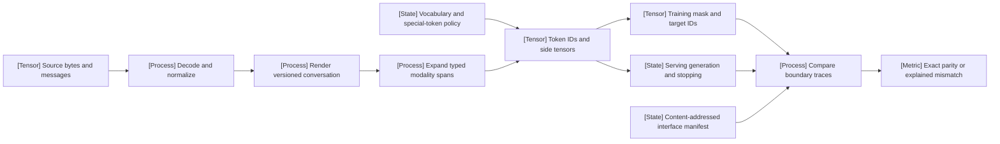

VOLUME I / PART II — DATA AND REPRESENTATION ENGINEERING / CHAPTER 10

# 10 — Tokenization, serialization, and interface correctness

A checkpoint consumes a versioned sequence of IDs and modality spans, so compatibility binds text normalization, segmentation, message rendering, control-token interpretation, supervision masks and termination behavior; a matching vocabulary size establishes none of those equalities.

6 sections · 0 spine papers · 4 declared implementations · artifact: a tokenizer and serialization compatibility suite · prerequisites: 04, 07–09 · updated 2026-10-25

## Why this chapter exists

[DERIVED] The previous chapters establish which records enter training. This chapter owns the transformation from those records into the model's interface. Two pipelines can read the same conversation and produce different training problems: normalization may remove a distinction, a chat template may add a second beginning-of-sequence token, a generation prefix may be missing, or a control token may become ordinary user text. A loss curve cannot identify which boundary changed. The required artifact compares intermediate representations and reports the first divergence.

[DERIVED] Treat the interface as a composition, not a tokenizer filename. Raw bytes first undergo a declared decoding and normalization policy. Segmentation maps the resulting text to ordinary IDs. Message rendering introduces role and control structure. A multimodal processor inserts or expands modality spans. The trainer then chooses supervised positions, and the runtime chooses stopping conditions. Some implementations combine these stages; the logical boundaries still have to be testable.

## Concept map

- **A — Source bytes and messages:** preserve bytes, roles, content types and provenance.
  - **B — Decode and normalize:** retain the declared transformation and offsets.
  - **C — Render versioned conversation:** identify role, turn and generation-prefix construction.
    - **I — Expand typed modality spans:** align placeholders with required side tensors.
- **H — Vocabulary and special-token policy:** bind ordinary IDs and control interpretation.
  - **D — Token IDs and side tensors:** expose the complete model-facing request.
    - **E — Training mask and target IDs:** identify exactly which positions contribute to loss.
    - **F — Serving generation and stopping:** preserve controls that terminate or route generation.
- **J — Content-addressed interface manifest:** bind the checkpoint and all interface dependencies.
  - **G — Compare boundary traces:** locate the first unexplained divergence.
    - **K — Exact parity or explained mismatch:** issue the declared compatibility decision.

## Position in the book

| Boundary | Connected responsibility |
|---|---|
| Prerequisites | [04 language modeling](../../part-01-scientific-foundations/ch04-language-modeling-and-learning-objectives/README.md) defines the conditional distribution and loss; [07 provenance](../ch07-data-provenance-acquisition-and-dataset-semantics/README.md) and [08 filtering](../ch08-cleaning-deduplication-privacy-filtering-and-contamination/README.md) fix which bytes/records enter the interface; [09 mixtures](../ch09-data-mixtures-curricula-and-sample-efficiency/README.md) fixes exposure units that tokenization can change. |
| Siblings (same part) | [09 mixtures](../ch09-data-mixtures-curricula-and-sample-efficiency/README.md) owns sampling; [11 synthetic data](../ch11-synthetic-data-preferences-and-interactive-trajectories/README.md) requires generated conversations and trajectories to preserve the same serialization contract; [12 ingestion](../ch12-scalable-data-infrastructure-and-reproducible-ingestion/README.md) owns resumable transformation and packing. |
| Downstream | [19 training loop](../../part-04-training-science-and-adaptation/ch19-pretraining-objectives-and-the-full-training-loop/README.md) consumes shifts and masks; [37 decoding](../../../vol-02-execution-and-optimization/part-07-inference-algorithms-distillation-and-compression/ch37-decoding-constrained-generation-and-speculative-execution/README.md) applies stop/continuation controls; [51 tool interfaces](../../../vol-03-grounded-and-interactive-intelligence/part-09-retrieval-context-and-agent-systems/ch51-tool-use-protocol-interfaces-and-reliable-execution/README.md) parses calls and establishes execution authority; [55 vision-language models](../../../vol-03-grounded-and-interactive-intelligence/part-10-multimodal-world-and-embodied-models/ch55-vision-language-models-and-document-intelligence/README.md) aligns pixel/crop evidence with processor spans. |
| Trades off with | [42 inference state](../../../vol-02-execution-and-optimization/part-07-inference-algorithms-distillation-and-compression/ch42-prefill-decode-kv-state-and-inference-resource-models/README.md) turns token fertility into cache/prefill/decode costs; [40 deployable artifacts](../../../vol-02-execution-and-optimization/part-07-inference-algorithms-distillation-and-compression/ch40-quantization-from-numerical-model-to-deployable-artifact/README.md) must preserve conversion semantics; [47 release control](../../../vol-02-execution-and-optimization/part-08-inference-engines-and-production-serving/ch47-observability-deployment-changes-and-incident-recovery/README.md) owns acceptance of intentional interface changes. Vocabulary width and shorter sequences require workload-specific accounting. |

## Sections

| Section | Title | What changes here | Primary evidence labels | Required evidence |
|---|---|---|---|---|
| [10.1](10-1-tokenization-algorithms.md) | Tokenization algorithms | Ranked merges, greedy matching, unigram segmentation and byte/character alternatives construct different mappings and computational costs. | PAPER-REPORTED / OFFICIAL-DOCUMENTATION / DERIVED | Segmentation traces, training versus encoding distinction, tie rules and explicit alphabet. |
| [10.2](10-2-implementations-and-normalization.md) | Implementations and normalization | Library pipelines decide whether a textual distinction survives and whether decoding is reversible. | PAPER-REPORTED / OFFICIAL-DOCUMENTATION / DERIVED | Byte-exact and normalized-exact tests reported separately; processor and artifact revisions retained. |
| [10.3](10-3-vocabulary-economics.md) | Vocabulary economics | Vocabulary width changes embeddings and the output head while token fertility changes sequence work and cache state. | PAPER-REPORTED / OFFICIAL-DOCUMENTATION / DERIVED | Matched-content and matched-compute comparisons with language/domain strata and padding/precision boundaries. |
| [10.4](10-4-conversation-serialization.md) | Conversation serialization | Role delimiters, generation prefixes, assistant masks and end-of-turn symbols define the supervised conditional distribution. | PAPER-REPORTED / OFFICIAL-DOCUMENTATION / DERIVED | Training/serving ID and mask parity for identical structured messages. |
| [10.5](10-5-tool-and-multimodal-interfaces.md) | Tool and multimodal interfaces | Typed content, schemas, control tokens and expanded modality spans determine which positions and actions the model can represent. | PAPER-REPORTED / OFFICIAL-DOCUMENTATION / DERIVED | Placeholder/span alignment and untrusted-text separation tested before execution. |
| [10.6](10-6-migration-and-compatibility.md) | Migration and compatibility | Vocabulary changes, embedding initialization and runtime conversion can alter probabilities or rendering before further training. | PAPER-REPORTED / OFFICIAL-DOCUMENTATION / DERIVED | Content-addressed interface manifest, staged parity tests and an explicit compatibility decision. |

## Artifact

[DERIVED] The concrete deliverable is a tokenizer and serialization compatibility suite: an interface manifest with checkpoint, vocabulary/ranks, normalizer, template, processor, control-token and generation-config hashes; a fixture inventory with raw bytes and structured messages; boundary traces with normalized text/offsets, rendered messages, IDs, side tensors, masks and stops; and an acceptance report identifying exact equality, declared transformation or first unexplained mismatch. A waiver records the affected workload and unresolved behavioral effect.

### Compatibility claims

[MATHEMATICALLY-DERIVED] Let $T_\eta$ be a versioned text/serialization/processor pipeline and $A$ the checkpoint. For a structured input $c$, the effective request is $T_\eta(c)$, which includes IDs and any required side tensors. Equality of decoded strings is weaker than equality of these requests. If two tokenizers map the same string to different ID sequences, substituting one without a corresponding checkpoint transformation changes the model input even when both decoders recover the same bytes. Conversely, equal IDs can conceal a changed loss mask during training.

[DERIVED] A release must therefore specify which equivalence it needs. Byte round-trip is a codec property. Canonicalized round-trip is a property relative to a normalization policy. Training/serving parity is equality of the model-facing request and relevant generation controls. Behavioral compatibility is a separate empirical claim under a declared workload. None follows merely from another. The serialization equation and supervision objective are developed in §10.4; migration bounds and their assumptions are developed in §10.6.

### Boundary comparison

[DERIVED] The compatibility suite should compare a chain of representations: original bytes; normalized text with offsets; rendered conversation; ID sequence and special-token positions; modality-span map; target IDs and loss mask; and termination configuration. Report the earliest differing stage. An error at normalization should not be misclassified as a serving-kernel discrepancy, and agreement of the final text should not erase an intermediate control-token divergence.

[DERIVED] Separate adversarial fixtures from representative workload measurements. A compact fixture set can expose combining marks, whitespace, ZWJ sequences, literal control-token strings, empty messages, tool results and image/audio placeholders. It cannot estimate their production prevalence. A representative multilingual workload can estimate fertility and latency, but may never contain the one malformed delimiter that breaks a parser. Both kinds of evidence are necessary for different acceptance rules.

### Implementation contract

[DERIVED] Bind the suite to immutable hashes of vocabulary/rank files, tokenizer configuration, normalizer and pre-tokenizer settings, chat template, processor configuration, special-token map and checkpoint revision. Preserve raw test inputs and the structured message form. A converter must identify whether it copies an artifact or reconstructs its semantics; reconstruction is precisely where an equality test is needed.

[DERIVED] Vocabulary economics crosses lifecycle boundaries. A larger vocabulary may shorten a sequence while enlarging an embedding/output matrix. Shorter sequences can reduce attention work and cache payload, but that saving is input-distribution dependent; a byte or character count does not determine it. The chapter's cost expressions retain width, vocabulary size, token count, precision and allocation boundary explicitly. Actual kernel throughput, conversion fidelity and engine defaults require the pinned implementation/workload evidence of the relevant execution chapters.

## Verification

[DERIVED] [Verification](verification.md) specifies difficult multilingual round-trips and exact training/serving request comparisons for identical conversations, including literal control text, empty turns, tool messages and multimodal spans. A mismatch must return a first-divergence trace. Report byte-exact, normalized-exact and model-facing parity as different tests; passing finite fixtures does not establish unrestricted behavioral equivalence. No suite or model experiment is claimed executed. The [reference ledger](references.md) restores the six sections' source identities without certifying mutable installed versions.

## Lineage

These dates locate the inherited research; the present continuation does not present them as new 2026 methods.

- 2015 · Sennrich, Haddow and Birch, *Neural Machine Translation of Rare Words with Subword Units* (R10.1) · **conceptual ancestor** — merge-based subword construction.
- 2018 · Kudo and Richardson, *SentencePiece* (R10.4) · **engineering optimization** — an implementation that combines segmentation algorithms with raw-text and normalization policies.
- 2021 · Xue et al., *ByT5* (R10.8) · **alternative branch** — byte-level modeling moves costs from vocabulary parameters toward longer sequences.
- 2024 · Tao et al., *Scaling Laws with Vocabulary* (R10.11) · **engineering optimization** — vocabulary allocation becomes a measured compute tradeoff within the fitted regime.
- 2024 · Minixhofer, Ponti and Vulić, *Zero-Shot Tokenizer Transfer* (R10.38) · **alternative branch** — predict replacement embeddings rather than assume an unchanged tokenizer/checkpoint interface.

## Terms owned here

| Term | Canonical meaning and teaching location |
|---|---|
| Tokenization algorithm | Vocabulary construction plus segmentation, distinguished from the library that implements it; [§10.1](10-1-tokenization-algorithms.md). |
| Pre-tokenization | A split whose boundaries constrain subsequent subword operations; [§10.1](10-1-tokenization-algorithms.md). |
| BPE merge table | An ordered merge list whose rank determines encoding priority; [§10.1](10-1-tokenization-algorithms.md). |
| Byte fallback | Representing an out-of-alphabet character through dedicated UTF-8 byte tokens; [§10.2](10-2-implementations-and-normalization.md). |
| Conversation serialization | The versioned mapping from structured messages to the learner-facing sequence and control structure; [§10.4](10-4-conversation-serialization.md). |
| Vocabulary expansion | Appending entries and corresponding embedding/head rows while preserving existing IDs; [§10.6](10-6-migration-and-compatibility.md). |
| Retokenization | Re-encoding stored content under a different tokenizer, with recoverability stated relative to retained bytes and normalization; [§10.6](10-6-migration-and-compatibility.md). |
| Train/serve template drift | A difference in the training and serving conversation-to-ID mappings; [§10.6](10-6-migration-and-compatibility.md). |

## Reference-stack coverage

The table records surfaces already used by the sections, rather than certifying a new execution or fresh inspection of every dependency.

| Stack section | Entry | Stack layer | What this chapter takes from it | Surface used | Sections | Evidence label |
|---|---|---|---|---|---|---|
| §1 lab | #2 OpenAI | — | GPT-2 byte BPE, tiktoken artifact structure and historical ChatML framing (R10.2/13/35). | Code: https://github.com/openai | 10.1,10.2,10.4 | PAPER-REPORTED / OFFICIAL-DOCUMENTATION |
| §1 lab | #18 Google Research | — | SentencePiece, unigram segmentation, GNMT WordPiece and byte-model alternatives (R10.3–8). | Papers: https://research.google/pubs/ | 10.1–10.3 | PAPER-REPORTED / OFFICIAL-DOCUMENTATION |
| §1 lab | #4 Meta AI / FAIR | — | Llama vocabulary and prompt-format records (R10.30–32). | Models: https://huggingface.co/meta-llama | 10.2–10.6 | PAPER-REPORTED / OFFICIAL-DOCUMENTATION |
| §1 lab | #5 Alibaba Qwen | — | Qwen delimiter and visual-token interfaces (R10.33/34). | Code: https://github.com/QwenLM | 10.4,10.5 | PAPER-REPORTED / OFFICIAL-DOCUMENTATION |
| §4 system | #26 Hugging Face Transformers | Model-definition layer | Normalization, templates, processor outputs, loss masks and resizing documentation (R10.12/14–19). | docs/code: https://huggingface.co/docs/transformers/ | 10.2,10.4–10.6 | OFFICIAL-DOCUMENTATION |
| §4 system | #29 Hugging Face TRL | Post-training / RL | Template-dependent supervision and token/embedding coupling (R10.20). | docs/code: https://huggingface.co/docs/trl/ | 10.4,10.6 | OFFICIAL-DOCUMENTATION |
| §4 system | #41 vLLM | LLM inference engine | Template/parser/loading and multimodal input boundaries (R10.23–25). | docs/code: https://docs.vllm.ai/ | 10.4–10.6 | OFFICIAL-DOCUMENTATION |
| §4 system | #42 SGLang | LLM/VLM serving engine | Named, JSON and Jinja template alternatives (R10.26). | docs/code: https://docs.sglang.ai/ | 10.4,10.6 | OFFICIAL-DOCUMENTATION |
| §4 system | #45 llama.cpp | Portable local inference | GGUF tokenizer metadata, template conversion and server overrides (R10.27–29). | docs/code: https://github.com/ggml-org/llama.cpp | 10.2,10.4–10.6 | OFFICIAL-DOCUMENTATION |
| §2 conference | #1 NeurIPS | — | Archival records for vocabulary scaling and tokenizer transfer (R10.11/38). | Papers: https://proceedings.neurips.cc/ | 10.3,10.6 | PAPER-REPORTED |
| §2 conference | #6 EMNLP | — | Archival LinMaxMatch and FOCUS sources (R10.7/39). | Papers: https://aclanthology.org/venues/emnlp/ | 10.1,10.6 | PAPER-REPORTED |
| §3 discovery source | #1 arXiv | — | Exact historical identities and revision histories; discovery is not empirical validation. | Home: https://arxiv.org/ | 10.1–10.6 | OFFICIAL-DOCUMENTATION |
| *Outside the reference stack (routed via book_plan.md anchors)* | CS336; Unicode; independent tokenizer and migration studies | — | The plan's CS336 anchor supplies construction/compatibility context (R10.22). Its algorithm, multilingual economics and migration matrix additionally requires R10.1/9/10/36–40; normalization and tool interfaces require R10.41–43. Their exact primary locators and historical inspection limits remain in the ledger. | [Chapter references](references.md) | 10.1–10.6 | PAPER-REPORTED / OFFICIAL-DOCUMENTATION / UNVERIFIED |

**Inspection dimensions applied.** Memory and Precision appear in embedding/head width, padding and dtype accounting (§10.3/10.6); Inference and Reliability in control parsing, prefix parity and stopping (§10.4–10.6); Reproducibility in tokenizer/template/processor manifests and first-divergence traces. Parallelism, Communication and Kernels are downstream cost conditions rather than measurements established by this chapter. The manifest does not certify an engine build.

## Source route

Use the reference stack's official-index → primary text/revision → official code sequence (§1.1), venue → paper → supplement/code workflow (§2.1), paper-search cascade (§3.1) and documentation-first compatibility protocol (§4.3). Filled-in queries are retrieval routes, not claims that each returned document was audited:

1. Lab/source route: `site:github.com/openai "tiktoken"`; follow the encoding artifact and its declared revision.
2. Exact archival route: `"Fast WordPiece Tokenization" EMNLP`; resolve the ACL Anthology version before using complexity claims.
3. Primary-paper route: `site:arxiv.org/abs "Scaling Laws with Vocabulary"`; compare the revision history with the archival NeurIPS record.
4. Official-interface route: `"Hugging Face Transformers" official documentation distributed training`; then restrict to the versioned tokenizer/model pages used by the section.
5. Compatibility route: `"vLLM" "Llama" "H100" "VERSION"` with VERSION replaced by the proposed deployment pin; retain missing hardware/runtime evidence rather than inferring parity from a template name.

## Status

[DERIVED] This overview integrates the chapter's existing, dated foundations and interface analyses. It does not redate older papers into the current research window or certify mutable library versions. All model/runtime comparisons remain source-reported or unexecuted proposals as labeled in their owning sections. No compatibility suite or model experiment is claimed executed by the book.

[UNVERIFIED] The CS336 handout checksum, several historical repository pins and actual cross-engine runtime compatibility remain unresolved. Workload-specific latency and conversion fidelity are NOT-DISCLOSED where the owning section gives no measurement. Source registration and mathematical checks do not close those empirical gaps.
