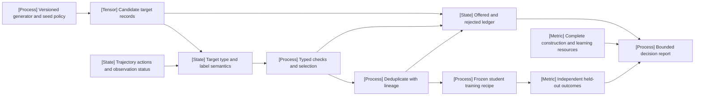

VOLUME I / PART II — DATA AND REPRESENTATION ENGINEERING / CHAPTER 11

# 11 — Synthetic data, preferences, and interactive trajectories

A generated row is a measurement and a training target only after its producer, selection rule, label semantics and information boundary are specified; more retained rows do not establish more useful supervision, and a judge's approval does not establish a student's held-out improvement.

6 sections · 5 spine works in the ledger · 5 declared implementations · artifact: a supervised-data and trajectory schema with quality gates · prerequisites: 06–10 · updated 2026-10-25

## Why this chapter exists

[DERIVED] Synthetic generation changes how training data are produced, not the need to identify the learning problem. An instruction, an answer, a rationale, a scalar reward, a preference pair and an environment trajectory are different objects. Converting one into another introduces a decision: a scalar score needs a comparison rule to form a preference; a successful final answer does not verify every step of a rationale; an apparently complete trajectory may have stopped before its outcome was observed. Each conversion must preserve its evidence and assumptions.

[DERIVED] This chapter makes that chain explicit. Generator configuration determines a candidate distribution. A selector changes that distribution and can introduce its own errors. Deduplication changes the training multiset and the cost per retained item. The student then transforms the selected examples into parameter updates under a specific objective. The outcome of interest is an independently measured student behavior under the target workload, rather than the generator's volume or the selector's self-evaluation.

## Concept map

- **A — Versioned generator and seed policy:** identify the producer and offered distribution.
  - **B — Candidate target records:** retain raw outputs and lineage before selection.
    - **I — Target type and label semantics:** distinguish the training target from a gate's proposition.
      - **C — Typed checks and selection:** record executed checks, judge results and disagreement.
      - **D — Deduplicate with lineage:** retain the grouping rule, representatives and discarded mass.
- **J — Trajectory actions and observation status:** preserve policy versions, event order, terminal evidence and unknown outcomes.
  - **E — Frozen student training recipe:** bind the retained multiset to the actual learning intervention.
    - **F — Independent held-out outcomes:** assess the target population without opening a new generator-feedback channel.
- **G — Offered and rejected ledger:** retain all paid attempts and rejection reasons.
- **K — Complete construction and learning resources:** keep additive work separate from peak allocation and elapsed latency.
  - **H — Bounded decision report:** combine outcome, uncertainty and feasibility, including inconclusive results.

## Position in the book

| Boundary | Connected responsibility |
|---|---|
| Prerequisites | [06 experimental design](../../part-01-scientific-foundations/ch06-experimental-design-and-evaluation-before-optimization/README.md) defines comparison and inference; [07 provenance](../ch07-data-provenance-acquisition-and-dataset-semantics/README.md) binds sources; [08 filtering](../ch08-cleaning-deduplication-privacy-filtering-and-contamination/README.md) defines selected populations and contamination controls; [09 mixtures](../ch09-data-mixtures-curricula-and-sample-efficiency/README.md) owns exposure/repetition; [10 interfaces](../ch10-tokenization-serialization-and-interface-correctness/README.md) preserves target serialization. |
| Siblings (same part) | [08 filtering](../ch08-cleaning-deduplication-privacy-filtering-and-contamination/README.md) supplies removal ledgers; [09 curricula](../ch09-data-mixtures-curricula-and-sample-efficiency/README.md) chooses exposure; [10 serialization](../ch10-tokenization-serialization-and-interface-correctness/README.md) defines learner-facing records; [12 ingestion](../ch12-scalable-data-infrastructure-and-reproducible-ingestion/README.md) owns resumable construction and loading. |
| Downstream | [31 supervised fine-tuning](../../../vol-02-execution-and-optimization/part-06-post-training-and-reinforcement-learning/ch31-supervised-fine-tuning-and-behavior-acquisition/README.md) consumes target types/masks; [33 preference objectives](../../../vol-02-execution-and-optimization/part-06-post-training-and-reinforcement-learning/ch33-direct-preference-optimization-and-related-objectives/README.md) consumes comparison semantics; [36 rollouts](../../../vol-02-execution-and-optimization/part-06-post-training-and-reinforcement-learning/ch36-agent-rl-and-distributed-rollout-systems/README.md) adds policy lag and asynchronous state; [60 embodied learning](../../../vol-03-grounded-and-interactive-intelligence/part-10-multimodal-world-and-embodied-models/ch60-vision-language-action-policies-and-embodied-learning/README.md) adds actuator/state/clock contracts beyond text trajectories. |
| Trades off with | [62 judges and uncertainty](../../../vol-03-grounded-and-interactive-intelligence/part-11-evaluation-interpretability-and-deployment-assurance/ch62-human-preference-model-judges-and-uncertainty/README.md) qualifies label populations, calibration and abstention; [63 reliability evaluation](../../../vol-03-grounded-and-interactive-intelligence/part-11-evaluation-interpretability-and-deployment-assurance/ch63-agent-retrieval-multimodal-and-system-reliability-evaluation/README.md) tests offered denominators, repeated outcomes and resource limits; [66 release closure](../../../vol-03-grounded-and-interactive-intelligence/part-11-evaluation-interpretability-and-deployment-assurance/ch66-release-decisions-reproducibility-and-research-to-production-closure/README.md) separates useful evidence from authorization to release. A teacher/selector proxy cannot replace those independent decisions. |

## Sections

| Section | Title | What changes here | Primary evidence labels | Required evidence |
|---|---|---|---|---|
| [11.1](11-1-generator-design.md) | Generator design | Which teacher, seeds, prompts and sampling controls produce which candidate population? | PAPER-REPORTED / OFFICIAL-DOCUMENTATION / DERIVED | Immutable generator configuration and sample-level provenance, including failed offers. |
| [11.2](11-2-target-types.md) | Target types | What does each field mean to the student objective? | PAPER-REPORTED / OFFICIAL-DOCUMENTATION / DERIVED | Typed records for instructions, responses, rationales, demonstrations, preferences, rewards, verifier labels and trajectories. |
| [11.3](11-3-selection-and-verification.md) | Selection and verification | Which checks support acceptance, and which remain proxies? | PAPER-REPORTED / OFFICIAL-DOCUMENTATION / DERIVED | Ordered gate evidence, disagreement and rejection records, with selector limitations. |
| [11.4](11-4-distributional-risks.md) | Distributional risks | How do generation, selection and repeated reuse change coverage and error dependence? | PAPER-REPORTED / OFFICIAL-DOCUMENTATION / DERIVED | Source/group exposure, leakage checks, tail coverage and generator–student coupling analysis. |
| [11.5](11-5-interactive-collection.md) | Interactive collection | Which outcome belongs to which action/policy, and was it actually observed? | PAPER-REPORTED / OFFICIAL-DOCUMENTATION / DERIVED | Event-resolvable trajectories with terminal/error/censoring states and policy identity. |
| [11.6](11-6-synthetic-data-economics.md) | Synthetic-data economics | Which pipeline buys a defensible student improvement under a comparable resource budget? | PAPER-REPORTED / MATHEMATICALLY-DERIVED / UNVERIFIED | Offered/accepted/unique counts, complete resource boundary, cost-matched learning curves and a decision with reversal conditions. |

## Artifact

[DERIVED] The deliverable is a typed supervised-data/trajectory schema, a provenance and gate manifest, offered-to-retained accounting, and a verification report. An acceptable pipeline must make its target semantics reconstructible and must support the stated downstream comparison. It may conclude that no candidate is justified under the available evidence. A budget limit establishes stopping, not optimality or data quality.

| Artifact component | Concrete fields |
|---|---|
| Producer and target manifest | Teacher/model/prompt/sampler/interface revisions; source/seed IDs; target type, label producer/proposition and parent lineage. |
| Gate and grouping ledger | Every offer and outcome, executed check evidence, judge/reviewer identity, reject/unknown reason, duplicate rule/group/representative and retained dataset hash. |
| Trajectory bundle | Task/reset/environment/policy revisions, ordered actions/observations, resource/deadline events, terminal evidence and observation status. |
| Learning and cost report | All paid offers/checks/grouping work, student data/exposure/seed/configuration, evaluator revision, paired outcomes, uncertainty and feasibility decision. |

### Measurement contract

[DERIVED] Keep four objects separate: the generator distribution, the offered candidate pool, the retained training multiset and the evaluation population. A selector's retained fraction is a property of its offered pool and decision rule. It is not a population accuracy estimate unless its labels and sampling design justify that interpretation. Near-duplicate detection uses a declared matching/grouping rule. A pairwise similarity threshold need not be transitive; record any connected-component or representative closure used to form groups. Changing that construction can remove either redundant mass or legitimate rare distinctions.

[DERIVED] The provenance record should therefore identify the original content, every transformation, the evidence behind each label, and the final learner-facing representation. A retained rationale can be useful supervision without being a verified explanation. A judge score can guide a sampler without being a reward label with the same semantics as environment success. A preference can express a particular rater population without defining universal quality. These are admissibility distinctions, not naming preferences.

### Selection and observation boundaries

[DERIVED] Generation and selection must be analyzed jointly. A stronger teacher can still produce a narrow pool; a high acceptance rate can reflect an easy judge; a low acceptance rate can reflect a genuine coverage expansion or an invalid generator. To distinguish these possibilities, audit rejected samples and compare alternative generation/selection policies on the same target population. Report offered counts and all paid work, rather than starting the cost denominator after filtering.

[DERIVED] Deduplication and usefulness are not interchangeable. Exact duplicate removal is a byte/content identity operation under a declared normalization. Semantic grouping introduces a representation and threshold. Neither operation proves that the remaining examples provide independent learning signal. Conversely, repeated examples can have an optimization effect even when they contribute no new content. Evaluate their contribution through a student experiment whose training exposure and resource budget are controlled.

[DERIVED] Interactive data require an additional clock and authority boundary. The next observation must be generated by the environment state that followed the recorded action, and the action must identify its policy/interface version. Timeout is an observed operational event; it is not automatically an observed task failure. Censoring cannot be repaired by dropping the affected episodes, and inverse-probability corrections require the relevant observation mechanism and positivity assumptions. The full trajectory treatment is in §11.5.

### Implementation contract

[DERIVED] Store candidate identity, source/seed identity, generator revision, sampling configuration, serialization revision, raw output, parsed target type, check results, selection revision, duplicate-group identity and downstream dataset revision. Where available, include executed-verifier stdout/results and environment digests. Distinguish a specified artifact field from a file actually produced by a run. A provenance schema does not execute or validate the generator by itself.

[DERIVED] Versioning should permit a rejected decision to be reconstructed without re-querying a mutable service. If that is impossible, record the missing dependency and narrow the reproducibility claim. Sampler seeds alone do not identify a distributed generation run: batching, engine behavior, model revision and failures can change which samples arrive. Engine-level scheduling and numerical compatibility remain in their owning execution chapters.

## Verification

[DERIVED] [Verification](verification.md) supplies integrated unexecuted protocols for generation/selection, interactive censoring and cost-matched student learning. The section experiments remain proposals where labeled. [The reference ledger](references.md) distinguishes historical works already used in the existing sections from the recent evidence added for economics; an access date does not change a paper's first public release.

[DERIVED] The decisive contrast is unfiltered versus verifier-filtered versus diversity-controlled targets with an independently qualified evaluator and declared exposure/resource boundary. Preserve rejected offers, failed runs and unknown outcomes. A selected policy passes only its prespecified practical-effect, harm and feasibility criteria; insufficient evidence remains inconclusive rather than a successful release.

## Lineage

Historical sources provide already-used foundations; the four current studies below first appeared in the continuation's specified 2026 window.

- 2022 · *Constitutional AI* (P22) · **conceptual ancestor** — critique/revision and model-produced preferences require explicit producer semantics.
- 2022 · Wang et al., *Self-Instruct* (R11.1/R11.22) · **engineering optimization** — instruction bootstrapping couples seeds, generation and novelty filtering; the two keys identify one study.
- 2023 · Shumailov et al., *The Curse of Recursion* (R11.7) · **conceptual ancestor** — the pinned version studies recursive distribution distortion, rather than all uses of synthetic data.
- 2024 · Gerstgrasser et al., *Is Model Collapse Inevitable?* (R11.9) · **alternative branch** — accumulating real/generated data changes the replacement assumption.
- 2025 · *DeepSeek-R1* (P26) · **engineering optimization** — rejection-sampled outputs become student targets within a specified generation and post-training recipe.
- 2026 · *How Much Is an AI Token Worth?* (R11.23) · **current frontier** — web-text value depends on human budget and target distribution within the measured model range.
- 2026 · *Effective Synthetic Data Curation Requires Group-Level Signals* (R11.24) · **current frontier** — group interactions and a privileged reference-loss intervention qualify isolated example scores.
- 2026 · *FinSafeGuard* and *Synthetic Data Characterization via Training Dynamics* (R11.25/R11.26) · **current frontier** — construction funnels and processed encoder-task studies supply different, bounded forms of evidence.

## Terms owned here

| Term | Canonical meaning and teaching location |
|---|---|
| Generator configuration | The teacher, prompt/seed construction and sampling tuple defining the specified candidate-generating process; [§11.1](11-1-generator-design.md). |
| Synthetic-data provenance record | Sample-level producer, rendered-input, sampling and parent-lineage information; [§11.1](11-1-generator-design.md). |
| Target type | A payload/objective category distinguishing instruction, response, rationale, demonstration, preference, reward, verifier and trajectory records; [§11.2](11-2-target-types.md). |
| Label semantics | The producer and proposition behind a label, independent of column layout; [§11.2](11-2-target-types.md). |
| Acceptance rate | Accepted offers divided by offered draws under the named generator/gate pair; [§11.3](11-3-selection-and-verification.md). |
| Verifier-filtered versus judge-filtered set | Retention by an executed/symbolic check versus a model verdict, with their evidence preserved; [§11.3](11-3-selection-and-verification.md). |
| Generator–student coupling | A difference in conditional student error rates depending on generator error under a common qualified evaluation; [§11.4](11-4-distributional-risks.md). |
| Trajectory schema | Header, ordered steps and terminal record binding policy actions to environment observations and evidence; [§11.5](11-5-interactive-collection.md). |
| Trajectory censoring | Unobserved task outcome after a recorded collection interruption, distinguished from operational deadline-service failure; [§11.5](11-5-interactive-collection.md). |
| Cost per accepted item | A stated accounting ratio whose stationary first-acceptance specialization is c/p, not a student-value estimate; [§11.6](11-6-synthetic-data-economics.md). |

## Reference-stack coverage

The table identifies what the existing sections use. Documentation evidence and a proposed engineering interface do not certify an executed training system.

| Stack section | Entry | Stack layer | What this chapter takes from it | Surface used | Sections | Evidence label |
|---|---|---|---|---|---|---|
| §1 lab | #1 Anthropic | — | Critique/revision and AI-feedback target construction (P22). | Papers: https://www.anthropic.com/research | 11.1–11.3 | PAPER-REPORTED |
| §1 lab | #8 DeepSeek | — | R1 sampling/rejection and student-SFT recipe (P26/R11.17). | Code: https://github.com/deepseek-ai | 11.1–11.4 | PAPER-REPORTED / OFFICIAL-DOCUMENTATION |
| §1 lab | #4 Meta AI / FAIR | — | Llama 2/3 historical generation and preference recipe accounts (R11.5/6). | Models: https://huggingface.co/meta-llama | 11.1–11.4 | PAPER-REPORTED |
| §1 lab | #22 Allen Institute for AI (Ai2) | — | Tülu 3 data, decontamination and unsuccessful recipe evidence (P29/R11.21), one project rather than independent studies. | Blog: https://allenai.org/blog | 11.1–11.4 | PAPER-REPORTED / OFFICIAL-DOCUMENTATION |
| §4 system | #29 Hugging Face TRL | Post-training / RL | Typed data formats and objective-compatible fields (R11.11). | docs/code: https://huggingface.co/docs/trl/ | 11.2,11.3 | OFFICIAL-DOCUMENTATION |
| §4 system | #37 verl | RL post-training | Multi-turn rollout records, delta tokenization and masks (R11.12/13). | docs/code: https://verl.readthedocs.io/en/latest/ | 11.2,11.5 | OFFICIAL-DOCUMENTATION |
| §4 system | #36 OpenRLHF | RLHF/post-training | Preference/rollout input surfaces (R11.14). | docs/code: https://github.com/OpenRLHF/OpenRLHF | 11.2,11.5 | OFFICIAL-DOCUMENTATION |
| §4 system | #41 vLLM | LLM inference engine | Conditional sampling configuration and version-dependent seed behavior (R11.15); proposed cost boundary in §11.6. | docs/code: https://docs.vllm.ai/ | 11.1,11.5,11.6 | OFFICIAL-DOCUMENTATION / DERIVED |
| §4 system | #42 SGLang | LLM/VLM serving engine | Rollout-backend boundary used by the verl account; this is not independent engine-performance evidence. | docs/code: https://docs.sglang.ai/ | 11.5 | OFFICIAL-DOCUMENTATION |
| §4 system | #17 PyTorch | Core training framework | Proposed student-update/resource instrumentation; no runtime or installation certified here. | docs/code: https://pytorch.org/docs/stable/ | 11.6 | DERIVED / UNVERIFIED |
| §3 discovery source | #1 arXiv | — | Exact source identities, first-release histories and pinned research revisions. | Home: https://arxiv.org/ | 11.1–11.6 | OFFICIAL-DOCUMENTATION |
| §2 conference | #4 ACL | — | Archival Self-Instruct identity (R11.22), an alias of R11.1. | Papers: https://aclanthology.org/venues/acl/ | 11.1 | PAPER-REPORTED |
| *Outside the reference stack (routed via book_plan.md anchors)* | Independent synthetic-data studies, SWE-bench/τ-bench harnesses and WildAI | — | The plan's R1/Constitutional-AI anchors and six-topic matrix require instruction/persona/rationale generation (R11.1–4), recursion (R11.7/9), preferences (R11.10), environment outcomes (P42/P43,R11.18/19) and student economics (R11.23–27). The ledger gives primary locators and bounded inspection status; none is added merely to increase source count. | [Chapter references](references.md) | 11.1–11.6 | PAPER-REPORTED / OFFICIAL-DOCUMENTATION / UNVERIFIED |

**Inspection dimensions applied.** Post-training appears in target/objective conversion and selection (§11.2/11.3); Inference in producer/sampling and rollout boundaries (§11.1/11.5); Metrics and Reliability in qualified labels, unknown outcomes and independent student comparisons (§11.3–11.6); Reproducibility in sample/policy lineage throughout. Memory, Precision, Parallelism, Kernels and Communication enter the proposed cost-matched implementation manifest, not a book-measured performance result. Device work, peak memory and elapsed time remain separate quantities.

## Source route

Follow official research/publication indices to exact primary revisions and official artifacts (§1.1), the venue → paper → supplement/code sequence (§2.1), the paper-search cascade (§3.1) and documentation-first stack protocol (§4.3). These filled-in queries describe how to recover evidence; they do not broaden the inspection claims in the ledger:

1. Lab route: `site:arxiv.org/abs "DeepSeek" "rejection sampling"`; resolve the R1 revision before reading its data recipe.
2. Lab route: `site:anthropic.com/research "Constitutional AI"`; retain the primary paper's critique/revision and preference stages separately.
3. Archival route: `"Self-Instruct: Aligning Language Models with Self-Generated Instructions" ACL`; reconcile the proceedings identity with the preprint rather than count two studies.
4. Primary-paper route: `site:arxiv.org/abs "Effective Synthetic Data Curation Requires Group-Level Signals"`; read the reference-set oracle and budget appendix with the headline comparison.
5. Implementation route: `site:github.com "verl" (architecture OR design OR RFC OR benchmark)`; then bind the documented rollout/mask contract to a full proposed source pin.
6. Compatibility route: `"vLLM" "DeepSeek-R1" "H100" "VERSION"` with VERSION replaced by the admitted engine pin; unresolved hardware/version information remains unknown.

## Status

[DERIVED] Manuscript draft. Existing source-reported experiments remain attributed to their original papers. New economics coverage uses first public releases in the March–October 2026 continuation window; inspected revisions and access dates are recorded separately, and book protocols are unexecuted. Neither an acceptance percentage nor a compiled schema establishes independent replication or a numerical scientific-quality rating.

[UNVERIFIED] No book generation, student-learning or interactive-collection protocol was executed; mutable service behavior, runtime compatibility and transfer beyond the source model/task regimes remain unresolved. Full corpus construction costs and production coverage/coupling quantities are NOT-DISCLOSED where their owning sources do not report them.
