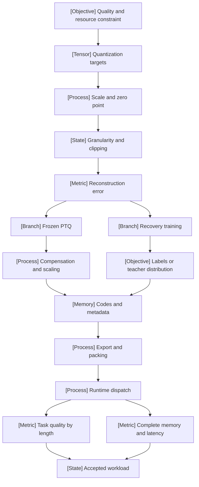

VOLUME II / PART VII — INFERENCE ALGORITHMS, DISTILLATION, AND COMPRESSION / CHAPTER 40

# 40 — Quantization from numerical model to deployable artifact

[MATHEMATICALLY-DERIVED] Quantization becomes a defensible engineering intervention only when its representable values, optimization procedure, serialized artifact and executed operator satisfy one explicit numerical and workload contract.

6 sections · 3 spine papers · 5 reference-stack implementations · prerequisites: 03, 23, 25–28, 39 · artifact: a quantized checkpoint with calibration and runtime evidence (planned) · updated 2026-10-14

## Why this chapter exists

[MATHEMATICALLY-DERIVED] A checkpoint's nominal bit width compresses several independent decisions into one number. It does not identify which tensors were quantized, how their scales were estimated, whether sensitive channels were compensated, whether the codebook is integer or floating, or whether the runtime actually multiplies low-bit operands. Treating these decisions as one property makes both scientific comparisons and deployment failures difficult to interpret. Two four-bit artifacts can have different effective storage, different decoded weights and different execution paths.

[MATHEMATICALLY-DERIVED] The dominant constraint changes with the phase. Static weight traffic can dominate a small-batch decode operation; dynamic activation encoding can add a request-dependent cost; growing cache state can dominate long-context capacity; optimizer moments can dominate a training process after weights are frozen or sharded. A useful numerical intervention must identify the state it changes and the state it leaves untouched. Its accounting follows the actual execution boundary rather than a universal bytes-per-parameter constant.

[PAPER-REPORTED] Historical GPTQ, AWQ and SmoothQuant provide distinct mechanisms for compensation and scaling [P33–R40.3]. Inspected 2026 disclosures add NVFP4 recovery, learned scales and mixed weight/cache assignments [R40.10, R40.18–R40.20]. Their scientific value is the changed objective or execution constraint and the evidence that isolates it. Their dates do not establish technical superiority. This chapter derives the numerical contracts, reconstructs those mechanisms and preserves the gaps between reported quality, export compatibility and end-to-end benefit.

## Concept map



Text equivalent:

- Quality and resource constraint
  - Quantization targets
    - Scale and zero point
      - Granularity and clipping
        - Reconstruction error
          - Frozen PTQ
            - Compensation and scaling
          - Recovery training
            - Labels or teacher distribution
          - Both produce codes and metadata
            - Export and packing
              - Runtime dispatch
                - Task quality by length
                - Complete memory and latency
                - Both determine accepted workload

## Position in the book

| Relation | Canonical locations |
|---|---|
| Prerequisites | [Numerical foundations](../../../vol-01-learning-and-representation/part-01-scientific-foundations/ch03-numerical-computation-and-trustworthy-training/README.md); [adaptation](../../../vol-01-learning-and-representation/part-04-training-science-and-adaptation/ch23-parameter-efficient-adaptation-and-model-composition/README.md); [hardware](../../part-05-hardware-kernels-and-distributed-execution/ch25-accelerators-memory-hierarchy-and-performance-models/README.md); [runtime integration](../../part-05-hardware-kernels-and-distributed-execution/ch28-frameworks-graph-compilers-and-runtime-integration/README.md); [distillation](../ch39-knowledge-response-and-policy-distillation/README.md) |
| Siblings (same part) | [Decoding](../ch37-decoding-constrained-generation-and-speculative-execution/README.md); [inference-time computation](../ch38-inference-time-reasoning-search-and-adaptive-compute/README.md); [pruning](../ch41-pruning-sparsity-rank-reduction-and-adaptive-execution/README.md) |
| Downstream | [Inference state and phases](../ch42-prefill-decode-kv-state-and-inference-resource-models/README.md); runtime and serving chapters in [Part VIII](../../part-08-inference-engines-and-production-serving/README.md) |
| Trades off with | [Distillation](../ch39-knowledge-response-and-policy-distillation/README.md), [structural compression](../ch41-pruning-sparsity-rank-reduction-and-adaptive-execution/README.md), [adapter composition](../../../vol-01-learning-and-representation/part-04-training-science-and-adaptation/ch23-parameter-efficient-adaptation-and-model-composition/README.md) |

## Sections

| Section | Title | What changes here | Primary evidence labels |
|---|---|---|---|
| [40.1](40-1-quantization-formulation.md) | Quantization formulation | Representable values, axes and distortion become explicit | MATHEMATICALLY-DERIVED, PAPER-REPORTED |
| [40.2](40-2-quantization-targets.md) | Quantization targets | Precision follows target lifetime and sensitivity | MATHEMATICALLY-DERIVED, OFFICIAL-DOCUMENTATION |
| [40.3](40-3-ptq-and-qat.md) | PTQ and QAT | Frozen representation search separates from recovery training | PAPER-REPORTED, MATHEMATICALLY-DERIVED |
| [40.4](40-4-method-families.md) | Method families | Compensation, coordinate transforms and codebooks separate | PAPER-REPORTED, OFFICIAL-DOCUMENTATION |
| [40.5](40-5-artifact-runtime-interfaces.md) | Artifact/runtime interfaces | Serialization and executable arithmetic become separate contracts | OFFICIAL-DOCUMENTATION, MATHEMATICALLY-DERIVED |
| [40.6](40-6-evaluation.md) | Evaluation | Local error is tested against task and service behavior | PAPER-REPORTED, MATHEMATICALLY-DERIVED |

## Artifact

[KNOWN] The plan specifies **a quantized checkpoint with calibration and runtime evidence**. The corresponding proposed bundle contains source/artifact identities, calibration membership and statistics, quantizer and precision maps, packed tensors/scales, tokenizer/template, conversion provenance, layerwise decoder and dispatch records, paired numerical/task outcomes, complete memory ledger and workload timing records. Exact fields and acceptance rules are in [verification.md](verification.md). This manuscript supplies the specification and source-grounded analysis; it does not pretend that the checkpoint or its measurements already exist.

## Verification

[KNOWN] The falsifiable study compares BF16 and quantized artifacts under identical prompts, template, hardware and workload, with unsupported/fallback paths included. It rejects deployment benefit if the compressed artifact violates declared quality tolerances, fails round-trip/operator checks or loses end-to-end benefit after complete memory and runtime accounting. Calibration and checkpoint selection remain separate from final acceptance data. All book-authored experiment configurations are proposals in [verification.md](verification.md), never manuscript observations.

## Lineage

- 2015 · limited-precision stochastic rounding [R40.6] · conceptual ancestor.
- 2018 · affine integer-only inference [R40.5] · conceptual ancestor.
- 2020 · AdaRound [R40.7] · alternative branch.
- 2022 · blockwise 8-bit optimizer states and LLM.int8() [R40.4, R40.8] · alternative branch.
- 2023 · GPTQ [P33] · engineering optimization.
- 2023 · SmoothQuant [R40.3] · alternative branch.
- 2023 · QLoRA/NF4 [P15] · alternative branch.
- 2024 · AWQ and KIVI [P34, R40.9] · engineering optimization.
- 2025 · NVFP4 and TorchAO [R40.17, R40.11] · engineering optimization.
- 2026 · QAD, mixed-precision allocation and learned scales [R40.10, R40.18–R40.20] · current frontier.

```figure
id: fig-40.1
kind: lineage
title: Numerical construction to runtime composition
caption: Different branches change rounding, operand coordinates, persistent state or recovery objectives; they do not form a single replacement sequence.
placement: inline
evidence: PAPER-REPORTED
source: [R40.5, R40.7, P33, R40.3, P34, R40.9, R40.10]
alt: Affine integer inference and adaptive rounding precede compensation, operand scaling and cache coding. Quantization-aware distillation changes recovery supervision in 2026.
spec:
  entries:
    - {year: 2018, work: Affine integer inference, cite: R40.5, relation: conceptual ancestor}
    - {year: 2020, work: AdaRound, cite: R40.7, relation: alternative branch}
    - {year: 2023, work: GPTQ, cite: P33, relation: engineering optimization}
    - {year: 2023, work: SmoothQuant, cite: R40.3, relation: alternative branch}
    - {year: 2024, work: AWQ, cite: P34, relation: engineering optimization}
    - {year: 2024, work: KIVI, cite: R40.9, relation: alternative branch}
    - {year: 2026, work: NVFP4 recovery through QAD, cite: R40.10, relation: current frontier}
```

```figure
id: fig-40.2
kind: cycle
title: Quantization construction and acceptance loop
caption: Failed export, quality or runtime evidence returns to construction; final evaluation data must not become an unreported tuning set.
placement: inline
evidence: MATHEMATICALLY-DERIVED
source: DERIVED:eq-40.19
alt: Calibration feeds construction, export and runtime evaluation. Diagnostics feed back to construction while independent acceptance remains separate.
spec:
  stages:
    - {id: calib, label: Calibration, kind: dataset}
    - {id: build, label: Construction, kind: process}
    - {id: export, label: Export, kind: memory}
    - {id: run, label: Execution, kind: process}
    - {id: assess, label: Acceptance, kind: metric}
  edges:
    - {from: calib, to: build}
    - {from: build, to: export}
    - {from: export, to: run}
    - {from: run, to: assess}
    - {from: assess, to: build, kind: feedback, label: diagnostic evidence}
```

## Terms owned here

| Term | Definition | Owner |
|---|---|---|
| Affine quantizer | Bounded integer encoding with positive scale and integer zero point | [40.1](40-1-quantization-formulation.md#formulation) |
| Quantization granularity | Partition of values sharing representation metadata | [40.1](40-1-quantization-formulation.md#mechanism) |
| Mixed-precision allocation | Constrained assignment of representations to distinct computational targets | [40.2](40-2-quantization-targets.md#formulation) |
| PTQ | Quantized construction from an already trained model without full-model recovery training | [40.3](40-3-ptq-and-qat.md#mechanism) |
| Fake quantization | Forward encode/decode simulation retaining a higher-precision tensor representation | [40.3](40-3-ptq-and-qat.md#mechanism) |
| QAT | Recovery optimization using simulated quantized forward computation and a declared gradient surrogate | [40.3](40-3-ptq-and-qat.md#mechanism) |
| Quantized artifact contract | Decoding metadata, packed values and runtime requirements identifying an executable numerical model | [40.5](40-5-artifact-runtime-interfaces.md#formulation) |

## Reference-stack coverage

| Stack section | Entry | Stack layer | What this chapter takes from it | Surface used | Sections | Evidence label |
|---|---|---|---|---|---|---|
| §1 lab | #14 NVIDIA Research | — | NVFP4/QAD and 2026 allocation/scale disclosures | https://research.nvidia.com/ ; https://developer.nvidia.com/blog/ ; https://github.com/NVIDIA | 2–6 | PAPER-REPORTED / OFFICIAL-DOCUMENTATION |
| §1 lab | #4 Meta AI / FAIR | — | Blockwise optimizer work and TorchAO authorship route | https://github.com/facebookresearch ; https://ai.meta.com/research/ | 2, 5 | PAPER-REPORTED |
| §1 lab | #41 MIT CSAIL | — | AWQ/SmoothQuant originating paper route | https://www.csail.mit.edu/research | 4 | PAPER-REPORTED |
| §1 lab | #18 Google Research | — | Historical integer inference publication route | https://research.google/pubs/ | 1 | PAPER-REPORTED |
| §1 lab | #27 Hugging Face Research | — | Quantizer/serialization documentation routes | https://huggingface.co/ ; https://github.com/huggingface | 4–5 | OFFICIAL-DOCUMENTATION |
| §2 conference | #2 ICML | — | SmoothQuant archival full text; AdaRound archival full text | https://proceedings.mlr.press/ | 1, 3–4 | PAPER-REPORTED |
| §2 conference | #3 ICLR | — | GPTQ and 8-bit optimizer conference-paper identity via full text | https://openreview.net/group?id=ICLR.cc/2026/Conference | 2, 4, 6 | PAPER-REPORTED |
| §3 discovery source | #1 arXiv | — | Versioned/unversioned originating full-text retrieval | https://arxiv.org/ ; https://arxiv.org/search/advanced | 1–6 | KNOWN |
| §3 discovery source | #2 OpenReview | — | 2025–2026 search route; no method claims from search snippets | https://openreview.net/ | 2–4 | KNOWN |
| §3 discovery source | #3 PMLR | — | Archival SmoothQuant/AdaRound retrieval | https://proceedings.mlr.press/ | 1, 3–4 | KNOWN |
| §4 system | #17 PyTorch | Model / autograd framework | Construction/autograd host in inspected implementation disclosures | https://pytorch.org/docs/stable/ | 1–6 | OFFICIAL-DOCUMENTATION |
| §4 system | #26 Hugging Face Transformers | Model definition / adaptation | Model/quantizer interface and export integration | https://huggingface.co/docs/transformers/ | 2–5 | OFFICIAL-DOCUMENTATION |
| §4 system | #32 torchtune | Model definition / adaptation | TorchAO-documented QAT integration | https://docs.pytorch.org/torchtune/stable/ | 3 | OFFICIAL-DOCUMENTATION |
| §4 system | #41 vLLM | Inference engine | Quantized-linear hardware restrictions and backend selection | https://docs.vllm.ai/ | 2, 4–6 | OFFICIAL-DOCUMENTATION |
| §4 system | #45 llama.cpp | Inference engine | GGUF quantization-tool interface | https://github.com/ggml-org/llama.cpp | 5–6 | OFFICIAL-DOCUMENTATION |
| Outside the reference stack (routed via book_plan.md anchors) | TorchAO; NVIDIA ModelOpt | Transformation tools; not numbered §4 entries | Explicit Chapter 40 anchors; tensor subclasses, export, 2026 methods | https://github.com/pytorch/ao ; https://github.com/NVIDIA/Model-Optimizer | 1–6 | PAPER-REPORTED / OFFICIAL-DOCUMENTATION |
| Outside the reference stack (routed via book_plan.md anchors) | bitsandbytes; GGUF; safetensors; LM evaluation interfaces | Library/formats; not engines | Appendix B's compression/artifact taxonomy and P15; exact decoding/interface evidence | R40.13–R40.16 primary URLs in ledger | 4–6 | OFFICIAL-DOCUMENTATION |
| Outside the reference stack (routed via book_plan.md anchors) | KIVI; AdaRound; stochastic rounding; Ascend PTQ study | Research methods | Chapter 40 target/calibration/evaluation requirements and method-specific-source mandate | R40.6–R40.9, R40.21 primary URLs in ledger | 2–6 | PAPER-REPORTED |

**Inspection dimensions applied.** [KNOWN] **Precision** covers all six sections; **Memory** covers representation, live states and expansion; **Kernels** and **Inference** cover §§40.4–40.6; **Communication** and **Parallelism** cover grouping/sharding constraints; **Post-training** covers recovery; **Checkpointing**, **Reliability**, **Metrics** and **Reproducibility** cover export identity, fallbacks, failures and independent acceptance. No unmeasured operational dimension is represented as a measured result.

## Source route

[KNOWN] Follow §1.1's official research index → publication index → primary full text → official code/model route; §2.1's topic → proceedings → exact paper → supplement/code → author/lab → related work; §3.1's arXiv/OpenReview → archival proceedings → bibliographic graph → GitHub/Hugging Face → lab context; and §4.3's official documentation first, architecture, performance, compatibility and failure searches. Filled queries used or retained for reproducible retrieval include:

- site:research.nvidia.com quantization NVFP4 2025 2026 Model Optimizer
- site:arxiv.org GPTQ AWQ SmoothQuant quantization 2025 2026
- site:openreview.net/forum ICLR quantization 2025 2026
- site:proceedings.mlr.press "SmoothQuant" "International Conference on Machine Learning"
- "vLLM" official documentation quantization
- site:github.com "TorchAO" quantization architecture

## Status

[KNOWN] **manuscript_draft**. All six matrix rows have substantive manuscript treatment and an obligation/source audit. Full primary texts and first-party documentation were inspected on 2026-10-14. Historical sources retain their dates; current documentation is explicitly unpinned. The 2026 inspection boundary includes QAD, learned scales and mixed cache allocation, without claiming an exhaustive literature search.

[UNVERIFIED] No checkpoint, code execution, independent benchmark, dispatch trace or energy/cost study was produced. These gaps block reviewed status for the planned artifact. [NOT-DISCLOSED] Several source studies omit exact hashes, repeated-seed uncertainty or full runtime identities. Their claims remain bounded to disclosed evidence. Open scientific issues include joint precision/runtime optimization and preservation of rare long trajectories; falsifiable questions appear in [verification.md](verification.md#research-questions-and-evidence-needed).
