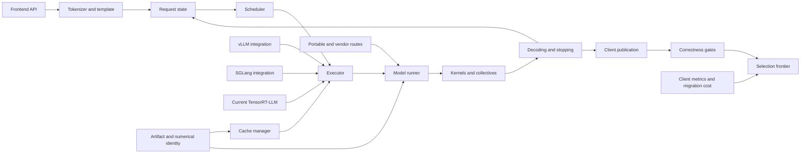

VOLUME II / PART VIII — INFERENCE ENGINES AND PRODUCTION SERVING / CHAPTER 43

# 43 — Runtime architecture and inference-engine selection

[DERIVED] An inference engine is scientifically comparable only after its semantic, numerical, resource and service contracts have been resolved for an executable deployment tuple.

6 sections · 2 spine papers · 10 implementations · prerequisites: 26–29, 37, 40–42 · artifact: version-pinned engine comparison (planned) · updated 2026-10-14

## Why this chapter exists

[DERIVED] A reference model loop makes execution appear local and sequential: tokenize input, evaluate the model, sample a token and repeat. Production inference separates those responsibilities across API processes, engine cores, worker groups, device streams and output transports. That separation exposes bottlenecks hidden by the original loop: repeated prefix work, metadata preparation, dispatch overhead, state ownership and collective communication. It also exposes correctness failures that a fast isolated matrix multiplication cannot reveal.

[DERIVED] Memory-efficient state and optimized kernels make larger active workloads possible, but the dominant constraint can then move to host preparation, synchronization, routing or service deadlines. The solution changes from optimizing one tensor operation to integrating a stateful execution system. A cache match must use compatible model identity; cancellation must respect outstanding device reads; graph replay must receive current metadata; a protocol-compatible server must preserve intended preprocessing and stopping.

[DERIVED] The scientific problem is therefore twofold. We must reconstruct how an engine realizes the model, and determine what evidence makes one deployable tuple preferable for a declared workload. This chapter treats current interfaces as versioned evidence, historical papers as bounded experiments, and performance as conditional on correctness. It does not infer a latency ranking from feature support. The 2026 inspection includes current PyTorch-native TensorRT-LLM, SGLang's current distributed/session interfaces and a backend-reproducibility study that localizes hidden defaults.

## Concept map



[DERIVED] Text equivalent:

- Frontend API passes through tokenizer/template into request state and scheduler.
  - Scheduler selects executor work; the cache manager constrains that execution.
  - Artifact/numerical identity constrains the cache manager and model runner.
- Executor invokes the model runner, kernels/collectives and decoding/stopping.
  - Decoding publishes client output and updates request state.
  - vLLM, SGLang and current TensorRT-LLM integrate the executor roles differently.
  - Portable/vendor routes provide alternative model-runner boundaries.
- Client publication feeds correctness gates and the selection frontier.
  - Client metrics and migration cost also constrain that frontier.

[DERIVED] The arrows denote dependencies or data/state transitions, not measured performance. A component appearing in multiple engines does not make the complete paths equivalent. The distinction between model-prefix commitment and published tokens is maintained throughout: stopping or output filtering can withhold computed model tokens from clients.

## Position in the book

| Relation | Canonical links |
|---|---|
| Prerequisites | [26 numerical equivalence](../../part-05-hardware-kernels-and-distributed-execution/ch26-kernel-programming-and-numerical-equivalence/README.md), [27 kernels](../../part-05-hardware-kernels-and-distributed-execution/ch27-attention-latent-attention-and-expert-kernels/README.md), [28 compilers](../../part-05-hardware-kernels-and-distributed-execution/ch28-frameworks-graph-compilers-and-runtime-integration/README.md), [29 collectives](../../part-05-hardware-kernels-and-distributed-execution/ch29-parallelism-collectives-and-distributed-optimization/README.md), [37 decoding](../../part-07-inference-algorithms-distillation-and-compression/ch37-decoding-constrained-generation-and-speculative-execution/README.md), [40 quantization](../../part-07-inference-algorithms-distillation-and-compression/ch40-quantization-from-numerical-model-to-deployable-artifact/README.md), [41 adaptive execution](../../part-07-inference-algorithms-distillation-and-compression/ch41-pruning-sparsity-rank-reduction-and-adaptive-execution/README.md), [42 inference resources](../../part-07-inference-algorithms-distillation-and-compression/ch42-prefill-decode-kv-state-and-inference-resource-models/README.md) |
| Siblings (same part) | [44 scheduling](../ch44-scheduling-distributed-serving-and-disaggregation/README.md), [45 local execution](../ch45-local-edge-and-heterogeneous-inference/README.md) |
| Downstream | [46 service contracts](../ch46-admission-control-routing-autoscaling-and-service-contracts/README.md), [47 operations](../ch47-observability-deployment-changes-and-incident-recovery/README.md), [48 capacity and economics](../ch48-capacity-planning-benchmarking-and-lifecycle-economics/README.md) |
| Trades off with | [40 artifact/precision choices](../../part-07-inference-algorithms-distillation-and-compression/ch40-quantization-from-numerical-model-to-deployable-artifact/README.md), [42 capacity](../../part-07-inference-algorithms-distillation-and-compression/ch42-prefill-decode-kv-state-and-inference-resource-models/README.md) |

[DERIVED] Chapter 42 supplies state accounting; this chapter reconstructs its integration into actual engine roles. Chapter 44 owns scheduling and placement policies; this chapter identifies where a selected engine invokes them and which numerical/resource invariants they must preserve. Chapter 48 develops full capacity/economic analysis; §43.6 establishes the measurement and migration boundary needed before that analysis is meaningful.

## Sections

| Section | Title | What changes here | Primary evidence labels |
|---|---|---|---|
| [43.1](43-1-runtime-decomposition.md) | Runtime decomposition | One call stack becomes explicit semantic and physical state owners | DERIVED / OFFICIAL-DOCUMENTATION |
| [43.2](43-2-vllm.md) | vLLM | Engine-core scheduling becomes runner tensors, prefix references and compiled dispatch | PAPER-REPORTED / OFFICIAL-DOCUMENTATION |
| [43.3](43-3-sglang.md) | SGLang | Program/prefix structure meets constraint state and asynchronous distributed execution | PAPER-REPORTED / OFFICIAL-DOCUMENTATION |
| [43.4](43-4-tensorrt-llm.md) | TensorRT-LLM | Pinned PyTorch-native execution is separated from tagged legacy backend workflows | OFFICIAL-DOCUMENTATION |
| [43.5](43-5-other-deployment-routes.md) | Other deployment routes | Graph capability and compilation must close complete generation semantics | DERIVED / OFFICIAL-DOCUMENTATION |
| [43.6](43-6-selection-methodology.md) | Selection methodology | Capability and correctness gates precede service and migration comparison | DERIVED / PAPER-REPORTED |

## Artifact

[DERIVED] The planned **version-pinned engine comparison** contains a candidate manifest, source/artifact hashes, resolved preprocessing/decoding records, operator/logit parity results, paired task outcomes, matched service traces and operational/migration findings. Each candidate identifies its actual attention, quantized-linear, cache, MoE, graph and communication paths. A project name and CLI string are insufficient.

[DERIVED] The manifest also records rejected and undetermined candidates. An unsupported shape or unresolved numerical discrepancy is evidence about feasibility, not a missing row to delete. Warm/cold cache and compilation conditions are explicit treatments. Client delivery and internal execution timings remain separately named. The complete schema and unexecuted protocol are in [verification](verification.md).

## Verification

[DERIVED] Hold source weights, tokenization/template, decoding, hardware and workload fixed, then investigate output differences before speed ranking. Compare identical-prefix operators/logits and independent free-running tasks separately. Only accepted candidates enter matched client-visible service tests. Failure/cancellation outcomes remain in the denominator. No book experiment has been executed; the procedure is a falsifiable proposal, not a result.

## Lineage

- 2023 · PagedAttention [P36](references.md#p36) · **engineering optimization** · paged state integration enables additional active work under the original study.
- 2024 · SGLang [P37](references.md#p37) · **alternative branch** · structured programs and prefix organization expose reuse opportunities.
- 2026 · TensorRT-LLM executable-revision boundary [R43.35-36](references.md#r43-35) · **superseded approach** · tagged v1.2.0 retains a legacy path absent from the inspected October development source.
- 2026 · SGLang asynchronous runtime optimization report [R43.11](references.md#r43-11) · **engineering optimization** · synchronization/metadata interventions target observed GPU bubbles.
- 2026 · The Silent Hyperparameter [R43.29](references.md#r43-29) · **current frontier** · controlled backend evaluation localizes semantic defaults and residual numerical effects.

[DERIVED] These relations identify changed mechanisms and evidence, not a linear replacement order or an engine ranking. Historical methods can remain informative after their original implementation changes. The development/release distinction is an inspected source boundary; it does not erase the reproducibility requirements of historical measurements.

```figure
id: fig-43.1
kind: lineage
title: Runtime integration and evidence lineage
caption: Historical mechanisms, current release boundaries and backend-aware evaluation address different constraints.
placement: inline
evidence: PAPER-REPORTED
source: P37
alt: PagedAttention, SGLang and current backend-aware evaluation form related but distinct research and engineering branches.
spec:
  entries:
    - {year: 2023, work: PagedAttention, cite: P36, relation: engineering optimization}
    - {year: 2024, work: SGLang, cite: P37, relation: alternative branch}
    - {year: 2026, work: TensorRT backend removal, cite: R43.14, relation: superseded approach}
    - {year: 2026, work: SGLang overlap optimization, cite: R43.11, relation: engineering optimization}
    - {year: 2026, work: Backend reproducibility study, cite: R43.29, relation: current frontier}
```

```figure
id: fig-43.2
kind: cycle
title: Runtime execution and acceptance loop
caption: Device completion permits state commitment and publication; terminal requests release resources, while diagnostics can return a candidate to configuration.
placement: inline
evidence: MATHEMATICALLY-DERIVED
source: DERIVED:eq-43.1
alt: Input resolution leads to reservation, execution, completion and commit, then publication. Continuing generation returns to reservation; terminal requests release resources.
spec:
  stages:
    - {id: input, label: Resolve input and identity, kind: process}
    - {id: reserve, label: Schedule and reserve, kind: memory}
    - {id: execute, label: Execute model work, kind: process}
    - {id: commit, label: Complete and commit, kind: state}
    - {id: publish, label: Process and publish, kind: process}
    - {id: release, label: Terminal release, kind: memory}
  edges:
    - {from: input, to: reserve}
    - {from: reserve, to: execute}
    - {from: execute, to: commit}
    - {from: commit, to: publish}
    - {from: publish, to: reserve, kind: feedback, label: generation continues}
    - {from: publish, to: release, label: terminal state}
```

## Terms owned here

| Term | Definition | Owner |
|---|---|---|
| Runtime execution contract | Declared semantics, state transitions and resource lifetimes for an executable inference tuple | [43.1](43-1-runtime-decomposition.md#formulation) |
| Prefix-reuse domain | Requests whose indexed input and execution identity imply compatible completed state | [43.3](43-3-sglang.md#formulation) |
| Executable backend identity | Artifact loader, model/operator implementation, executor configuration and target tuple | [43.4](43-4-tensorrt-llm.md#formulation) |
| Deployment closure | Complete supported operators, state, decoding and interfaces for an application | [43.5](43-5-other-deployment-routes.md#formulation) |
| Engine selection tuple | Immutable candidate description spanning artifacts, execution and observation boundary | [43.6](43-6-selection-methodology.md#formulation) |

## Reference-stack coverage

| Stack section | Entry | Stack layer | What this chapter takes from it | Surface used | Sections | Evidence label |
|---|---|---|---|---|---|---|
| §1 lab | #14 NVIDIA Research | — | Current runtime/removal and first-party optimization disclosures | https://github.com/NVIDIA ; https://developer.nvidia.com/blog/ | 1, 4 | OFFICIAL-DOCUMENTATION |
| §1 lab | #27 Hugging Face Research | — | TGI repository, maintenance and historical service interface | https://github.com/huggingface | 5 | OFFICIAL-DOCUMENTATION |
| §2 conference | #1 NeurIPS | — | Archival SGLang full text | https://proceedings.neurips.cc/ | 3 | PAPER-REPORTED |
| §3 discovery source | #1 arXiv | — | Originating full text and 2026 backend-study retrieval | https://arxiv.org/ ; https://arxiv.org/search/advanced | 1–3, 6 | KNOWN |
| §3 discovery source | #4 NeurIPS Proceedings | — | Stable archival SGLang route | https://proceedings.neurips.cc/ | 3 | KNOWN |
| §4 system | #17 PyTorch | Model / autograd framework | Framework execution interfaces in engine architecture/source | https://pytorch.org/docs/stable/ | 1–4 | OFFICIAL-DOCUMENTATION |
| §4 system | #26 Hugging Face Transformers | Model definition / adaptation | Model/tokenizer integration and reference evaluator | https://huggingface.co/docs/transformers/ | 2, 4–6 | OFFICIAL-DOCUMENTATION / PAPER-REPORTED |
| §4 system | #39 FlashAttention | Kernels / numerics / collectives | Documented engine backend integration; no isolated benchmark | https://github.com/Dao-AILab/flash-attention | 2–3 | OFFICIAL-DOCUMENTATION |
| §4 system | #41 vLLM | Inference engine | V1 processes, prefix identity, compilation, immutable engine core | https://docs.vllm.ai/ | 1–2, 6 | OFFICIAL-DOCUMENTATION / PAPER-REPORTED |
| §4 system | #42 SGLang | Inference engine | Structured execution, sessions, determinism, DPA and source loop | https://docs.sglang.ai/ | 1, 3, 6 | OFFICIAL-DOCUMENTATION / PAPER-REPORTED |
| §4 system | #43 TensorRT-LLM | Inference engine | Current PyExecutor, removal boundary and optimization reports | https://docs.nvidia.com/tensorrt-llm/ | 1, 4, 6 | OFFICIAL-DOCUMENTATION |
| §4 system | #44 NVIDIA Triton Inference Server | Serving / portable runtime | TensorRT-LLM-documented integration boundary only | https://docs.nvidia.com/triton-inference-server/ | 4 | OFFICIAL-DOCUMENTATION |
| §4 system | #46 Hugging Face Text Generation Inference (TGI) | Inference engine | Archived historical service/migration case | https://huggingface.co/docs/text-generation-inference/ | 5 | OFFICIAL-DOCUMENTATION |
| §4 system | #48 ONNX Runtime | Serving / portable runtime | Capability partition, graph rewrite, I/O and vendor-provider routes | https://onnxruntime.ai/docs/ | 5–6 | OFFICIAL-DOCUMENTATION |
| §4 system | #49 OpenVINO | Serving / portable runtime | HETERO topology costs and separate GenAI pipeline | https://docs.openvino.ai/ | 5–6 | OFFICIAL-DOCUMENTATION |
| Outside the reference stack (routed via book_plan.md anchors) | MLC-LLM; DeepSpeed-MII | Inference engine | Explicit 43.5 portable/runtime and historical design coverage | https://llm.mlc.ai/docs/ ; https://github.com/deepspeedai/DeepSpeed-MII | 5 | OFFICIAL-DOCUMENTATION |
| Outside the reference stack (routed via book_plan.md anchors) | TensorRT; Dynamo; vendor execution providers | Accelerator / driver / compiler; serving integration | TensorRT-LLM anchor/current-vs-legacy boundary and explicit vendor-route coverage | R43.12, R43.15, R43.32 exact primary URLs | 4–5 | OFFICIAL-DOCUMENTATION |
| Outside the reference stack (routed via book_plan.md anchors) | LMSYS/SGLang technical disclosure; CISPA backend study; SOSP P36 | Primary report/paper routes | SGLang/vLLM anchors and 43.6 correctness-before-performance requirement | P36, R43.11, R43.29 exact primary URLs | 2–3, 6 | PAPER-REPORTED / OFFICIAL-DOCUMENTATION |

**Inspection dimensions applied.** [KNOWN] **Parallelism** and **Communication** appear in §§43.1–4; **Precision**, **Memory**, **Kernels** and **Inference** span engine and portable-route integration; **Metrics**, **Reliability** and **Reproducibility** govern §43.6 and the artifact. **Checkpointing** is limited to artifact/revision loading, not training recovery. **Post-training** is not owned here; Chapter 40 supplies numerical artifacts.

## Source route

[KNOWN] Apply §1.1's official lab/publication/code route, §2.1's topic→proceedings→exact paper→supplement/code workflow, §3.1's preprint→archival→artifact cascade and §4.3's documentation/architecture/performance/compatibility/failure searches. Filled queries used or retained for precise retrieval:

- site:research.nvidia.com/publications inference runtime TensorRT-LLM 2025 2026
- site:proceedings.neurips.cc SGLang structured language model programs
- site:arxiv.org inference backends reproducibility 2026
- "vLLM" official documentation architecture V1
- site:github.com "SGLang" scheduler overlap
- "TensorRT-LLM" "TensorRT backend removed" release

[OFFICIAL-DOCUMENTATION] The reference stack's SGLang domain now redirects to docs.sglang.io; actual resolved URLs are retained in the ledger. Current source commits were resolved through public official GitHub APIs and inspected at immutable paths. Discovery routes identify evidence; they are not evidence for unrelated claims.

## Status

[KNOWN] **manuscript_draft**. All six required rows have substantive methods, formal contracts, bounded explanatory algorithms, costs and an audit. Sources were inspected on 2026-10-14. Three official engine source files are pinned and statically inspected. Current mutable documentation is explicitly unpinned; TensorRT-LLM's generated documentation exposes a separate build revision.

[UNVERIFIED] No package import, compilation, server launch, kernel execution, independent quality evaluation or service replay occurred. These gaps prevent reviewed status for the planned comparison artifact. [NOT-DISCLOSED] Several source reports omit full task-quality uncertainty, exact dispatch/configuration identity or controlled service comparisons. Their claims remain within disclosed boundaries. Genuine research questions concern long-trajectory numerical stability, capacity/dispatch joint optimization and nonstationary cache routing; [verification](verification.md) states evidence that could settle them.
