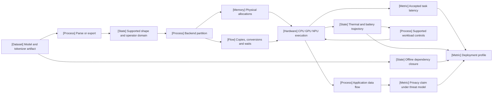

VOLUME II / PART VIII — INFERENCE ENGINES AND PRODUCTION SERVING / CHAPTER 45

# 45 — Local, edge, and heterogeneous inference

[DERIVED] A defensible local deployment is a complete application/resource contract: supported operators and artifact identity, physical memory and transfers, sustained thermal/energy behavior, accepted-task latency and declared offline/privacy boundaries.

6 sections · 5 reference-stack implementation layers · prerequisites: 25, 37, 40–43 · artifact: a constrained-device deployment profile (planned) · updated 2026-10-14

## Why this chapter exists

[DERIVED] A checkpoint that fits and generates text is an important milestone, but it leaves the deployment question unresolved. The application may exceed memory once context and scratch grow, wait on uncompiled kernels after an update, or deliver an initial burst followed by thermally limited service. On personal devices, foreground work shares memory, bandwidth and cooling. On edge modules, enclosure and available administrative controls can differ substantially from a phone despite similar processor names.

[DERIVED] Portable execution adds a second contract. A model must survive serialization/export, operator lowering, shape/state constraints and backend partitioning without changing the accepted task. A listed GPU, NPU or WebGPU backend does not establish that every model runs there; fallback boundaries can move state and dominate repeated token generation. The fastest processor for a dense prompt need not be the best path for batch-one decode.

[DERIVED] This chapter reconstructs those mechanisms rather than ranking device brands or counting supported backend names. It keeps format, tensor library, inference runtime and service process distinct. It joins initialization, physical residency and graph cuts to sustained trajectories. Its analytical models identify assumptions explicitly, while current official documentation and versioned primary studies supply narrow evidence about actual systems.

[DERIVED] The 2026 boundary is explicit. ThermE supplies a contemporary calibrated edge-control study, and the MLCommons Edge Agentic call supplies a conversation-level benchmark specification. Historical MELT and PowerInfer-2 remain useful evidence about measurement and specialized streaming. They do not establish current universal runtime rankings or ordinary-phone compatibility. Static implementation inspection is recorded with immutable commits where available; no device execution is claimed.

## Concept map



[DERIVED] Equivalent text structure:

- Model/tokenizer artifact → parsing/export → supported shape/operator domain → backend partition.
- Partition → physical allocations and copies/conversions/waits → CPU/GPU/NPU execution.
- Execution → accepted-task latency and thermal/battery trajectories.
  - Trajectory → supported workload controls → execution.
- Artifact → offline dependency closure.
- Application data flow → privacy claim under an explicit threat model.
- Latency, trajectories, dependency closure and privacy evidence → deployment profile.

## Position in the book

| Relation | Canonical destinations |
|---|---|
| Prerequisites | [Hardware bounds](../../part-05-hardware-kernels-and-distributed-execution/ch25-accelerators-memory-hierarchy-and-performance-models/README.md), [decoding](../../part-07-inference-algorithms-distillation-and-compression/ch37-decoding-constrained-generation-and-speculative-execution/README.md), [quantization](../../part-07-inference-algorithms-distillation-and-compression/ch40-quantization-from-numerical-model-to-deployable-artifact/README.md), [inference accounting](../../part-07-inference-algorithms-distillation-and-compression/ch42-prefill-decode-kv-state-and-inference-resource-models/README.md) |
| Siblings (same part) | [Runtime selection](../ch43-runtime-architecture-and-inference-engine-selection/README.md), [scheduling/disaggregation](../ch44-scheduling-distributed-serving-and-disaggregation/README.md) |
| Downstream | [Service control](../ch46-admission-control-routing-autoscaling-and-service-contracts/README.md), [observability](../ch47-observability-deployment-changes-and-incident-recovery/README.md), [benchmarking/economics](../ch48-capacity-planning-benchmarking-and-lifecycle-economics/README.md) |
| Trades off with | Accepted-task quality, complete latency, simultaneous physical occupancy, sustained energy/thermal trajectory and deployment/permission coverage |

## Sections

| Section | Title | Central mechanism | Evidence |
|---|---|---|---|
| [45.1](45-1-device-constraints.md) | Device constraints | Join capacity/rate constraints to cumulative heat and energy | MATHEMATICALLY-DERIVED; PAPER-REPORTED |
| [45.2](45-2-llamacpp-stack.md) | llama.cpp stack | Follow GGUF values through loading, GGML and backend/service boundaries | OFFICIAL-DOCUMENTATION; DERIVED |
| [45.3](45-3-apple-and-mobile-execution.md) | Apple and mobile execution | Shared-memory stream dependencies and exported/delegated mobile graphs | OFFICIAL-DOCUMENTATION; MATHEMATICALLY-DERIVED |
| [45.4](45-4-portable-runtimes.md) | Portable runtimes | Operator/domain coverage, fallback boundaries and target compilation | OFFICIAL-DOCUMENTATION; DERIVED |
| [45.5](45-5-hybrid-placement.md) | Hybrid placement | Stationary placement, streaming, graph cuts and physical page locality | MATHEMATICALLY-DERIVED; PAPER-REPORTED |
| [45.6](45-6-device-evaluation.md) | Device evaluation | Initial-state vectors, sustained traces and accepted-task energy | MATHEMATICALLY-DERIVED; PAPER-REPORTED |

## Artifact

[DERIVED] The planned constrained-device deployment profile is specified in [verification.md](verification.md). Its records include immutable model/runtime/device identity; supported input/state/operator domain; physical allocation and lifetime ledger; placement/transfer recurrence map; initialization-state vector; aligned latency, memory, power and thermal trajectories; task-quality acceptance; offline dependency closure; privacy threat/data-flow model; and explicit failed/missing cases. Each record has units, boundary and provenance.

[DERIVED] A profile is reviewable before it becomes a deployment recommendation. An unsupported operator rejects a capability claim. A missing staging allocation rejects the memory ledger. A warm page cache rejects a claimed cold-storage timing. A thermal trajectory outside calibration rejects extrapolated sustainability. A successful disconnected task supports offline functionality under that boundary; it does not independently prove every privacy property. Keeping these diagnoses distinct makes corrective engineering possible.


```figure
{
  "id": "fig-45.1",
  "kind": "cycle",
  "title": "Deployment evidence and rejection loop",
  "caption": "A failed support, resource or task check returns to the corresponding configuration; validation does not follow from model loading.",
  "placement": "inline",
  "evidence": "DERIVED",
  "source": "DERIVED:eq-45.1",
  "alt": "A failed support, resource or task check returns to the corresponding configuration; validation does not follow from model loading.",
  "spec": {
    "stages": [
      {
        "id": "i",
        "label": "Identity/domain",
        "kind": "state"
      },
      {
        "id": "p",
        "label": "Placement/limits",
        "kind": "process"
      },
      {
        "id": "r",
        "label": "Bounded run",
        "kind": "process"
      },
      {
        "id": "v",
        "label": "Validate profile",
        "kind": "metric"
      },
      {
        "id": "f",
        "label": "Revise or reject",
        "kind": "feedback"
      }
    ],
    "edges": [
      {
        "from": "i",
        "to": "p"
      },
      {
        "from": "p",
        "to": "r"
      },
      {
        "from": "r",
        "to": "v"
      },
      {
        "from": "v",
        "to": "f"
      },
      {
        "from": "f",
        "to": "i",
        "kind": "feedback"
      },
      {
        "from": "f",
        "to": "p",
        "kind": "feedback"
      }
    ]
  }
}
```


## Verification

[DERIVED] Proposed validation compares phase/application boundaries under pinned identities, separate warm/cold state vectors, controlled context and sustained duration. It records memory pressure, thermal changes, whole-device energy and accepted tasks together. Matched CPU/static-offload/portable paths isolate graph-cut and fallback costs when their numerical task contracts agree. Every failed case and unsupported domain remains visible. No model execution, device measurement or security test was performed for this manuscript.

## Lineage

- 2023 · llama.cpp / GGML · **engineering optimization**: [OFFICIAL-DOCUMENTATION] portable tensor/runtime and local serving route [R45.3–R45.8].
- 2023 · MLX · **alternative branch**: [OFFICIAL-DOCUMENTATION] shared-array CPU/GPU execution and dependency-managed streams [R45.1].
- 2024 · MELT · **conceptual ancestor**: [PAPER-REPORTED] joint on-device measurement infrastructure [R45.9].
- 2024 · PowerInfer-2 · **alternative branch**: [PAPER-REPORTED] sparse smartphone cluster/cache/I/O execution [R45.21].
- 2026 · ThermE · **current frontier**: [PAPER-REPORTED] calibrated predictive shared thermal control [R45.2].
- 2026 · MLCommons Edge Agentic call · **engineering optimization**: [OFFICIAL-DOCUMENTATION] specified conversation/accuracy boundaries [R45.23].


```figure
{
  "id": "fig-45.2",
  "kind": "lineage",
  "title": "Local execution and evaluation lineage",
  "caption": "Runtime portability, specialized streaming, sustained control and task benchmarking solve different parts of the deployment contract.",
  "placement": "inline",
  "evidence": "DERIVED",
  "source": [
    "R45.3",
    "R45.1",
    "R45.9",
    "R45.21",
    "R45.2",
    "R45.23"
  ],
  "alt": "Runtime portability, specialized streaming, sustained control and task benchmarking solve different parts of the deployment contract.",
  "spec": {
    "entries": [
      {
        "year": 2023,
        "work": "llama.cpp / GGML",
        "cite": "R45.3",
        "relation": "engineering optimization"
      },
      {
        "year": 2023,
        "work": "MLX",
        "cite": "R45.1",
        "relation": "alternative branch"
      },
      {
        "year": 2024,
        "work": "MELT",
        "cite": "R45.9",
        "relation": "conceptual ancestor"
      },
      {
        "year": 2024,
        "work": "PowerInfer-2",
        "cite": "R45.21",
        "relation": "alternative branch"
      },
      {
        "year": 2026,
        "work": "ThermE",
        "cite": "R45.2",
        "relation": "current frontier"
      },
      {
        "year": 2026,
        "work": "Edge Agentic call",
        "cite": "R45.23",
        "relation": "engineering optimization"
      }
    ]
  }
}
```


## Terms owned here

- **Device feasibility region** — simultaneous physical, latency, cumulative energy and thermal constraints; §45.1.
- **Portable execution domain** — supported operator/dtype/shape/state/target contract; §45.4.
- **Static layer offload** — weights placed once with recurring activation/state crossings separately counted; §45.5.
- **Dynamic weight streaming** — recurring nonresident weight transfers before use; §45.5.
- **Cold-state vector** — independent process, mapping/page, compilation, prefix and thermal initial states; §45.6.
- **Accepted-task energy** — energy over a declared boundary divided by nonzero accepted completions; §45.6.

## Reference-stack coverage

| Stack section | Entry | Layer | Material actually used | Surface/route | Sections | Evidence |
|---|---|---|---|---|---|---|
| §1 lab | #21 Apple Machine Learning Research | — | M5 GPU first-party workload disclosure, routed to R45.12 | https://machinelearning.apple.com/research | 45.3 | OFFICIAL-DOCUMENTATION |
| §3 discovery | #1 arXiv | — | Versioned ThermE, MELT and PowerInfer-2 full text | https://arxiv.org/ | 45.1, 45.5–45.6 | PAPER-REPORTED |
| §4 system | #45 llama.cpp | Inference engine | Pinned loader/backend interfaces; GGUF and server/benchmark docs | https://github.com/ggml-org/llama.cpp | 45.2, 45.5–45.6 | OFFICIAL-DOCUMENTATION |
| §4 system | #50 Apple MLX / MLX-LM | Serving / portable runtime | Shared arrays, lazy evaluation, streams, generation route | https://ml-explore.github.io/mlx/ | 45.1, 45.3 | OFFICIAL-DOCUMENTATION |
| §4 system | #17 PyTorch | Model / autograd framework | ExecuTorch export/lower/delegate deployment route | https://pytorch.org/docs/stable/ | 45.3 | OFFICIAL-DOCUMENTATION |
| §4 system | #48 ONNX Runtime | Serving / portable runtime | Provider partitioning, I/O binding and WebGPU ownership | https://onnxruntime.ai/docs/ | 45.4 | OFFICIAL-DOCUMENTATION |
| §4 system | #49 OpenVINO | Serving / portable runtime | Heterogeneous affinity and preview pipeline contract | https://docs.openvino.ai/ | 45.4 | OFFICIAL-DOCUMENTATION |

[DERIVED] **Inspection dimensions applied:** Precision and Kernels (45.2–45.4); Memory and Communication (45.1–45.5); Inference and Metrics (all sections); Reliability and Reproducibility (45.2–45.6). Parallel placement is local/heterogeneous here; distributed training and post-training algorithms are canonical elsewhere.

| Outside the reference stack (routed via book_plan.md anchors) | Plan justification | Primary surface | Sections | Evidence |
|---|---|---|---|---|
| GGML/GGUF and ExecuTorch | Explicit Chapter 45 artifact/mobile anchors | https://github.com/ggml-org/ggml ; https://docs.pytorch.org/executorch/stable/ | 45.2–45.3 | OFFICIAL-DOCUMENTATION |
| MLC-LLM and Metal/Vulkan/WebGPU | Explicit Chapter 45 portable-target anchors | https://llm.mlc.ai/docs/ ; R45.10/R45.12/R45.20 | 45.3–45.4 | OFFICIAL-DOCUMENTATION |
| Linux NUMA Memory Policy | Chapter 45 NUMA/mmap required mechanism | https://www.kernel.org/doc/html/latest/admin-guide/mm/numa_memory_policy.html | 45.5 | OFFICIAL-DOCUMENTATION |
| MLCommons | External benchmark anchors in Chapters 47–48, device protocol relevance | https://mlcommons.org/2026/07/mlperf-inference-v61-edge-agentic/ | 45.6 | OFFICIAL-DOCUMENTATION |

[DERIVED] GGML/GGUF, ExecuTorch, MLC-LLM and Metal/Vulkan/WebGPU are explicit Chapter 45 plan anchors rather than separately numbered reference-stack entries. Their primary documentation follows the corresponding implementation route. Linux NUMA documentation is a primary OS source needed to qualify mapped-page locality. MLCommons is the plan's external benchmark route. These additions are source-specific, not invented stack entries.

## Source route

[DERIVED] Follow the reference stack's originating-disclosure protocol (§1.1), archival cross-check (§2.1), revision/full-text cascade (§3.1) and implementation inspection (§4.3). These filled queries locate the chapter's existing evidence routes; a search match does not change a source's recorded publication or execution status.

- §1.1: site:machinelearning.apple.com/research "M5" "MLX"
- §2.1: "MELTing point: Mobile Evaluation of Language Transformers" (MLSys OR ASPLOS OR EuroSys)
- §3.1: site:arxiv.org "ThermE" "Shared Thermal Headroom"
- §4.3: site:github.com/ggml-org/llama.cpp "GGUF" "llama-bench"
- §4.3: site:ml-explore.github.io/mlx "unified memory" "lazy"
- §4.3: site:onnxruntime.ai/docs "I/O Binding" "Execution Providers"

[DERIVED] Resolve results to the inspected [Apple disclosure](https://machinelearning.apple.com/research/exploring-llms-mlx-m5), [ThermE v1](https://arxiv.org/html/2610.00267v1), [MELTing point v2](https://arxiv.org/html/2403.12844v2) and [ONNX Runtime provider documentation](https://onnxruntime.ai/docs/execution-providers/), then retain the exact revision and locator from [references](references.md). The archival query is a discovery step: R45.9 remains a preprint in this ledger. Runtime routes must resolve to the recorded commit or explicitly unpinned documentation; search results and build instructions do not establish executed compatibility.

## Status

[DERIVED] All six planned topics are developed in full manuscripts and mapped to claims, locators, costs and validation gaps in verification. The current primary paper plus mutable 2026 runtime documentation updates the research boundary without claiming that every source is a new 2026 result. HeatCache was screened and excluded from phone evidence because its liquid-cooled edge-server setting is different.

[UNVERIFIED] The chapter is a research manuscript draft. Pinned static source inspection strengthens narrow format/interface claims but supplies no executed device compatibility or sustained performance. Missing execution, immutable identities for some documentation, telemetry access and cross-runtime quality matching remain explicit gaps.
