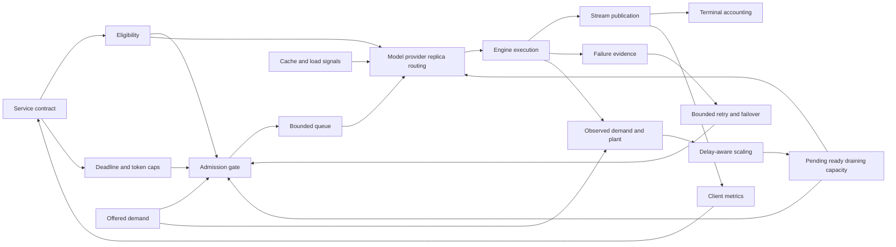

VOLUME II / PART VIII — INFERENCE ENGINES AND PRODUCTION SERVING / CHAPTER 46

# 46 — Admission control, routing, autoscaling, and service contracts

[DERIVED] A serving control plane is defensible when every accepted request has an eligible destination, bounded resource and retry obligations, and a client-observable terminal outcome despite delayed capacity and partial failure.

6 sections · 0 spine papers · 2 indexed implementations · prerequisites: 6, 42–45 · artifact: SLO-driven serving control-plane design (planned) · updated 2026-10-14

## Why this chapter exists

[DERIVED] High isolated inference throughput does not specify which requests a service may promise to finish. Demand arrives unevenly, model execution consumes variable work, and capacity changes after loading and coordination delays. Accepting everything can hide rejection in an ever-growing queue. Retrying every timeout can multiply the work precisely when the service has the least spare capacity. Routing toward cached state can cross an authorization boundary unless hard eligibility is enforced first.

[DERIVED] The chapter reconstructs those mechanisms as coupled state transitions. A contract first defines successful service at a named observation boundary. Admission commits finite queue, token and execution obligations. Routing selects only among legal and capable actions. Scaling reconciles desired capacity with actual ready, pending and draining resources. Resilience preserves logical identity while bounding physical attempts. Streaming exposes progress and failure without confusing an initial HTTP success with a completed valid answer.

[DERIVED] The 2026 evidence changes the control options, but also sharpens their limits. Operator-level elasticity changes the actuation unit; predictive scaling compensates for startup delay; model/budget routing changes the action space. Their experiments use different estimators, data planes and observation boundaries. We therefore preserve reported protocols and uncertainty instead of assembling their headline gains into an imaginary integrated deployment. Formal bounds explain finite-resource consequences; mutable documentation explains current interfaces; the proposed replay in verification is a separate unexecuted obligation.

## Concept map



[DERIVED] Text equivalent:

- The service contract defines eligibility, deadlines and token caps.
  - These constrain the admission gate for offered demand.
  - Admission feeds a bounded queue and model/provider/replica routing.
- Routing combines eligibility with cache/load signals and available capacity.
  - Engine execution feeds stream publication and terminal accounting.
  - Failure evidence feeds bounded retry/failover through the admission gate.
- Offered demand and execution feed observations of demand and the plant.
  - Delay-aware scaling changes pending, ready and draining capacity.
  - Capacity constrains both admission and routing.
- Stream publication produces client metrics.
  - Metrics inform the next service-contract revision.

[DERIVED] The cycle contains delayed feedback and competing clocks. A replica requested now is not ready now; an output published now cannot be silently withdrawn by a later retry; an expired lease is not proof that its former owner stopped computing. Those distinctions determine valid action order.

## Position in the book

| Relation | Canonical owner |
|---|---|
| Prerequisites | [6 controlled evaluation](../../../vol-01-learning-and-representation/part-01-scientific-foundations/ch06-experimental-design-and-evaluation-before-optimization/README.md); [42 inference resources](../../part-07-inference-algorithms-distillation-and-compression/ch42-prefill-decode-kv-state-and-inference-resource-models/README.md) |
| Siblings (same part) | [43 engines](../ch43-runtime-architecture-and-inference-engine-selection/README.md); [44 scheduling](../ch44-scheduling-distributed-serving-and-disaggregation/README.md); [45 local execution](../ch45-local-edge-and-heterogeneous-inference/README.md) |
| Downstream | [47 operations](../ch47-observability-deployment-changes-and-incident-recovery/README.md); [48 capacity and economics](../ch48-capacity-planning-benchmarking-and-lifecycle-economics/README.md) |
| Trades off with | [44 placement/locality](../ch44-scheduling-distributed-serving-and-disaggregation/README.md); [48 idle capacity and cost](../ch48-capacity-planning-benchmarking-and-lifecycle-economics/README.md) |

[DERIVED] Chapter 42 owns cache-byte and execution-resource accounting; Chapter 44 owns scheduling/disaggregation definitions. Here those mechanisms become admission and service obligations. Chapter 47 develops deployment epochs, observability and recovery; this chapter states the fencing boundary necessary for durable retry takeover. Chapter 48 develops complete capacity and lifecycle economics rather than inheriting a router's dated token-price estimate.

## Sections

| Section | Title | Mechanism and evidence boundary | Primary source locator |
|---|---|---|---|
| [46.1](46-1-service-contracts.md) | Service contracts | Joint timing/quality/terminal predicate, denominator policy and cancellation order | R46.16 Two levels of tuning; R46.20 Request cancellation; Eq. 46.1–4 |
| [46.2](46-2-admission-and-backpressure.md) | Admission and backpressure | Finite queue/work reservations, quotas, overload and cost-aware fairness | R46.4 Load shedding; R46.7 resources; Eq. 46.5–10 |
| [46.3](46-3-routing.md) | Routing | Hard eligibility, preference learning, expected budgets, model/budget actions and cache/load scores | R46.3 §3.2; R46.18 §§2–5; R46.19 §§3–6; R46.14 How It Works |
| [46.4](46-4-autoscaling.md) | Autoscaling | Delayed readiness, joint capacity, predictive margins, operator elasticity and safe drain | R46.1 §§3–5; R46.2 §§III–V; R46.16 Guardrails |
| [46.5](46-5-resilience.md) | Resilience | Attempt bounds, amplification, retry deadlines, durable identity and fencing | R46.9 §9.2.2; R46.24 retry controls; R46.22 Ejection algorithm; Eq. 46.21–25 |
| [46.6](46-6-api-behavior.md) | API behavior | Authentication boundary, streaming state, finite buffering and visible partial failure | R46.13 lines 11,30–62; R46.10 §§3.1–3.2; R46.11 §§9.2.3–6 |

[DERIVED] The order follows commitment. The service must know what it promises before reserving work, and must know what has been published before deciding whether retry or replay is safe. Mechanisms can be implemented in different processes, but their logical ordering cannot be recovered by aggregate throughput metrics.

## Artifact

[KNOWN] The planned artifact is **an SLO-driven serving control-plane design**. [Verification](verification.md#artifact-specification) specifies request/attempt identities, immutable policy/configuration records, quota and queue ledgers, routing eligibility, capacity timelines, failure/retry events and client-visible outcomes. It includes explicit unsupported and unmeasured fields.

[DERIVED] Its primary join key is the logical request; attempt identity, ownership epoch and event sequence identify distinct physical work and publication. Without those joins, one successful answer can conceal duplicate computation, a cancellation can conceal retained device state, and accepted throughput can conceal work rejected downstream.

## Verification

[ASSUMED] The proposed replay offers bursts and long requests, exercises overload and delayed loading, and injects cancellation, partial-stream failure and ownership takeover. It tests bounded queues and attempts, recovery after offered load falls, hard-policy preservation and explicit terminal outcomes. All thresholds are preregistered design inputs rather than source-reported results.

[UNVERIFIED] No replay, controller deployment, router training or fault experiment has been executed. The manuscript's finite-state procedures explain contracts; they do not certify a production implementation.

## Lineage

| Year | Work | Relation | Changed mechanism and remaining boundary |
|---|---|---|---|
| 2022 | RFC 9110 [R46.9] | conceptual ancestor | Intended-effect idempotency and retry semantics; no external transaction guarantee |
| 2023 | RFC 9457 [R46.10] | engineering optimization | Structured error identity; no complete streaming terminal protocol |
| 2024 | RouteLLM [R46.3] | alternative branch | Query-conditioned preference routing; quality depends on training distribution |
| 2025 | Unified routing/cascading [R46.18] | engineering optimization | Expected-budget selection with ex-ante/post-hoc estimates; estimators and sequential work remain costly |
| 2026 | R2-Router [R46.19] | current frontier | Model plus output-budget actions; oracle action-space dominance is not learned quality assurance |
| 2026 | OpScale / predictive scaling [R46.1–2] | current frontier | Finer actuation / delay lookahead; common-backend and small-hardware evidence are distinct |

```figure
id: fig-46.1
kind: lineage
title: Service semantics meet learned and delayed control
caption: Historical standards, learned selection and 2026 scaling form different branches with explicit evidence boundaries.
placement: inline
evidence: PAPER-REPORTED
source: R46.18
alt: HTTP semantics precede structured errors and learned routing, followed by budget routing and two scaling branches.
spec:
  entries:
    - {year: 2022, work: HTTP semantics, cite: R46.9, relation: conceptual ancestor}
    - {year: 2023, work: Structured problem details, cite: R46.10, relation: engineering optimization}
    - {year: 2024, work: RouteLLM, cite: R46.3, relation: alternative branch}
    - {year: 2025, work: Unified routing and cascading, cite: R46.18, relation: engineering optimization}
    - {year: 2026, work: Model and budget routing, cite: R46.19, relation: current frontier}
    - {year: 2026, work: Operator-level autoscaling, cite: R46.1, relation: current frontier}
    - {year: 2026, work: Startup-delay lookahead, cite: R46.2, relation: current frontier}
```

```figure
id: fig-46.2
kind: cycle
title: Bounded serving-control loop
caption: Admission commits finite work, execution publishes observable events, and measured demand/readiness returns to capacity control without granting unready capacity.
placement: inline
evidence: DERIVED
source: DERIVED:eq-46.5
alt: Admit, route, execute, publish and account form the request cycle; observation and scaling return ready capacity to admission.
spec:
  stages:
    - {id: admit, label: Check policy and reserve, kind: state}
    - {id: route, label: Route eligible work, kind: process}
    - {id: execute, label: Execute bounded attempt, kind: process}
    - {id: publish, label: Publish or terminal failure, kind: process}
    - {id: account, label: Reconcile work and outcome, kind: state}
    - {id: observe, label: Observe demand and readiness, kind: metric}
    - {id: scale, label: Scale and drain safely, kind: hardware}
  edges:
    - {from: admit, to: route}
    - {from: route, to: execute}
    - {from: execute, to: publish}
    - {from: publish, to: account}
    - {from: account, to: admit, kind: feedback, label: safe bounded retry only}
    - {from: account, to: observe}
    - {from: observe, to: scale}
    - {from: scale, to: admit, kind: feedback, label: ready capacity only}
```

## Terms owned here

| Term | Definition | Owner |
|---|---|---|
| Serving acceptance contract | Eligibility, timing, quality and terminal-state predicate at a named observation boundary | [46.1](46-1-service-contracts.md#formulation) |
| Admission commitment | Finite queue/work/resource reservation associated with accepted work | [46.2](46-2-admission-and-backpressure.md#formulation) |
| Routing eligibility set | Destinations satisfying all hard capability, authorization, geography and deployment constraints | [46.3](46-3-routing.md#formulation) |
| Ready capacity state | Actually available supported service, distinct from desired/pending/draining capacity | [46.4](46-4-autoscaling.md#formulation) |
| Resilience attempt contract | Durable identity, finite attempts, inherited deadline and fenced publication/effect ownership | [46.5](46-5-resilience.md#formulation) |
| Observable inference protocol | Event/terminal semantics and versioned client measurement boundary | [46.6](46-6-api-behavior.md#formulation) |

## Reference-stack coverage

| Stack section | Entry | Stack layer | What this chapter takes from it | Surface used | Sections | Evidence label |
|---|---|---|---|---|---|---|
| §1 lab | #13 Microsoft Research / Microsoft AI | — | Coauthored originating OpScale report, routed from the deployment anchors | https://www.microsoft.com/research/publications/ | 2, 4 | PAPER-REPORTED |
| §1 lab | #14 NVIDIA Research | — | Dynamo controller/KV configuration and engine integration | https://github.com/NVIDIA ; https://developer.nvidia.com/blog/ | 3–4, 6 | OFFICIAL-DOCUMENTATION |
| §2 conference | #2 ICML | — | Archival metadata for unified routing/cascading and R2-Router | https://proceedings.mlr.press/ | 3 | PAPER-REPORTED |
| §3 discovery source | #1 arXiv | — | Full methods/results at fixed revisions including 2026 reports | https://arxiv.org/ ; https://arxiv.org/search/advanced | 1–4 | KNOWN |
| §3 discovery source | #3 PMLR | — | Archival cross-check for 2025/2026 routing papers | https://proceedings.mlr.press/ | 3 | KNOWN |
| §4 system | #41 vLLM | Inference engine | Security middleware, Production Stack routing/autoscaling deployment surfaces | https://docs.vllm.ai/ | 1–6 | OFFICIAL-DOCUMENTATION |
| §4 system | #43 TensorRT-LLM | Inference engine | Runtime/serving integration boundary; no control-plane execution | https://docs.nvidia.com/tensorrt-llm/ | 1–6 | OFFICIAL-DOCUMENTATION |
| Outside the reference stack (routed via book_plan.md anchors) | Ray Serve; Kubernetes; KEDA; Envoy; Dynamo | Serving-control integrations | Required admission, scaling, drain, retry and API behavior via vLLM deployment/TensorRT-LLM integration anchors | R46.4–7, R46.14–17, R46.20, R46.22, R46.24 exact URLs | 1–6 | OFFICIAL-DOCUMENTATION |
| Outside the reference stack (routed via book_plan.md anchors) | AWS Builders Library; IETF RFCs; WHATWG | Primary service/protocol specifications | Required deadlines/retries/idempotency, structured errors, authentication/streaming semantics | R46.8–11, R46.23 exact URLs | 1, 5–6 | OFFICIAL-DOCUMENTATION |
| Outside the reference stack (routed via book_plan.md anchors) | RouteLLM; unified routing/cascading; R2-Router; OpScale/nano-vLLM; predictive Kubernetes study | Originating research | Required model/cost routing, autoscaling, warm/loading-delay mechanisms | R46.1–3, R46.18–19 exact primary URLs | 2–4 | PAPER-REPORTED |

**Inspection dimensions applied.** [KNOWN] **Inference**, **Metrics**, **Reliability** and **Reproducibility** span all sections; **Memory** and **Communication** govern reservations, retained streams and stateful drain; **Parallelism** and **Kernels** enter capacity/placement models without repeating Chapter 44; **Precision** is retained as a reported or missing experiment condition. **Checkpointing** is limited to durable request/ownership state and model loading. **Post-training** is not owned here; router-estimator training is described locally.

## Source route

[KNOWN] Apply §1.1 official lab/paper/code retrieval, §2.1 topic→archival paper→supplement workflow, §3.1 preprint→proceedings→artifact cascade and §4.3 documentation/architecture/performance/compatibility/failure queries. Filled queries:

- site:microsoft.com/research/publication operator LLM autoscaling OpScale 2026
- site:proceedings.mlr.press routing cascading cost budget 2025
- site:arxiv.org LLM predictive autoscaling startup delay 2026
- site:docs.vllm.ai production stack load aware routing autoscaling
- site:docs.nvidia.com/dynamo planner guardrails scale down
- site:github.com/vllm-project/vllm AuthenticationMiddleware GUARDED_PREFIX

[DERIVED] Retrieval order identifies originating evidence. A conference listing verifies publication metadata; the fixed full-text revision supports the reconstructed method. Current configuration documentation supports only its disclosed interface, especially where it explicitly warns that draining is absent.

## Status

[KNOWN] **manuscript_draft**. Six substantive sections satisfy the planned topic locations, with 29 numbered equations, six bounded mathematical procedures and 20 chapter-local figures. The ledger records 24 sources inspected on 2026-10-14, including one immutable official source file.

[UNVERIFIED] No runtime, controller, router, queue/fault replay or end-to-end deployment was executed. Independent uncertainty calibration, joint-capacity identification, hard-policy enforcement and takeover correctness remain open empirical obligations. The [audit](verification.md#topic-completeness-audit) separates these gaps from substantive scientific questions about coupled delayed control, estimator drift and consistent streaming recovery.
