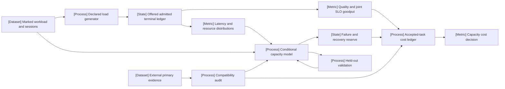

VOLUME II / PART VIII — INFERENCE ENGINES AND PRODUCTION SERVING / CHAPTER 48

# 48 — Capacity planning, benchmarking, and lifecycle economics

[DERIVED] Capacity and cost are defensible only for a declared offered workload, accepted-task contract, measurement population, physical execution domain and ownership horizon.

6 sections · 2 reference-stack implementation layers · prerequisites: 06, 21, 25, 42–47 · artifact: a workload-specific capacity/cost model (planned) · updated 2026-10-14

## Why this chapter exists

[DERIVED] A deployment decision joins several kinds of evidence. The model determines conditional work and quality; the runtime determines how requests share resources; the workload determines when and which work arrives; measurement determines which outcomes are visible; and accounting determines which costs are borne. A peak token rate or isolated endpoint median answers only a small part of that decision.

[DERIVED] The coupling is consequential. Client mix can change prompt/output demand during bursts. Caching depends on identity, locality and routing. A completion-paced test reduces offers when service slows. Successful-only latency can improve during an outage. Near saturation, small execution-model errors can cause large queue errors. A discounted resource can lower the bill while worsening strict tails. Each mechanism changes what a capacity or cost claim means.

[DERIVED] This chapter develops a chain of explicit contracts. Marked workloads feed a declared load process. Complete event ledgers produce accepted service and uncertainty. Conditional physical/queue models delimit capacity, including failure reserves. A nonoverlapping ownership ledger prices that service. External benchmark/data records enter only through a compatibility audit rather than an unsupported conversion into production guarantees.

[DERIVED] Current evidence includes the 2026 longitudinal workload study, MLPerf Inference v6.1 and the newly opened but still explicitly draft/WIP MLPerf Endpoints surface. Historical ServeGen, Vidur, wrk2 and SpotServe remain useful method/protocol evidence. Their disclosure and operating-domain limits are retained. Independent mathematical analysis rejects stronger conclusions than the evidence supports.

## Concept map



[DERIVED] Equivalent text structure:

- Marked workloads/sessions → declared load generator → complete offered/admitted/terminal ledger.
- Ledger → quality/joint-SLO goodput and latency/resource distributions.
- Workload plus resource/distribution evidence → conditional capacity model.
  - Capacity model → failure/recovery reserve.
  - Held-out validation feeds back to the model.
- Accepted service plus reserves → complete accepted-task cost ledger.
- External primary evidence → compatibility audit → bounded capacity/cost inputs.
- Validated capacity and complete cost → deployment decision.

## Position in the book

| Relation | Canonical destinations |
|---|---|
| Prerequisites | [Experimental design](../../../vol-01-learning-and-representation/part-01-scientific-foundations/ch06-experimental-design-and-evaluation-before-optimization/README.md), [scaling/allocation](../../../vol-01-learning-and-representation/part-04-training-science-and-adaptation/ch21-scaling-laws-and-compute-allocation/README.md), [hardware](../../part-05-hardware-kernels-and-distributed-execution/ch25-accelerators-memory-hierarchy-and-performance-models/README.md), [inference accounting](../../part-07-inference-algorithms-distillation-and-compression/ch42-prefill-decode-kv-state-and-inference-resource-models/README.md) |
| Siblings (same part) | [Runtime selection](../ch43-runtime-architecture-and-inference-engine-selection/README.md), [scheduling](../ch44-scheduling-distributed-serving-and-disaggregation/README.md), [device evaluation](../ch45-local-edge-and-heterogeneous-inference/README.md), [service control](../ch46-admission-control-routing-autoscaling-and-service-contracts/README.md), [observability](../ch47-observability-deployment-changes-and-incident-recovery/README.md) |
| Downstream | Task/evaluation-system chapters 61–63 consume the workload, acceptance, uncertainty and cost boundaries |
| Trades off with | Accepted quality, offered-task coverage, latency tails, failure resilience, resource occupancy and complete horizon cost |

## Sections

| Section | Title | Central mechanism | Evidence |
|---|---|---|---|
| [48.1](48-1-workload-specification.md) | Workload specification | Preserve marked arrivals, joint shape and session/cache dependencies | MATHEMATICALLY-DERIVED; PAPER-REPORTED |
| [48.2](48-2-load-test-methodology.md) | Load-test methodology | Distinguish intended offers, actual sends and completion feedback | MATHEMATICALLY-DERIVED; OFFICIAL-DOCUMENTATION |
| [48.3](48-3-metrics.md) | Metrics | Complete populations, joint goodput and tail uncertainty | MATHEMATICALLY-DERIVED; OFFICIAL-DOCUMENTATION |
| [48.4](48-4-queueing-and-capacity.md) | Queueing and capacity | Conditional mean laws, stateful simulation and failure reserves | MATHEMATICALLY-DERIVED; PAPER-REPORTED |
| [48.5](48-5-economics.md) | Economics | Nonoverlapping lifecycle/attempt cost over accepted tasks | MATHEMATICALLY-DERIVED; PAPER-REPORTED |
| [48.6](48-6-external-measurements.md) | External measurements | Audit model/endpoint/SUT and protocol compatibility | DERIVED; OFFICIAL-DOCUMENTATION |

## Artifact

[DERIVED] The proposed model in [verification.md](verification.md) retains immutable workload/runtime/measurement identity; intended/sent/admitted/terminal events; task/attempt/quality ancestry; cache/session state; resource inventory and calibrated execution surface; scheduler/failure model; held-out prediction residuals; dated ownership/cost records; and an external-evidence compatibility register. Every field has units, boundary and provenance. No model run or capacity experiment was performed.

[DERIVED] The artifact supports specific rejection diagnoses. Missing offers reject an open-loop claim; omitted failures reject the accepted population; unstable queues reject sustained capacity at that point; mispredicted local timings reject calibration; correct timings with wrong queues reject workload/scheduler assumptions; missing cost records produce a partial subtotal. This separates correctable model components from untestable headline optimism.


```figure
{
  "id": "fig-48.1",
  "kind": "cycle",
  "title": "Capacity calibration and falsification",
  "caption": "Held-out service errors return to workload, execution or scheduler assumptions; rejected operating points remain visible.",
  "placement": "inline",
  "evidence": "DERIVED",
  "source": "DERIVED:eq-48.6",
  "alt": "Workload and inventory lead to calibration, prediction, holdout and rejection/revision.",
  "spec": {
    "stages": [
      {
        "id": "w",
        "label": "Workload/inventory",
        "kind": "dataset"
      },
      {
        "id": "c",
        "label": "Calibration",
        "kind": "process"
      },
      {
        "id": "p",
        "label": "Predict service/cost",
        "kind": "metric"
      },
      {
        "id": "h",
        "label": "Holdout/failure audit",
        "kind": "process"
      },
      {
        "id": "r",
        "label": "Revise or reject",
        "kind": "feedback"
      }
    ],
    "edges": [
      {
        "from": "w",
        "to": "c"
      },
      {
        "from": "c",
        "to": "p"
      },
      {
        "from": "p",
        "to": "h"
      },
      {
        "from": "h",
        "to": "r"
      },
      {
        "from": "r",
        "to": "w",
        "kind": "feedback"
      },
      {
        "from": "r",
        "to": "c",
        "kind": "feedback"
      }
    ]
  }
}
```


## Verification

[DERIVED] The proposed study validates capacity predictions on held-out temporal/client traffic and reports the complete cost of meeting declared P95/P99 service constraints. It includes generator headroom, cache/context dependence, quality/failure cohorts, uncertainty and failure/recovery reserves. Training/preparation/idle/tool/network/storage/energy costs remain visible. The detailed topic audit maps every obligation to its canonical section and identifies empirical gaps.

## Lineage

- 1961 · Little's law · **conceptual ancestor**: [PAPER-REPORTED] stable mean population/time relation [R48.10].
- 2014 · wrk2 intended-time accounting · **engineering optimization**: [OFFICIAL-DOCUMENTATION] coordinated-omission-aware HTTP measurement [R48.4].
- 2019 · MLPerf Inference · **conceptual ancestor**: [PAPER-REPORTED] scenario-specific standardized SUT measurement [R48.8].
- 2024 · Vidur · **engineering optimization**: [PAPER-REPORTED] profiled discrete-event deployment search [R48.9].
- 2024 · SpotServe · **alternative branch**: [PAPER-REPORTED] preemptible-resource latency/cost frontier [R48.21].
- 2025 · ServeGen · **engineering optimization**: [PAPER-REPORTED] client-conditioned workload generation [R48.1].
- 2026 · Longitudinal workload study · **current frontier**: [PAPER-REPORTED] extended model/user/cache observation [R48.2].
- 2026 · MLPerf Endpoints/RAG · **current frontier**: [OFFICIAL-DOCUMENTATION] versioned endpoint and pipeline boundaries [R48.13/R48.15].


```figure
{
  "id": "fig-48.2",
  "kind": "lineage",
  "title": "Capacity evidence lineage",
  "caption": "Mean identities, demand-time measurement, workload simulation and endpoint/task benchmarking address different obligations.",
  "placement": "inline",
  "evidence": "DERIVED",
  "source": [
    "R48.10",
    "R48.4",
    "R48.8",
    "R48.9",
    "R48.21",
    "R48.1",
    "R48.2",
    "R48.13"
  ],
  "alt": "The lineage extends mean queue accounting through workload-aware and contemporary endpoint/task evaluation.",
  "spec": {
    "entries": [
      {
        "year": 1961,
        "work": "Little's law",
        "cite": "R48.10",
        "relation": "conceptual ancestor"
      },
      {
        "year": 2014,
        "work": "wrk2",
        "cite": "R48.4",
        "relation": "engineering optimization"
      },
      {
        "year": 2019,
        "work": "MLPerf Inference",
        "cite": "R48.8",
        "relation": "conceptual ancestor"
      },
      {
        "year": 2024,
        "work": "Vidur",
        "cite": "R48.9",
        "relation": "engineering optimization"
      },
      {
        "year": 2024,
        "work": "SpotServe",
        "cite": "R48.21",
        "relation": "alternative branch"
      },
      {
        "year": 2025,
        "work": "ServeGen",
        "cite": "R48.1",
        "relation": "engineering optimization"
      },
      {
        "year": 2026,
        "work": "Longitudinal workload",
        "cite": "R48.2",
        "relation": "current frontier"
      },
      {
        "year": 2026,
        "work": "Endpoints/RAG",
        "cite": "R48.13",
        "relation": "current frontier"
      }
    ]
  }
}
```


## Terms owned here

- **Marked workload contract** — offered events with model/task/length/session/cache identities; §48.1.
- **Intended-time latency** — terminal time minus intended offer, including send lag; §48.2.
- **Quality-and-SLO goodput** — unique accepted tasks per declared duration; §48.3.
- **Capacity validation domain** — workload/configuration/failure region supported by holdout evidence; §48.4.
- **Accepted-task cost ledger** — complete nonoverlapping charges over unique accepted tasks; §48.5.
- **External-evidence compatibility** — justified mapping of object/protocol/unit/boundary to target claims; §48.6.

## Reference-stack coverage

| Stack section | Entry | Stack layer | What this chapter takes from it | Surface used | Sections | Evidence |
|---|---|---|---|---|---|---|
| §3 discovery | #1 arXiv | — | Full-text workload/serving primary papers and revision identities | https://arxiv.org/ | 48.1, 48.4–48.6 | PAPER-REPORTED |
| §4 system | #41 vLLM | Inference engine | Dataset/load controls and pinned benchmark event/metric source | https://docs.vllm.ai/ | 48.1–48.5 | OFFICIAL-DOCUMENTATION |
| §4 system | #44 NVIDIA Triton Inference Server | Serving / portable runtime | GenAI-Perf inputs/load/metric definitions | https://docs.nvidia.com/triton-inference-server/ | 48.1–48.3, 48.5–48.6 | OFFICIAL-DOCUMENTATION |

[DERIVED] **Inspection dimensions applied:** Inference and Metrics (all sections); Memory/Communication/Kernels (48.1–48.4); Reliability (48.2–48.5); Reproducibility (all sections). Precision is held as an identity/quality factor; distributed mechanisms and training/post-training algorithms are canonical prerequisites.

| Outside the reference stack (routed via book_plan.md anchors) | Plan justification | Primary route | Sections | Evidence |
|---|---|---|---|---|
| MLPerf/MLCommons | Explicit Chapter 48 external measurement anchor | https://mlcommons.org/benchmarks/inference-datacenter/ ; pinned policies | 48.2–48.3, 48.6 | OFFICIAL-DOCUMENTATION |
| Artificial Analysis / Epoch | Explicit Chapter 48 methodology/data anchors; stack's current-measurement signals | https://artificialanalysis.ai/methodology ; https://epoch.ai/data | 48.6 | OFFICIAL-DOCUMENTATION |
| MLSys Vidur / ASPLOS SpotServe | Reproducible internal measurement and cost/capacity mechanisms | https://proceedings.mlsys.org/ ; https://github.com/Hsword/SpotServe | 48.4–48.5 | PAPER-REPORTED |
| wrk2 / Little's paper | Required coordinated-omission and Little-law foundations | https://github.com/giltene/wrk2 ; https://doi.org/10.1287/opre.9.3.383 | 48.2, 48.4 | OFFICIAL-DOCUMENTATION; PAPER-REPORTED |

[DERIVED] Discovery, endpoint measurement and model-development metadata are not used as originating architecture/optimization evidence. Current searches routed to full methods and protocols; unavailable/screened sources do not supply results.

## Source route

[DERIVED] Use the reference stack's originating-disclosure protocol (§1.1), archival workflow (§2.1), paper/revision cascade (§3.1) and implementation search (§4.3). MLCommons is an outside-stack first-party measurement route explicitly anchored by the plan. These queries recover sources already recorded in the chapter, without treating discovery results as measurements.

- §1.1, adapted to the plan's measurement anchor: site:mlcommons.org "MLPerf Inference" "v6.1" "2026"
- §2.1: site:proceedings.mlsys.org "Vidur"
- §3.1: site:arxiv.org "ServeGen" "Workload Characterization"
- §4.3: site:docs.vllm.ai "bench serve" "request-rate" "goodput"
- §4.3: site:docs.nvidia.com "GenAI-Perf" "Metrics" "request rate"
- §4.3, plan-anchored rules: site:github.com/mlcommons/endpoints_policies "endpoints_rules.md" "v1.0_rules_dev"

[DERIVED] Continue to the inspected [ServeGen v1](https://arxiv.org/html/2505.09999v1), [Vidur archival PDF](https://proceedings.mlsys.org/paper_files/paper/2024/file/b74a8de47d2b3c928360e0a011f48351-Paper-Conference.pdf), [vLLM benchmark interface](https://docs.vllm.ai/en/stable/cli/bench/serve/) and [MLPerf Endpoints documentation](https://docs.mlcommons.org/endpoints-submission-docs/). For external comparisons, use the recorded [Artificial Analysis methodology](https://artificialanalysis.ai/methodology) and [Epoch model-data documentation](https://epoch.ai/data/ai-models-documentation) rather than transferring endpoint or development metadata into an inference-capacity claim. [References](references.md) preserves the actual inspected revisions, draft policy status and missing execution.

## Status

[UNVERIFIED] All six planned topics have coherent manuscripts, bounded mathematical algorithms, executable figures and explicit claim limits. The chapter remains draft: no performance run, financial ledger, model simulation or independent reproduction was executed. Some source surfaces are mutable, and the inspected Endpoints policy remains draft/WIP. These gaps prevent reviewed status for stronger empirical deployment claims.
