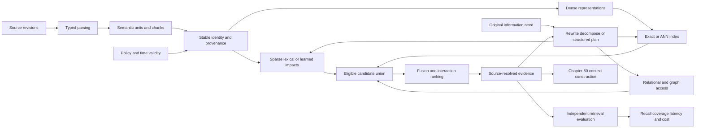

VOLUME III / PART IX — RETRIEVAL, CONTEXT, AND AGENT SYSTEMS / CHAPTER 49

# 49 — Retrieval models, indexing, and evidence access

[DERIVED] Retrieval is scientifically defensible when a versioned representation and search procedure return authorized, source-resolvable evidence whose relevance, completeness and service cost are evaluated independently of generation.

6 sections · 2 spine papers · 2 indexed implementations · prerequisites: 6–12, 18, 48 · artifact: versioned retrieval pipeline and recall/latency evaluation (planned) · updated 2026-10-14

## Why this chapter exists

[DERIVED] Retrieval connects a model to changing evidence, but the connection contains several lossy transformations. Parsing can omit a table relation. Chunking can split a definition from its qualification. An embedding can conflate related but incompatible claims. Approximate search can miss the best vector. Reranking can truncate the decisive span. A generated rewrite can drift away from the original need. Each stage changes a different object and requires a different diagnostic.

[DERIVED] The scientific task is to reconstruct those objects before comparing outcomes. A nearest-neighbor index approximates a metric; a relevance model estimates usefulness under a training and labeling policy; an evidence strategy tries to assemble sufficient source material. Authorization and temporal validity constrain all three. A high score does not make an inaccessible source eligible, and a correct generated answer does not establish that retrieval succeeded.

[DERIVED] The 2026 inspection includes source-traceable document parsing, instruction-aware multimodal retrieval/reranking and a controlled scientific-corpus comparison with direct source-paper metrics. Their results are useful within disclosed boundaries. Synthetic documents do not establish enterprise representativeness; expanded model/candidate budgets do not isolate architecture; answer-only judging cannot verify source faithfulness. Historical DPR, BM25, HNSW, rank fusion and late interaction remain mechanism foundations, with exact dates and implementation-specific limits retained.

## Concept map



[DERIVED] Text equivalent:

- Source revisions pass through typed parsing and semantic units/chunks into stable provenance.
  - Policy and time validity constrain that provenance and every returned representation.
  - Sparse lexical/learned-impact and dense-representation branches create candidates.
  - Dense representations pass through exact or approximate indexes.
- The original information need drives a bounded rewrite, decomposition or structured plan.
  - The plan can query sparse retrieval, vector indexes or relational/graph access.
  - All branches contribute to an eligible candidate union.
- The candidate union passes through fusion/interaction ranking to source-resolved evidence.
  - Evidence can inform a bounded next retrieval action or Chapter 50 context construction.
  - Independent retrieval evaluation joins recall/coverage to latency/cost.

[DERIVED] These arrows identify dependencies, not a universal pipeline or speed ranking. Sparse and dense retrieval are alternative or parallel branches. A graph summary can be an additional derived representation, but its source contributions and permissions remain part of its identity.

## Position in the book

| Relation | Canonical owner |
|---|---|
| Prerequisites | [6 evaluation](../../../vol-01-learning-and-representation/part-01-scientific-foundations/ch06-experimental-design-and-evaluation-before-optimization/README.md) |
| Data/interface prerequisites | [7 provenance](../../../vol-01-learning-and-representation/part-02-data-and-representation-engineering/ch07-data-provenance-acquisition-and-dataset-semantics/README.md); [8 cleaning/contamination](../../../vol-01-learning-and-representation/part-02-data-and-representation-engineering/ch08-cleaning-deduplication-privacy-filtering-and-contamination/README.md); [9 mixtures](../../../vol-01-learning-and-representation/part-02-data-and-representation-engineering/ch09-data-mixtures-curricula-and-sample-efficiency/README.md); [10 serialization](../../../vol-01-learning-and-representation/part-02-data-and-representation-engineering/ch10-tokenization-serialization-and-interface-correctness/README.md); [11 synthetic data](../../../vol-01-learning-and-representation/part-02-data-and-representation-engineering/ch11-synthetic-data-preferences-and-interactive-trajectories/README.md); [12 ingestion](../../../vol-01-learning-and-representation/part-02-data-and-representation-engineering/ch12-scalable-data-infrastructure-and-reproducible-ingestion/README.md) |
| Representation/system prerequisites | [18 multimodal primitives](../../../vol-01-learning-and-representation/part-03-model-architectures-and-state/ch18-multimodal-architectural-primitives/README.md); [48 capacity/economics](../../../vol-02-execution-and-optimization/part-08-inference-engines-and-production-serving/ch48-capacity-planning-benchmarking-and-lifecycle-economics/README.md) |
| Downstream | [50 context construction](../ch50-context-construction-and-retrieval-augmented-generation/README.md); [51 tools](../ch51-tool-use-protocol-interfaces-and-reliable-execution/README.md); [52 control](../ch52-planning-control-flow-verification-and-recovery/README.md); [53 memory](../ch53-agent-memory-persistent-state-and-long-horizon-consistency/README.md) |
| Siblings (same part) | [50 context construction](../ch50-context-construction-and-retrieval-augmented-generation/README.md); [51 tools](../ch51-tool-use-protocol-interfaces-and-reliable-execution/README.md); [52 control](../ch52-planning-control-flow-verification-and-recovery/README.md); [53 memory](../ch53-agent-memory-persistent-state-and-long-horizon-consistency/README.md); [54 coordination](../ch54-multi-agent-coordination-and-system-level-evaluation/README.md) |
| Trades off with | [49.3 candidate exploration and codec error](49-3-search-infrastructure.md#siblings); [49.4 ranking cost and evidence coverage](49-4-ranking-and-fusion.md#siblings); [50.5 retrieval versus context length](../ch50-context-construction-and-retrieval-augmented-generation/50-5-retrieval-versus-context-length.md) |
| Related owners | [55 document intelligence](../../part-10-multimodal-world-and-embodied-models/ch55-vision-language-models-and-document-intelligence/README.md); [63 system evaluation](../../part-11-evaluation-interpretability-and-deployment-assurance/ch63-agent-retrieval-multimodal-and-system-reliability-evaluation/README.md) |

[DERIVED] Chapter 49 owns evidence access and retrieval-only metrics. Chapter 50 owns context assembly, generation marginalization and grounding decisions; Chapter 52 owns general agent control/recovery. Detailed visual model architectures belong to Chapter 55. Shared prerequisites are linked rather than retaught as competing taxonomies.

## Sections

| Section | Mechanism | Exact primary locators |
|---|---|---|
| [49.1 Corpus construction](49-1-corpus-construction.md) | Typed units, source spans, chunk counts, stable IDs and policy | P39 §4.1; R49.1 §2.1/Appendices A,E,H; R49.20 §5.9 |
| [49.2 Retrieval representations](49-2-retrieval-representations.md) | BM25, sparse expansion, contrastive geometry, negatives and adaptation | R49.2 §3.4 Eqs. 3.10–3.15; P39 §3; R49.3 §§2–4; R49.17 §§2–5 |
| [49.3 Search infrastructure](49-3-search-infrastructure.md) | Exact/graph/list candidates, PQ, filtering, deletion and replication | R49.4 Algorithms 1–5/§4.2; R49.5 §§3–7; R49.19 exact source functions |
| [49.4 Ranking and fusion](49-4-ranking-and-fusion.md) | Score/rank fusion, cross-encoder and MaxSim interaction | R49.10 §1/Tables 1–3; R49.11 §2; R49.12 §4; R49.17 §6.4 |
| [49.5 Query and evidence strategy](49-5-query-and-evidence-strategy.md) | Hypotheses, decomposition, bounded hops, time and typed plans | R49.13 §3; R49.14 §§3–5; R49.15 §3; R49.20 §7.2 |
| [49.6 Retrieval evaluation](49-6-retrieval-evaluation.md) | Neighbor/relevance/coverage targets, freshness, leakage and cost | P39 §2; P40 §2.4; R49.16 §§3–5; R49.18 §§3–4 |

[DERIVED] Every section supplies a formal contract, method reconstruction, finite procedure, execution/resource boundary, source-reported protocol and four-part observations. The audit tracks each concept separately so one method's experiment cannot stand in for an unrelated variant.

[DERIVED] Three engineering choices recur across those mechanisms. More stored context can preserve dependencies while increasing encoding and search cost. Wider candidate exploration can improve metric recall while leaving relevance unchanged. More interaction compute can improve ranking while retaining the first stage's omissions. The chapter treats each choice as a conditional tradeoff with an identifiable object and measurement boundary, so an improvement can be localized instead of attributed to pipeline complexity alone.

## Artifact

[KNOWN] The planned artifact is **a versioned retrieval pipeline and recall/latency evaluation**. [Verification](verification.md#artifact-specification) specifies immutable source/ingestion/representation/index manifests, policy epochs, original/transformed queries, ranked IDs, exact-search diagnostics, independent relevance/facet labels and client-level cost/latency records.

[DERIVED] Its central join is a query plus evidence-unit revision. A model name and aggregate recall cannot identify stale content, changed chunks, missing branch results or unauthorized expansion. Retain rejected/absent evidence cases and undefined metric denominators alongside successful runs.

## Verification

[ASSUMED] The proposed protocols evaluate retrieval before generation, include deliberately missing and inaccessible evidence, separate exact-versus-ANN error from representation/ranking error, and replay updates/revocations under finite search budgets. They use independent acceptance labels and explicit cold/warm service boundaries.

[UNVERIFIED] No corpus, encoder, index, router or benchmark was executed. Proposed artifacts and thresholds are not source-reported outcomes.

## Lineage

| Year | Work | Relation | Changed primitive and limitation |
|---|---|---|---|
| 2009 | BM25 account / RRF [R49.2,R49.10] | conceptual ancestor | Saturating lexical weighting / rank aggregation; neither guarantees universal relevance |
| 2016 | HNSW [R49.4] | engineering optimization | Hierarchical graph exploration; original complexity conditions remain restricted |
| 2020 | DPR / RAG [P39,P40] | alternative branch | Learned passage geometry / generation-coupled retrieval; retrieval validity remains separate |
| 2021 | SPLADE v2 / ColBERTv2 revisions [R49.3,R49.12] | engineering optimization | Sparse impacts or residual-compressed token interaction with changed supervision |
| 2023 | HyDE / IRCoT [R49.13–14] | alternative branch | Generated query hypotheses / sequential evidence acquisition; intermediate error can propagate |
| 2024–2025 | Faiss report / GraphRAG revision [R49.5,R49.15] | engineering optimization | Compositional index analysis / graph-community summaries; metric and source claims stay distinct |
| 2026 | PureDocBench / Qwen3-VL / controlled corpus study [R49.1,R49.17–18] | current frontier | Source audits, multimodal relevance and direct target recovery with explicit confounds |

```figure
id: fig-49.1
kind: lineage
title: Evidence representations and retrieval control
caption: "These branches change different objects: corpus validity, relevance representation, search mechanics and evidence strategy."
placement: inline
evidence: PAPER-REPORTED
source: P39
alt: Lexical weighting and rank fusion precede graph search, learned passage retrieval, sparse or token interaction, generated hypotheses and 2026 source-aware evaluation.
spec:
  entries:
    - {year: 2009, work: BM25 and rank fusion, cite: R49.2, relation: conceptual ancestor}
    - {year: 2016, work: Hierarchical graph search, cite: R49.4, relation: engineering optimization}
    - {year: 2020, work: Dense passage retrieval, cite: P39, relation: alternative branch}
    - {year: 2021, work: Sparse expansion and token interaction, cite: R49.12, relation: engineering optimization}
    - {year: 2023, work: Hypothesis and iterative search, cite: R49.14, relation: alternative branch}
    - {year: 2026, work: Source-traceable parsing audit, cite: R49.1, relation: current frontier}
    - {year: 2026, work: Controlled retrieval evaluation, cite: R49.18, relation: current frontier}
```

```figure
id: fig-49.2
kind: cycle
title: Evidence acquisition and validation loop
caption: A finite next query uses source-validated observations while preserving original policy and need; exhaustion returns incomplete evidence.
placement: inline
evidence: DERIVED
source: DERIVED:eq-49.23
alt: Original constraints lead to a bounded query, eligible search, source validation and coverage assessment; an authorized next action repeats only within finite budgets.
spec:
  stages:
    - {id: need, label: Original need and policy, kind: state}
    - {id: plan, label: Bounded query or typed plan, kind: process}
    - {id: search, label: Eligible candidate search, kind: process}
    - {id: validate, label: Resolve source and revision, kind: state}
    - {id: assess, label: Assess evidence coverage, kind: metric}
    - {id: stop, label: Sufficient or incomplete result, kind: state}
  edges:
    - {from: need, to: plan}
    - {from: plan, to: search}
    - {from: search, to: validate}
    - {from: validate, to: assess}
    - {from: assess, to: plan, kind: feedback, label: finite authorized next action}
    - {from: assess, to: stop}
```

## Terms owned here

| Term | Definition | Owner |
|---|---|---|
| Evidence unit | Versioned content/structure with source spans, transform identity and policy | [49.1](49-1-corpus-construction.md#formulation) |
| Retrieval representation contract | Tokenization, pooling, normalization, dimensions, metric and model revision | [49.2](49-2-retrieval-representations.md#formulation) |
| Candidate-versus-codec error | Omitted search region versus distorted within-candidate comparison | [49.3](49-3-search-infrastructure.md#formulation) |
| Candidate-union ceiling | Evidence unavailable to a reranker because it never entered its candidates | [49.4](49-4-ranking-and-fusion.md#intuition) |
| Retrieval hypothesis | Generated search aid kept separate from source-bearing evidence | [49.5](49-5-query-and-evidence-strategy.md#formulation) |
| Evidence coverage | Independently required facets supported by returned authorized sources | [49.6](49-6-retrieval-evaluation.md#mechanism) |

## Reference-stack coverage

| Stack section | Entry | Stack layer | What this chapter takes from it | Surface used | Sections | Evidence label |
|---|---|---|---|---|---|---|
| §1 lab | #4 Meta AI / FAIR | — | DPR/RAG and originating Faiss report/source | https://github.com/facebookresearch | 1–4, 6 | PAPER-REPORTED / OFFICIAL-DOCUMENTATION |
| §1 lab | #5 Alibaba Qwen | — | 2026 multimodal embedding/reranking methods and tables | https://qwenlm.github.io/ ; https://github.com/QwenLM | 2, 4 | PAPER-REPORTED |
| §1 lab | #13 Microsoft Research / Microsoft AI | — | Originating BM25 account and GraphRAG revision | https://www.microsoft.com/research/publications/ ; https://github.com/microsoft | 2, 5 | PAPER-REPORTED |
| §2 conference | #4 ACL | — | HyDE/IRCoT archival cross-checks and licensed primary materials | https://aclanthology.org/venues/acl/ | 5 | PAPER-REPORTED |
| §2 conference | #6 EMNLP | — | DPR archival full paper | https://aclanthology.org/venues/emnlp/ | 1–2, 6 | PAPER-REPORTED |
| §3 discovery source | #1 arXiv | — | Fixed full-text revisions and 2026 study retrieval | https://arxiv.org/ ; https://arxiv.org/search/advanced | 1–6 | KNOWN |
| §3 discovery source | #5 ACL Anthology | — | Primary PDFs, archival metadata and reuse policy | https://aclanthology.org/ | 1–2, 4–5 | KNOWN |
| §4 system | #17 PyTorch | Model / autograd framework | Source-reported neural training/encoding paths | https://pytorch.org/docs/stable/ | 1–6 | PAPER-REPORTED |
| §4 system | #26 Hugging Face Transformers | Model definition / adaptation | Encoder/ranker model and tokenizer interfaces in inspected reports | https://huggingface.co/docs/transformers/ | 1–6 | PAPER-REPORTED |
| Outside the reference stack (routed via book_plan.md anchors) | Faiss; HNSW; SPLADE; ColBERT; sparse engines | Search/representation integration | DPR indexing anchor and explicit sparse/ANN/ranking coverage | R49.3–9,R49.12,R49.19 exact primary URLs | 2–4 | PAPER-REPORTED / OFFICIAL-DOCUMENTATION |
| Outside the reference stack (routed via book_plan.md anchors) | PureDocBench; BEIR; scientific-corpus comparison | Originating evaluation research | Corpus construction and retrieval-independent evaluation rows | R49.1,R49.16,R49.18 | 1, 6 | PAPER-REPORTED |
| Outside the reference stack (routed via book_plan.md anchors) | RRF/SIGIR; ColBERTv2/NAACL; PostgreSQL; HyDE/IRCoT/GraphRAG | Primary method/protocol routes | Ranking/fusion, structured access and query/evidence rows | R49.10,R49.12–15,R49.20 | 4–6 | PAPER-REPORTED / OFFICIAL-DOCUMENTATION |

**Inspection dimensions applied.** [KNOWN] **Memory**, **Communication**, **Inference**, **Metrics**, **Reliability** and **Reproducibility** span the pipeline. **Precision** and **Kernels** enter representation/codec and device boundaries; **Parallelism** enters batch search, shards and query breadth. **Checkpointing** means immutable corpus/index manifests and update snapshots here. **Post-training** is limited to retrieval/ranker adaptation, not generative policy optimization.

## Source route

[KNOWN] Apply §1.1 originating lab/publication/code retrieval, §2.1 topic→archival paper→supplement workflow, §3.1 preprint→proceedings→artifact cascade and §4.3 architecture/performance/compatibility/failure searches. Filled queries:

- site:ai.meta.com/results publication dense passage retrieval
- site:qwenlm.github.io Qwen3 VL embedding reranker 2026
- site:aclanthology.org retrieval hard negatives late interaction
- site:arxiv.org document parsing source traceable 2026
- site:github.com/facebookresearch/faiss index deletion direct map
- site:arxiv.org retrieval controlled comparison 2026 scientific corpus

[DERIVED] Discovery routes locate evidence; only the originating full methods/results or official source support attributed claims. The ledger records unavailable original-PQ retrieval separately from the successfully inspected Faiss author report and pinned codec source.

## Status

[KNOWN] **manuscript_draft**. All six sections contain full methods, 33 equations, six finite mathematical procedures and the complete concept audit. The source ledger records 23 works inspected on 2026-10-14, including two immutable source files at one Faiss commit.

[UNVERIFIED] No executable pipeline, current benchmark, ACL enforcement, index update or independent label audit occurred. The open questions concern filtered recall under drift, evidence sufficiency under incomplete judgments and adaptation/update tradeoffs. Structural checks and static source inspection support reviewability; they do not establish scientific replication or production reliability.
