VOLUME III / PART IX — RETRIEVAL, CONTEXT, AND AGENT SYSTEMS / CHAPTER 51

# 51 — Tool use, protocol interfaces, and reliable execution

[DERIVED] Reliable tool use requires a typed action proposal, independently enforced authority and state preconditions, and evidence of the actual environment outcome across uncertain delivery and partial effects.

6 sections · 1 spine paper · 0 numbered-stack implementations · prerequisites: 10–11, 37, 46–47, 50 · artifact: a typed tool-execution contract (planned) · updated 2026-10-14

## Why this chapter exists

[DERIVED] Function calling makes an operation easier to express but does not establish what it is allowed to do. A valid argument object can name the wrong resource, violate a policy, refer to stale state or trigger an irreversible effect. As a tool catalog grows, semantic retrieval and constrained generation become necessary mechanisms for reducing ambiguity, while the consequence of a wrong choice becomes greater than an incorrect sentence.

[DERIVED] The bottleneck then moves from producing parseable calls to maintaining evidence through an execution boundary. A client can lose a response after the server commits. A retry can duplicate an effect. A preview can become stale before approval, and a recovery action can fail or conflict with another actor. These are distributed-state problems that require explicit operation identity, commit observations and durable recovery records.

[DERIVED] The solution changes at several layers. Typed representations constrain syntax; grounded arguments constrain unsupported inference; independent authorization and commit-time checks constrain effects; operation journals preserve uncertainty across restart. Current protocol details matter because the July 2026 MCP revision uses request-scoped metadata and client-mediated input cycles rather than the older initialize/session model. External data remains untrusted even when it arrives in a conforming result. The chapter connects these mechanisms to task-level evaluation without promoting a successful demonstration or classifier score into a reliability or security guarantee.

## Concept map

```mermaid
flowchart LR
  T["[Dependency] User task and authority"] --> R["[Dataset] Versioned tool catalog"]
  R --> E["[Process] Trusted eligibility"]
  E --> S["[Process] Retrieve and select"]
  S --> A["[State] Grounded action proposal"]
  A --> V["[Process] Schema and semantic validation"]
  V --> G["[Boundary] Independent authority gate"]
  G --> P["[Flow] Request-scoped protocol"]
  P --> X["[Process] Bounded execution"]
  X --> C["[State] Commit or unknown outcome"]
  C --> J["[Memory] Durable operation journal"]
  J --> O["[Process] Reconcile or compensate"]
  X --> U["[Dataset] Untrusted result"]
  U --> F["[Process] Provenance and security checks"]
  F --> S
  O --> Q["[Metric] Verified task and policy outcome"]
```



[DERIVED] Text equivalent:

- User task and authority
  - Versioned tool catalog
  - Trusted eligibility
  - Retrieve and select
  - Grounded action proposal
- Validation and execution boundary
  - Schema and semantic validation
  - Independent authority gate
  - Request-scoped protocol
  - Bounded execution
- Effect knowledge and recovery
  - Commit or unknown outcome
  - Durable operation journal
  - Reconcile or compensate
  - Verified task and policy outcome
- Observation feedback
  - Untrusted result
  - Provenance and security checks
  - Return permitted data to retrieve/select

## Position in the book

| Relation | Chapters |
|---|---|
| Prerequisites | [10: Tokenization, serialization, and interface correctness](../../../vol-01-learning-and-representation/part-02-data-and-representation-engineering/ch10-tokenization-serialization-and-interface-correctness/README.md) · [11: Synthetic data, preferences, and interactive trajectories](../../../vol-01-learning-and-representation/part-02-data-and-representation-engineering/ch11-synthetic-data-preferences-and-interactive-trajectories/README.md) · [37: Decoding, constrained generation, and speculative execution](../../../vol-02-execution-and-optimization/part-07-inference-algorithms-distillation-and-compression/ch37-decoding-constrained-generation-and-speculative-execution/README.md) · [46: Admission control, routing, autoscaling, and service contracts](../../../vol-02-execution-and-optimization/part-08-inference-engines-and-production-serving/ch46-admission-control-routing-autoscaling-and-service-contracts/README.md) · [47: Observability, deployment changes, and incident recovery](../../../vol-02-execution-and-optimization/part-08-inference-engines-and-production-serving/ch47-observability-deployment-changes-and-incident-recovery/README.md) · [50: Context construction and retrieval-augmented generation](../ch50-context-construction-and-retrieval-augmented-generation/README.md) |
| Siblings (same part) | [49: Retrieval models, indexing, and evidence access](../ch49-retrieval-models-indexing-and-evidence-access/README.md) · [50: Context construction and retrieval-augmented generation](../ch50-context-construction-and-retrieval-augmented-generation/README.md) · [52: Planning, control flow, verification, and recovery](../ch52-planning-control-flow-verification-and-recovery/README.md) · [53: Agent memory, persistent state, and long-horizon consistency](../ch53-agent-memory-persistent-state-and-long-horizon-consistency/README.md) · [54: Multi-agent coordination and system-level evaluation](../ch54-multi-agent-coordination-and-system-level-evaluation/README.md) |
| Downstream | [52: Planning, control flow, verification, and recovery](../ch52-planning-control-flow-verification-and-recovery/README.md) · [53: Agent memory, persistent state, and long-horizon consistency](../ch53-agent-memory-persistent-state-and-long-horizon-consistency/README.md) · [54: Multi-agent coordination and system-level evaluation](../ch54-multi-agent-coordination-and-system-level-evaluation/README.md) · [65: Security, privacy, safety, and adversarial robustness](../../part-11-evaluation-interpretability-and-deployment-assurance/ch65-security-privacy-safety-and-adversarial-robustness/README.md) |
| Trades off with | [48: Capacity planning, benchmarking, and lifecycle economics](../../../vol-02-execution-and-optimization/part-08-inference-engines-and-production-serving/ch48-capacity-planning-benchmarking-and-lifecycle-economics/README.md); [50: Context construction and retrieval-augmented generation](../ch50-context-construction-and-retrieval-augmented-generation/README.md) |


## Sections

| Section | Title | What changes here | Evidence |
|---|---|---|---|
| [51.1](51-1-tool-representation.md) | Tool representation | Syntax becomes an explicit semantic/authority contract | DERIVED; OFFICIAL-DOCUMENTATION; PAPER-REPORTED |
| [51.2](51-2-routing-and-selection.md) | Routing and selection | Eligible coverage and grounded arguments constrain selection | MATHEMATICALLY-DERIVED; PAPER-REPORTED |
| [51.3](51-3-protocol-boundaries.md) | Protocol boundaries | Modern MCP requests replace legacy session assumptions | OFFICIAL-DOCUMENTATION; DERIVED |
| [51.4](51-4-execution-correctness.md) | Execution correctness | Unknown delivery and durable attempt budgets govern retries | MATHEMATICALLY-DERIVED; PAPER-REPORTED |
| [51.5](51-5-side-effect-management.md) | Side-effect management | Reviewed proposals bind to commit and partial-effect recovery | DERIVED; PAPER-REPORTED |
| [51.6](51-6-tool-security.md) | Tool security | Untrusted data cannot mint authority; utility remains measured | MATHEMATICALLY-DERIVED; PAPER-REPORTED |

## Artifact

[DERIVED] The typed tool-execution contract contains: qualified operation identity/revision; input/output languages; argument provenance; semantic preconditions; principal/resource authorization; effect/postcondition/status semantics; logical-operation and attempt identities; durable attempt/deadline limits; deduplication and reconciliation scope; proposal/approval binding; commit/compensation journal; transport era/revision/capabilities; secret-aware provenance/audit policy; task and trajectory acceptance rules.

[DERIVED] Its explanatory execution cycle prepares, gates, dispatches, observes and reconciles. Unknown outcomes remain unknown until authoritative evidence resolves them. Recovery consumes the same persisted budget and authority discipline as initial execution.


```figure
{
  "id": "fig-51.1",
  "kind": "cycle",
  "title": "Tool execution and effect knowledge",
  "caption": "Unknown outcomes return to bounded reconciliation; another attempt preserves logical identity and durable budget.",
  "placement": "inline",
  "evidence": "DERIVED",
  "source": "DERIVED:eq-51.8",
  "alt": "Prepare and gate, reserve and dispatch, classify the outcome, reconcile unknowns, then stop or safely continue.",
  "spec": {
    "stages": [
      {
        "id": "p",
        "label": "Prepare and gate",
        "kind": "process"
      },
      {
        "id": "d",
        "label": "Persist and dispatch",
        "kind": "memory"
      },
      {
        "id": "o",
        "label": "Observe outcome",
        "kind": "state"
      },
      {
        "id": "r",
        "label": "Reconcile unknown",
        "kind": "feedback"
      },
      {
        "id": "s",
        "label": "Verified stop/continue",
        "kind": "branch"
      }
    ],
    "edges": [
      {
        "from": "p",
        "to": "d"
      },
      {
        "from": "d",
        "to": "o"
      },
      {
        "from": "o",
        "to": "r"
      },
      {
        "from": "r",
        "to": "s"
      },
      {
        "from": "s",
        "to": "p",
        "kind": "feedback"
      }
    ]
  }
}
```

## Verification

[DERIVED] The proposed study tests duplicate delivery, timeout/response loss, malformed outputs, cancellation races, restart, stale approval and partial effects against a state-owning fixture. It separately tests unauthorized handles/resources and injected results. Acceptance requires matching the intended effect and policy path with complete event/journal evidence; protocol access is never counted as authorization. The full topic/obligation audit and proposed experiment are in [verification](verification.md).

## Lineage

- 1987 · Sagas · **conceptual ancestor**: [PAPER-REPORTED] explicit subtransaction/compensation recovery [R51.19].
- 2020 · JSON Schema 2020-12 · **engineering optimization**: [OFFICIAL-DOCUMENTATION] structural validation vocabulary [R51.3].
- 2023 · Toolformer · **alternative branch**: [PAPER-REPORTED] predictive-usefulness learning for calls [R51.4].
- 2023 · ToolLLM · **engineering optimization**: [PAPER-REPORTED] API retrieval and tool-use traces [R51.6].
- 2024 · τ-bench · **conceptual ancestor**: [PAPER-REPORTED] repeated environment-outcome evaluation [P43].
- 2024 · InjecAgent/AgentDojo · **alternative branch**: [PAPER-REPORTED] untrusted-result attack evaluation [R51.21/R51.22].
- 2025 · τ²-bench · **engineering optimization**: [PAPER-REPORTED] dual control and final-state assertions [R51.8].
- 2026 · MCP 2026-07-28 · **current frontier**: [OFFICIAL-DOCUMENTATION] per-request protocol semantics [R51.9–R51.15].
- 2026 · Detector transfer audit · **current frontier**: [PAPER-REPORTED] tool-format, false-block and overlap analysis [R51.23].


```figure
{
  "id": "fig-51.2",
  "kind": "lineage",
  "title": "Tool contract and evaluation lineage",
  "caption": "Transaction recovery, learned calling, stateful evaluation and modern protocol/security audits address distinct obligations.",
  "placement": "inline",
  "evidence": "DERIVED",
  "source": [
    "R51.19",
    "R51.3",
    "R51.4",
    "R51.6",
    "P43",
    "R51.22",
    "R51.8",
    "R51.9",
    "R51.23"
  ],
  "alt": "A lineage from saga recovery and typed validation through learned tool use to 2026 protocol and detector audits.",
  "spec": {
    "entries": [
      {
        "year": 1987,
        "work": "Sagas",
        "cite": "R51.19",
        "relation": "conceptual ancestor"
      },
      {
        "year": 2020,
        "work": "JSON Schema",
        "cite": "R51.3",
        "relation": "engineering optimization"
      },
      {
        "year": 2023,
        "work": "Toolformer",
        "cite": "R51.4",
        "relation": "alternative branch"
      },
      {
        "year": 2023,
        "work": "ToolLLM",
        "cite": "R51.6",
        "relation": "engineering optimization"
      },
      {
        "year": 2024,
        "work": "τ-bench",
        "cite": "P43",
        "relation": "conceptual ancestor"
      },
      {
        "year": 2024,
        "work": "AgentDojo/InjecAgent",
        "cite": "R51.22",
        "relation": "alternative branch"
      },
      {
        "year": 2025,
        "work": "τ²-bench",
        "cite": "R51.8",
        "relation": "engineering optimization"
      },
      {
        "year": 2026,
        "work": "Modern MCP",
        "cite": "R51.9",
        "relation": "current frontier"
      },
      {
        "year": 2026,
        "work": "Detector transfer audit",
        "cite": "R51.23",
        "relation": "current frontier"
      }
    ]
  }
}
```

## Terms owned here

[DERIVED] The following terms are owned here. General schema-constrained decoding belongs to Chapter 37, retrieval to Chapter 49, controller planning/recovery to Chapter 52 and persistent memory/state to Chapter 53.

| Term | Definition | Owning section |
|---|---|---|
| Tool-execution contract | The qualified operation's input/output, authority, precondition, effect and recovery obligations | [51.1](51-1-tool-representation.md#formulation) |
| Tool argument provenance | The recorded evidence and transformation that justify an argument value | [51.1](51-1-tool-representation.md#mechanism) |
| Eligible tool routing | Selection from the trusted admissible catalog, with retrieval coverage distinct from final correctness | [51.2](51-2-routing-and-selection.md#formulation) |
| Tool protocol boundary | The revision-specific message and transport contract between client and server | [51.3](51-3-protocol-boundaries.md#formulation) |
| Logical operation versus delivery attempt | One immutable intended operation may have multiple separately budgeted delivery attempts | [51.4](51-4-execution-correctness.md#formulation) |
| Unresolved tool outcome | Available evidence establishes neither committed effect nor confirmed absence | [51.4](51-4-execution-correctness.md#mechanism) |
| Proposal-bound approval | Authorization binds a principal, exact proposed payload, relevant state revision and allowed effect | [51.5](51-5-side-effect-management.md#formulation) |
| Tool-effect compensation | An authorized recovery effect with its own preconditions and failure semantics, rather than an assumed inverse | [51.5](51-5-side-effect-management.md#mechanism) |
| Tool-result trust boundary | Returned data can supply observations but cannot grant authority or rewrite trusted execution policy | [51.6](51-6-tool-security.md#formulation) |

## Reference-stack coverage

| Stack section | Entry | Stack layer | What this chapter takes from it | Surface used | Sections | Evidence label |
|---|---|---|---|---|---|---|
| §1 lab | #4 Meta AI / FAIR | Not applicable | Toolformer learned-call sampling, execution and weighted-loss filtering [R51.4] | [Papers](https://ai.meta.com/results/?content_types%5B0%5D=publication); primary revision in [references](references.md) | 51.1–51.2 | PAPER-REPORTED |
| §1 lab | #43 Tsinghua AIR / KEG | Not applicable | ToolLLM catalog/retrieval and controlled comparison [R51.6] | [Papers](https://air.tsinghua.edu.cn/en/); primary revision in [references](references.md) | 51.1–51.2 | PAPER-REPORTED |
| §3 discovery source | #1 arXiv | Not applicable | Locate exact originating paper revisions; the index establishes no method/result claim | [Home](https://arxiv.org/); [search/API](https://arxiv.org/search/advanced) | 51.1–51.2, 51.4–51.6 | UNVERIFIED for discovery-only snippets; primary texts separately PAPER-REPORTED |

**Outside the reference stack (routed via book_plan.md anchors).**

| Plan source anchor | Sources and mechanism | Primary surface | Sections | Evidence label |
|---|---|---|---|---|
| MCP and tool-use system documentation | Modern MCP tools/schema/discovery/versioning/transports, input cycles, authorization, cancellation, security and licensing [R51.1–R51.2, R51.7, R51.9–R51.17, R51.20, R51.24]; Tasks remains a separate draft extension | [Versioned MCP specification](https://modelcontextprotocol.io/specification/2026-07-28/basic/versioning); exact pages and immutable schema pin in [references](references.md) | 51.1–51.6 | OFFICIAL-DOCUMENTATION |
| Typed interfaces and execution correctness | JSON Schema structural assertions [R51.3]; HTTP method/idempotency semantics [R51.18] | [JSON Schema](https://json-schema.org/draft/2020-12/json-schema-validation); exact RFC record in [references](references.md) | 51.1, 51.3–51.5 | OFFICIAL-DOCUMENTATION |
| Reliable execution and agent/tool evaluation | Saga compensation [R51.19]; environment outcomes in τ-bench/τ²-bench [P43, R51.8] | Originating full texts in [references](references.md) | 51.4–51.5 | PAPER-REPORTED |
| Tool security and adversarial evaluation | InjecAgent, AgentDojo and the 2026 detector-transfer audit [R51.21–R51.23] | Originating full texts and protocol locators in [references](references.md) | 51.6 | PAPER-REPORTED |

[DERIVED] MCP is an explicitly plan-anchored protocol interface, outside the numbered system taxonomy. JSON Schema and HTTP semantics supply primary interface foundations. Sierra's τ benchmarks, AgentDojo/InjecAgent and the JAIST detector study are relevant primary evaluation sources outside the top-50 lab list; their inclusion follows the chapter's task rather than an organizational ranking. The schema source is pinned; no SDK interoperability or model execution is asserted.

[DERIVED] **Inspection dimensions applied.** Inference covers typed selection and protocol execution (§§51.1–51.3); Memory and Communication cover durable journals, request/response and external-effect boundaries (§§51.3–51.5); Metrics covers task populations, repeated success and false blocks (§§51.4, 51.6); Reliability and Reproducibility cover authority, state ownership, pinned revisions, timeout/retry budgets and fault protocols (§§51.1–51.6). GPU Kernels, training Parallelism, optimizer Precision, training Checkpointing and Post-training are not mechanisms owned here; model compute follows Chapters 25/42, persistent memory Chapter 53 and accepted-task economics Chapter 48. No numbered §4 system is invented for an unlisted tool adapter.

## Source route

[DERIVED] Apply the stack's lab protocol (§1.1), proceedings workflow (§2.1) and paper cascade (§3.1), then inspect the primary method, experiment and revision listed in [references](references.md). These filled queries are retrieval routes, not evidence that every result is eligible:

- `site:ai.meta.com/results publication "tool use" OR site:arxiv.org/abs "Meta AI" "tool use"`
- `site:arxiv.org/abs ("Tsinghua" OR "THUDM" OR "KEG") "ToolLLM"`
- `site:papers.nips.cc "Toolformer"`
- `site:arxiv.org/abs "tau-bench"`
- `site:arxiv.org/abs "Passing the Test You Trained On"`
- `site:modelcontextprotocol.io/specification/2026-07-28 "authorization"`

[OFFICIAL-DOCUMENTATION] For the plan-anchored protocol route, follow the versioned pages to the schema commit recorded in the ledger; revision-named website pages remain mutable. The §4.3 implementation-search protocol is applied to that official schema/repository surface without assigning it a nonexistent numbered stack entry. No search snippet establishes execution or interoperability.

## Status

[OFFICIAL-DOCUMENTATION] The source ledger records actual inspection on 2026-10-14, including MCP revision 2026-07-28 and schema commit 5ea996028df322ce97d1c906731cf8c05a6e268e. Website pages remain mutable even when revision-named; schema source is immutable. The Tasks material is a separate Draft extension. The project license transition is recorded without copying specification prose [R51.24].

[UNVERIFIED] All nine files are manuscript_draft. No tool server, model, authorization flow, fault injection, detector or sandbox was executed. Mathematical derivations and static source inspection support only their stated domains. The next review must execute the bounded contract against pinned fixtures and preserve unknown/partial effects.
