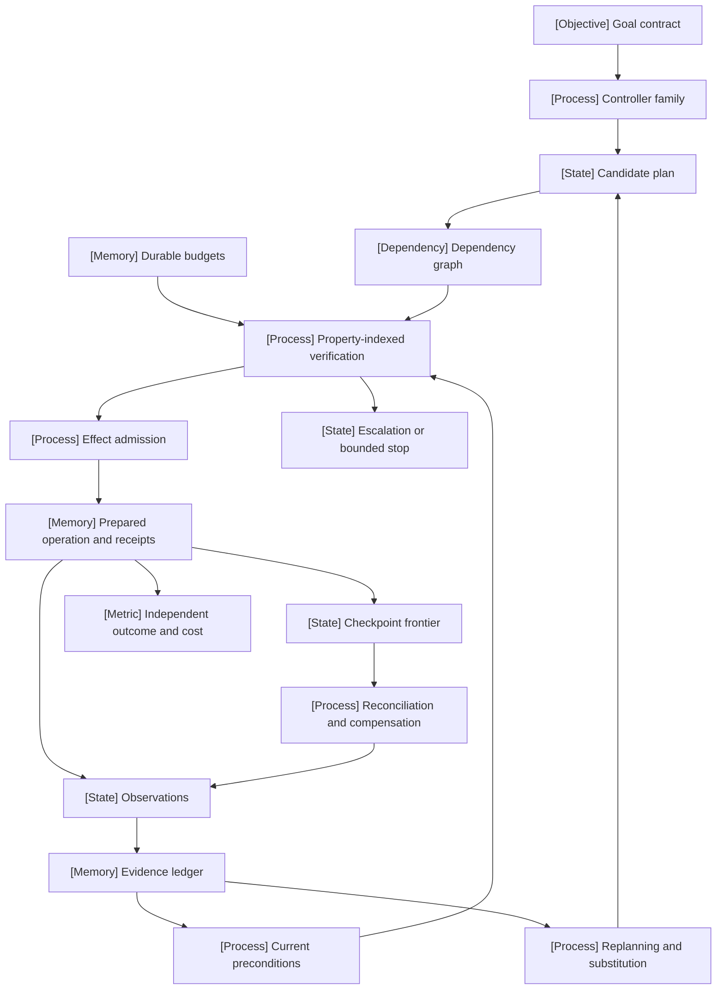

VOLUME III / PART IX — RETRIEVAL, CONTEXT, AND AGENT SYSTEMS / CHAPTER 52

# 52 — Planning, control flow, verification, and recovery

A scientifically defensible agent controller separates proposed plans, supported execution conditions and independently established effects within a durable finite resource envelope.

6 sections · 2 spine papers · 0 indexed implementations · prerequisites: 36, 38, 50–51 · artifact: a bounded agent controller with explicit state transitions (planned) · updated 2026-10-14

## Why this chapter exists

[DERIVED] A tool-capable model can generate an apparently coherent sequence while omitting a dependency, using a stale value or claiming an external effect that never occurred. Adding a reasoning loop exposes observations but also introduces repeated calls and unbounded continuation. Adding a planner moves decisions earlier, where future observations are unavailable. Adding search introduces branches whose effects must remain simulated until a chosen action is committed. The bottleneck is therefore the coupling of inference to state and effect semantics.

[DERIVED] Partial execution makes this problem harder. An agent can fail after a reservation has committed and before its receipt is saved. Replaying the prompt does not restore the world. A reliable controller needs persistent operation identity, a current evidence ledger, an explicit effect frontier and a bounded reconciliation path. Some external systems cannot provide safe replay or complete compensation; an honest terminal ambiguity is then part of the contract.

[PAPER-REPORTED] Historical ReAct, ReWOO, Reflexion and LATS studies investigate different feedback/computation structures [P41, §2; R52.4–5, methods; R52.10, §3]. The 2026 ToolMaze and PlanBench-XL preprints expose controlled faults and alternative paths, while retaining synthetic-world boundaries [R52.2, §3; R52.1, §3]. [DERIVED] The solution is not a universal architectural winner. It is a controller whose admissibility, verification and recovery claims can be inspected separately from model fluency and whose performance metrics preserve their denominators.

## Concept map



Text equivalent, preserving the same nodes:

- Goal contract
  - Controller family
    - Candidate plan
      - Dependency graph
      - Property-indexed verification
        - Effect admission
          - Prepared operation and receipts
            - Observations
              - Evidence ledger
                - Current preconditions
                - Replanning and substitution, returning to candidate plan
            - Checkpoint frontier
              - Reconciliation and compensation, returning to observations
            - Independent outcome and cost
        - Escalation or bounded stop
  - Durable budgets, constraining property-indexed verification

[DERIVED] Read the graph as information and control dependencies, not a promise that all checks execute in one serial pipeline. Evidence may be refreshed without an effect. Several checks can run independently. A rejected or unresolved required property blocks dispatch; a post-effect outcome check still follows an admitted operation. Recovery feeds actual receipts into the next decision rather than replacing them with a regenerated narrative.

## Position in the book

| Relation | Canonical connection |
|---|---|
| Prerequisites | [Agent RL and rollouts](../../../vol-02-execution-and-optimization/part-06-post-training-and-reinforcement-learning/ch36-agent-rl-and-distributed-rollout-systems/README.md); [inference-time search](../../../vol-02-execution-and-optimization/part-07-inference-algorithms-distillation-and-compression/ch38-inference-time-reasoning-search-and-adaptive-compute/README.md); [context construction](../ch50-context-construction-and-retrieval-augmented-generation/README.md); [tool execution](../ch51-tool-use-protocol-interfaces-and-reliable-execution/README.md) |
| Siblings (same part) | [Retrieval](../ch49-retrieval-models-indexing-and-evidence-access/README.md); [memory](../ch53-agent-memory-persistent-state-and-long-horizon-consistency/README.md); [coordination](../ch54-multi-agent-coordination-and-system-level-evaluation/README.md) |
| Downstream | [Persistent consistency](../ch53-agent-memory-persistent-state-and-long-horizon-consistency/README.md); [system evaluation](../../part-11-evaluation-interpretability-and-deployment-assurance/ch63-agent-retrieval-multimodal-and-system-reliability-evaluation/README.md) |
| Trades off with | [Service deadlines/retries](../../../vol-02-execution-and-optimization/part-08-inference-engines-and-production-serving/ch46-admission-control-routing-autoscaling-and-service-contracts/README.md); [deployment recovery/fencing](../../../vol-02-execution-and-optimization/part-08-inference-engines-and-production-serving/ch47-observability-deployment-changes-and-incident-recovery/README.md); [lifecycle economics](../../../vol-02-execution-and-optimization/part-08-inference-engines-and-production-serving/ch48-capacity-planning-benchmarking-and-lifecycle-economics/README.md) |

[DERIVED] Chapter 38 owns general inference-time search and verifier alternatives. This chapter reconstructs their integration with external actions. Chapter 51 owns tool protocols and repeat safety; Chapter 52 decides when a validated operation belongs in a task continuation. Chapter 53 owns cross-session memory policy. A controller checkpoint is discussed here only to establish what must be recoverable for correct execution.

## Sections

| Section | Title | What changes here | Primary evidence labels | Exact primary locator |
|---|---|---|---|---|
| [52.1](52-1-controller-families.md) | Controller families | Feedback timing and branching determine proposal structure and cost | PAPER-REPORTED; DERIVED | P41 §2; R52.5 §§2–3/Table 2; R52.4 §4/Table 3 |
| [52.2](52-2-state-and-constraints.md) | State and constraints | Hidden state, current evidence and durable caps constrain admission | MATHEMATICALLY-DERIVED; PAPER-REPORTED | R52.6 §3.3/p.107; P43 §3/Table 3 |
| [52.3](52-3-plan-verification.md) | Plan verification | Property-specific checks replace an unqualified verified flag | PAPER-REPORTED; OFFICIAL-DOCUMENTATION | R52.8 §3; R52.9 Basic Commands; R52.10 §4.3/Tables 1–3 |
| [52.4](52-4-adaptive-execution.md) | Adaptive execution | Evidence deltas invalidate and repair a bounded continuation | PAPER-REPORTED; DERIVED | R52.10 §3; R52.4 Table 8; R52.2 §4.2/Table 2 |
| [52.5](52-5-recovery.md) | Recovery | Effect reconciliation and compensation preserve truthful partial state | PAPER-REPORTED; OFFICIAL-DOCUMENTATION | R52.15 §§1,4–5,8; R52.13 Resuming interrupts |
| [52.6](52-6-performance-analysis.md) | Performance analysis | Denominators and total attempts determine the comparison | MATHEMATICALLY-DERIVED; PAPER-REPORTED | P43 §3/Tables 1–2/Figure 4; R52.2 §3.5/Eqs.1–4 |

[DERIVED] The manuscript distinguishes conditional formal results from engineering synthesis. Bayesian updates require a model and a positive normalizer. Solver transfer requires a faithful abstraction and nonblocking executions. Finite counters require persistent ownership and bounded waits. These conditions are part of each result, so the reader can identify which premise an implementation or benchmark has actually established.

## Artifact

[DERIVED] The [artifact specification](verification.md#artifact-specification) defines a bounded controller with five inspectable record groups: goal/policy manifest, versioned plan and dependencies, evidence/claim ledger, durable resource/effect ledger, and terminal verification/measurement record. Every operation has an exact identity and payload before dispatch. Every claim has provenance. Every status distinguishes rejected, unsupported, ambiguous and verified outcomes.

[DERIVED] The artifact is deliberately controller-level. It can call an inference engine or tool transport but does not inherit their correctness from an API name. Its interfaces declare timeouts, ownership epochs, authorization, output tolerances and cleanup allowances. A runnable reference would need these contracts connected to specific sinks and stores; this edition supplies the specification and mathematical procedures, with static source inspection clearly separated from execution.

## Verification

[ASSUMED] The [proposed verification protocol](verification.md#verification-task) compares a fixed workflow, reactive controller and planner using the same tools, task states, effect permissions and total resource envelope. It injects changing state, explicit failures, schema-valid wrong observations and crash/timeout ambiguity. Independent outcome checks and all-attempt accounting determine success, cost and fault sensitivity.

[DERIVED] The central claim is falsifiable at the interface boundary: if the artifact can dispatch after a failed reservation, reset a logical budget on resume, accept a required unknown verification result, duplicate an effect through replay or publish unsupported completion, its claimed bounded and auditable execution contract fails. Benchmark quality differences are secondary to these invariants. No proposed experiment is presented as a book result.

## Lineage

| Year · work · relation | Mechanism change and surviving limitation |
|---|---|
| 1987 · Sagas · conceptual ancestor | Semantic compensation for partial committed execution; no global time reversal [R52.15, §1] |
| 1998 · POMDP state estimation · conceptual ancestor | Belief-conditioned control; requires a suitable world model [R52.6, §§3.1–3.3] |
| 2003 · PDDL2.1 · conceptual ancestor | Explicit temporal/numeric conditions; model fidelity remains external [R52.7, §§4–5] |
| 2023 · ReAct · conceptual ancestor | Interleaves internal reasoning and observations [P41, §2] |
| 2023 · ReWOO · engineering optimization | Separates plan/work/solve and reduces reported input repetition [R52.5, §2] |
| 2023 · Reflexion · alternative branch | Conditions later trials on verbal feedback without weight updates [R52.10, §3] |
| 2024 · LATS · alternative branch | Adds evaluated branching and reflection in resettable environments [R52.4, §4] |
| 2026 · ToolMaze and PlanBench-XL · current frontier | Controlled tool faults and alternatives; synthetic modeled-world scope [R52.1–2, §3] |

[DERIVED] This lineage records changes in mechanism rather than a sequence of universally improving agents. ReWOO's lower tokens coexist with lower exact match in the cited case. Search adds computation and evaluator dependence. Fault benchmarks improve diagnosis while leaving real effect recovery unmeasured. The historical state/control and transaction foundations remain relevant because a newer model does not remove their assumptions.

```figure
id: fig-52.1
kind: lineage
title: "Controller and recovery mechanism lineage"
caption: "Branches change feedback and effect handling rather than forming one universal quality ranking. Historical model and transaction assumptions remain explicit in the 2026 comparison."
placement: inline
evidence: PAPER-REPORTED
source: [R52.15, R52.6, P41, R52.5, R52.10, R52.4, R52.2]
alt: "Sagas and POMDPs precede ReAct, ReWOO, Reflexion and LATS; 2026 ToolMaze examines fault-conditioned behavior within simulated tool worlds."
spec:
  entries:
    - {year: 1987, work: "Sagas", cite: R52.15, relation: conceptual ancestor}
    - {year: 1998, work: "POMDP state estimation", cite: R52.6, relation: conceptual ancestor}
    - {year: 2023, work: "ReAct", cite: P41, relation: conceptual ancestor}
    - {year: 2023, work: "ReWOO", cite: R52.5, relation: engineering optimization}
    - {year: 2023, work: "Reflexion", cite: R52.10, relation: alternative branch}
    - {year: 2024, work: "LATS", cite: R52.4, relation: alternative branch}
    - {year: 2026, work: "ToolMaze", cite: R52.2, relation: current frontier}
```

```figure
id: fig-52.2
kind: cycle
title: "Evidence, effects and bounded controller feedback"
caption: "Observations update evidence before another proposal. Failure routes through reconciliation or repair; completion requires a separate outcome check and a finite terminal branch."
placement: inline
evidence: DERIVED
source: DERIVED:eq-52.1
alt: "Evidence feeds proposal, verification, reserved execution and receipt recording. Receipts return to evidence; discrepancies trigger bounded repair or reconciliation, while independent checks determine terminal completion."
spec:
  stages:
    - {id: evidence, label: "Evidence and current constraints", kind: memory}
    - {id: proposal, label: "Bounded proposal", kind: process}
    - {id: verify, label: "Property-indexed verification", kind: process}
    - {id: effect, label: "Reserved effect execution", kind: process}
    - {id: receipt, label: "Receipts and independent outcome", kind: metric}
    - {id: repair, label: "Repair / reconcile / terminal stop", kind: branch}
  edges:
    - {from: evidence, to: proposal}
    - {from: proposal, to: verify}
    - {from: verify, to: effect}
    - {from: effect, to: receipt}
    - {from: receipt, to: evidence, kind: feedback, label: "validated observations"}
    - {from: verify, to: repair, kind: feedback, label: "unsupported required property"}
    - {from: receipt, to: repair, kind: feedback, label: "discrepancy / ambiguity"}
    - {from: repair, to: evidence, kind: feedback, label: "bounded refreshed state"}
```

## Terms owned here

| Term | Definition | Owner |
|---|---|---|
| Controller family | Structure that determines how proposals depend on observations and decomposition/search state | 52.1 |
| Property-indexed verification verdict | Separate supported, failed or unresolved result for each required plan property | 52.3 |
| Plan repair closure | Changed-premise nodes and their downstream evidence dependencies | 52.4 |
| Effect frontier | Dependency-consistent set of established operations/results with their receipts | 52.5 |
| Controller fault sensitivity | Change in declared outcome/resource metrics across controlled fault conditions | 52.6 |

## Reference-stack coverage

| Stack section | Entry | Stack layer | What this chapter takes from it | Surface used | Sections | Evidence label |
|---|---|---|---|---|---|---|
| §1 lab | #1 Anthropic | — | Historical workflow/agent distinction, explicitly dated | Blog https://www.anthropic.com/engineering | 52.1 | OFFICIAL-DOCUMENTATION |
| §1 lab | #13 Microsoft Research / Microsoft AI | — | Z3 logical modeling and result semantics | Code https://github.com/microsoft | 52.3 | OFFICIAL-DOCUMENTATION |
| §2 conference | #1 NeurIPS | — | Reflexion archival identity; inspected v4 is separately recorded | Papers https://proceedings.neurips.cc/ | 52.3–52.4 | PAPER-REPORTED |
| §2 conference | #2 ICML | — | LATS archival proceedings route and version identity | Papers https://proceedings.mlr.press/ | 52.1, 52.4 | PAPER-REPORTED |
| §3 discovery source | #1 arXiv | — | Full primary revisions, methods, tables and appendices | Search/API https://arxiv.org/search/advanced | all | PAPER-REPORTED |
| §3 discovery source | #3 PMLR | — | Stable LATS metadata and originating author list | Home https://proceedings.mlr.press/ | 52.1, 52.4 | PAPER-REPORTED |
| Outside the reference stack (routed via book_plan.md anchors) | Google Research/Princeton ReAct; Sierra τ-bench; UIUC PlanBench-XL; ToolMaze authors; ReWOO; APB; LLM-Modulo | — | Originating agent mechanisms and diagnostic studies, through ReAct/control anchors and P43 | Exact primary URLs and revisions in references.md | all | PAPER-REPORTED |
| Outside the reference stack (routed via book_plan.md anchors) | POMDP; PDDL2.1; Sagas | — | Formal state/action and partial-effect foundations needed to scrutinize the controller | Author/official proceedings PDFs in references.md | 52.2–52.5 | PAPER-REPORTED |
| Outside the reference stack (routed via book_plan.md anchors) | LangGraph; Z3 | — | Concrete orchestration/checker boundaries, not runtime certification | Exact documentation and immutable source URLs in references.md | 52.1–52.5 | OFFICIAL-DOCUMENTATION |

**Inspection dimensions applied.** [DERIVED] Memory and checkpointing cover evidence/receipt state and durable counters; communication covers model/tool/critic calls; inference covers controller branching; metrics cover all-attempt and fault-conditioned accounting; reliability covers ambiguity, replay and ownership; reproducibility covers source pins, configurations and missingness. Accelerator kernels and distributed training are delegated to earlier chapters because these sources do not establish a common backend measurement.

## Source route

[DERIVED] Apply the stack protocols in order: §1.1 originating disclosure, §2.1 archival identity, §3.1 revision/full-text cascade and §4.3 implementation inspection. Concrete queries are:

- §1.1: site:anthropic.com/engineering "agents" "workflows"
- §2.1: site:proceedings.mlr.press "Language Agent Tree Search"
- §2.1: site:proceedings.neurips.cc "Reflexion" "verbal reinforcement"
- §3.1: site:arxiv.org "2026" "tool" "recovery" "planning"
- §4.3 adapted to outside-stack control infrastructure: site:github.com/langchain-ai/langgraph "recursion_limit" "_loop.py"

## Status

[DERIVED] **manuscript_draft.** All six matrix rows receive mechanism-level treatment, mathematical procedures, resource accounting, actual source-reported protocols and critical observations. The 2026 claims are confined to inspected preprints and mutable documentation as of 2026-10-14. The LangGraph source pin supports narrow static properties only; no controller, solver, checkpoint backend or external sink was executed.

[NOT-DISCLOSED] Cross-paper equal-budget latency/energy comparisons, immutable provider backend builds, complete uncertainty intervals and real transaction recovery rates are absent. [UNVERIFIED] The proposed artifact's executable compatibility, fault behavior and independent replication remain open. These gaps prevent reviewed status and operational reliability claims; they do not justify omitting the mechanisms or replacing source evidence with architectural recommendations.
