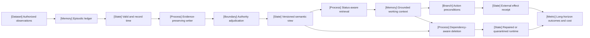

VOLUME III / PART IX — RETRIEVAL, CONTEXT, AND AGENT SYSTEMS / CHAPTER 53

# 53 — Agent memory, persistent state, and long-horizon consistency

[DERIVED] Persistent agent memory is defensible only when evidence, accepted state, actions and deletion guarantees retain explicit provenance and consistency boundaries.

6 sections · 2 spine papers · 2 implementations · prerequisites: 24, 42, 49–52 · artifact: a memory/state policy with provenance and deletion semantics (planned) · updated 2026-10-14

## Why this chapter exists

[DERIVED] Retaining more conversation does not ensure that an agent knows which statement is current, which source is authoritative, or which action actually happened. A compressed preference can lose an exception; a plan can be mistaken for a committed booking; a recently retrieved assertion can outrank a correction. Persistence introduces feedback because these interpretations become future inputs.

[DERIVED] The bottleneck shifts from storing strings to preserving decision-relevant distinctions under changing state. That constraint includes temporal applicability, permission, conflicting evidence, concurrent updates and the lifetime cost of extraction, retrieval and repair. A memory service that optimizes recall alone can preserve the wrong state more effectively.

[DERIVED] The solution developed here separates immutable observations, versioned semantic views, procedural records, pending plans, authoritative external state and reconstructible runtime state. Writers propose interpretations; trusted policies adjudicate authority and updates; transactions protect the relevant state scope; action execution preserves its own effect boundary. Correction and revocation traverse the resulting dependency graph rather than editing only the original record.

[PAPER-REPORTED] The source lineage supplies distinct mechanisms: RAG's external evidence access, MemGPT's context management, LongMemEval's interface ablations, STALE's current-state probes and a 2026 tier-aware deletion study. None supplies an unconditional guarantee for the composed architecture. The manuscript's policy is an engineering synthesis with explicit mathematical premises and unexecuted verification. [P40; R53.1; R53.3; R53.5; R53.7]

## Concept map



[DERIVED] Text equivalent of the same nodes:

- Authorized observations
  - Episodic ledger
    - Valid and record time
      - Evidence-preserving writer
        - Authority adjudication
          - Versioned semantic view
            - Status-aware retrieval
              - Grounded working context
                - Action preconditions
                  - External effect receipt
            - Dependency-aware deletion (also receives affected working context)
              - Repaired or quarantined runtime
- Long-horizon outcomes and cost (receives effect and repair outcomes)

## Position in the book

| Relation | Canonical location and boundary |
|---|---|
| Prerequisites | [24, parameter adaptation/unlearning](../../../vol-01-learning-and-representation/part-04-training-science-and-adaptation/ch24-continual-learning-model-editing-and-unlearning/README.md); [42, inference state/resources](../../../vol-02-execution-and-optimization/part-07-inference-algorithms-distillation-and-compression/ch42-prefill-decode-kv-state-and-inference-resource-models/README.md); [49, retrieval](../ch49-retrieval-models-indexing-and-evidence-access/README.md); [50, context/RAG](../ch50-context-construction-and-retrieval-augmented-generation/README.md); [51, tools](../ch51-tool-use-protocol-interfaces-and-reliable-execution/README.md); [52, control](../ch52-planning-control-flow-verification-and-recovery/README.md) |
| Siblings (same part) | [49](../ch49-retrieval-models-indexing-and-evidence-access/README.md) owns index/search; [50](../ch50-context-construction-and-retrieval-augmented-generation/README.md) owns context compilation; [51](../ch51-tool-use-protocol-interfaces-and-reliable-execution/README.md) owns effect execution; [52](../ch52-planning-control-flow-verification-and-recovery/README.md) owns general planning/control |
| Downstream | [54, shared multi-agent state and evaluation](../ch54-multi-agent-coordination-and-system-level-evaluation/README.md) |
| Trades off with | [24, persistent parameter changes](../../../vol-01-learning-and-representation/part-04-training-science-and-adaptation/ch24-continual-learning-model-editing-and-unlearning/README.md); [42, context/KV occupancy](../../../vol-02-execution-and-optimization/part-07-inference-algorithms-distillation-and-compression/ch42-prefill-decode-kv-state-and-inference-resource-models/README.md); [50.2, evidence budget](../ch50-context-construction-and-retrieval-augmented-generation/50-2-context-budgeting.md) |

## Sections

| Section | Title | What changes here | Primary evidence labels |
|---|---|---|---|
| [53.1](53-1-memory-taxonomy.md) | Memory taxonomy | Different state objects receive different sufficiency/authority contracts | DERIVED; MATHEMATICALLY-DERIVED; PAPER-REPORTED |
| [53.2](53-2-write-policies.md) | Write policies | Selection and extraction become provenance-preserving revision proposals | DERIVED; MATHEMATICALLY-DERIVED; PAPER-REPORTED |
| [53.3](53-3-retrieval-and-use.md) | Retrieval and use | Ranking follows eligibility and status-aware action grounding | DERIVED; PAPER-REPORTED |
| [53.4](53-4-state-consistency.md) | State consistency | Transaction scope and effect reconciliation constrain concurrent decisions | DERIVED; MATHEMATICALLY-DERIVED; OFFICIAL-DOCUMENTATION |
| [53.5](53-5-forgetting-and-deletion.md) | Forgetting and deletion | Removal scope includes derived copies and reconstructible runtime influence | DERIVED; MATHEMATICALLY-DERIVED; PAPER-REPORTED; OFFICIAL-DOCUMENTATION |
| [53.6](53-6-long-horizon-evaluation.md) | Long-horizon evaluation | Offered-task outcomes and lifecycle costs replace recall-only conclusions | DERIVED; MATHEMATICALLY-DERIVED; PAPER-REPORTED |

## Artifact

[DERIVED] The deliverable is **a memory/state policy with provenance and deletion semantics**. The manuscript specifies its event schema, semantic-view schema, authority/temporal predicates, dependency graph, transaction/action ledger, deletion receipt and evaluation ledger. Its fields include immutable IDs, tenant/purpose, source/revision, valid/record time, extraction/adjudication release, confidence definition, status, supersedes/contradicts relations, state/cache epoch, operation identity, effect receipt, copy owner and retention boundary.

[DERIVED] The policy has explicit branches for current-unknown, conflict, infeasible budget, concurrent revision, ambiguous external effect, partial deletion and unavailable counterfactual replay. A durable remaining-work ledger and enforced timeouts bound every logical operation across retries and restarts. Persisting an inventory record does not imply that a represented external action committed.

[UNVERIFIED] These are reviewable specifications, not a delivered runtime implementation. The nine manuscript files contain the policy and audit; no additional executable artifact or measured deployment is claimed.

## Verification

[DERIVED] The plan's verification inserts outdated and contradictory records and checks whether the agent recovers the current authoritative state and explains provenance. [Verification](verification.md) extends that task with delayed/out-of-order observations, concurrent updates, replica lag and revocation of derived/runtime state. Acceptance distinguishes semantic correctness, serialization, action effects, serving denial, physical-copy scope and behavior after repair. Every proposed experiment remains unexecuted.

## Lineage

- 2016 · EWC · conceptual ancestor for the distinct parametric-retention problem; [P16].
- 2020 · Retrieval-Augmented Generation · conceptual ancestor for external evidence access; [P40].
- 2023 · Generative Agents · alternative branch using salience/recency retrieval and reflection; [R53.2].
- 2023 · MemGPT · engineering optimization through explicit context tiers and memory functions; [R53.1, v2 inspected in 2024].
- 2025 · LongMemEval · alternative branch evaluating memory interfaces and updates; [R53.3].
- 2026 · STALE / CUPMem · current frontier for implicit invalidation and state-aware readout; [R53.5].
- 2026 · Deployment-Time Memorization · current frontier for tier-aware removal evidence; [R53.7].

```figure
{
  "id": "fig-53.1",
  "kind": "lineage",
  "title": "Agent memory and state-management lineage",
  "caption": "The branches address retrieval, context management, state revision and revocation; chronology is not a ranking.",
  "placement": "inline",
  "evidence": "PAPER-REPORTED",
  "source": [
    "P40",
    "R53.1",
    "R53.2",
    "R53.3",
    "R53.5",
    "R53.7"
  ],
  "alt": "2020 RAG supplies external retrieval; 2023 agents add salience and context management; 2025 LongMemEval separates memory interfaces; 2026 STALE and deletion studies test revision and revocation.",
  "spec": {
    "entries": [
      {
        "year": 2020,
        "work": "Retrieval-Augmented Generation",
        "cite": "P40",
        "relation": "conceptual ancestor"
      },
      {
        "year": 2023,
        "work": "Generative Agents",
        "cite": "R53.2",
        "relation": "alternative branch"
      },
      {
        "year": 2023,
        "work": "MemGPT",
        "cite": "R53.1",
        "relation": "engineering optimization"
      },
      {
        "year": 2025,
        "work": "LongMemEval",
        "cite": "R53.3",
        "relation": "alternative branch"
      },
      {
        "year": 2026,
        "work": "STALE / CUPMem",
        "cite": "R53.5",
        "relation": "current frontier"
      },
      {
        "year": 2026,
        "work": "Deployment-Time Memorization",
        "cite": "R53.7",
        "relation": "current frontier"
      }
    ]
  }
}
```

```figure
{
  "id": "fig-53.2",
  "kind": "cycle",
  "title": "Versioned memory decisions and correction",
  "caption": "Only permitted evidence enters writes; accepted state constrains reads/actions, while corrections and revocations return through a durable state transition.",
  "placement": "inline",
  "evidence": "DERIVED",
  "source": "DERIVED:eq-53.14",
  "alt": "Observe, retain provenance, adjudicate a versioned view, retrieve/use it with action preconditions, record effects, then correct or revoke through the same state service.",
  "spec": {
    "stages": [
      {
        "id": "o",
        "label": "Authorized observation",
        "kind": "dataset"
      },
      {
        "id": "p",
        "label": "Provenance / valid time",
        "kind": "memory"
      },
      {
        "id": "w",
        "label": "Protected state revision",
        "kind": "process"
      },
      {
        "id": "r",
        "label": "Status-aware read / action",
        "kind": "branch"
      },
      {
        "id": "e",
        "label": "Effect and audit receipt",
        "kind": "state"
      },
      {
        "id": "c",
        "label": "Correction / revocation",
        "kind": "feedback"
      }
    ],
    "edges": [
      {
        "from": "o",
        "to": "p"
      },
      {
        "from": "p",
        "to": "w"
      },
      {
        "from": "w",
        "to": "r"
      },
      {
        "from": "r",
        "to": "e"
      },
      {
        "from": "e",
        "to": "c"
      },
      {
        "from": "c",
        "to": "w",
        "kind": "feedback",
        "label": "new epoch / provenance"
      }
    ]
  }
}
```

## Terms owned here

| Term | Canonical definition and owner |
|---|---|
| Agent memory inventory | Typed catalog distinguishing retained evidence, accepted propositions, procedures, plans and environment/runtime state; [53.1](53-1-memory-taxonomy.md) |
| Memory semantic view | Versioned policy-accepted interpretation with supporting event IDs and explicit unresolved alternatives; [53.2](53-2-write-policies.md) |
| Unknown-current memory state | Old default is unsafe while no reliable replacement is established; [53.2](53-2-write-policies.md) |
| Status-aware memory bundle | Query evidence retaining current, historical, stale and unresolved roles plus source versions; [53.3](53-3-retrieval-and-use.md) |
| Bitemporal memory record | Separate intervals for world applicability and system knowledge; [53.4](53-4-state-consistency.md) |
| Memory deletion closure | Recorded reachable artifact set requiring removal or reconstruction after revocation; [53.5](53-5-forgetting-and-deletion.md) |
| Lifetime memory utility per cost | Paired offered-task utility gain divided by all specified lifecycle costs; [53.6](53-6-long-horizon-evaluation.md) |

## Reference-stack coverage

| Stack section | Entry | Stack layer | What this chapter takes from it | Surface used | Sections | Evidence label |
|---|---|---|---|---|---|---|
| §1 lab | #3 Google DeepMind | — | EWC's parameter-retention boundary, through P16 | https://deepmind.google/research/publications/ | 53.1 | PAPER-REPORTED |
| §1 lab | #4 Meta AI / FAIR | — | RAG external evidence-access anchor, through P40 | https://github.com/facebookresearch | Chapter lineage; 53.1 | PAPER-REPORTED |
| §2 conference | #1 NeurIPS | — | P40 archival identity; no new serving claim | https://proceedings.neurips.cc/ | Chapter lineage | PAPER-REPORTED |
| §2 conference | #3 ICLR | — | LongMemEval 2025 publication/official artifact route | https://openreview.net/group?id=ICLR.cc/2026/Conference | 53.3, 53.6 | PAPER-REPORTED |
| §3 discovery source | #1 arXiv | — | Exact full-text revisions, methods, experiments and appendices | https://arxiv.org/ | All | PAPER-REPORTED |
| §4 system | #26 Hugging Face Transformers | Model definition / adaptation | Layer-specific cache rollback/state availability | https://huggingface.co/docs/transformers/ | 53.5 | OFFICIAL-DOCUMENTATION |
| §4 system | #17 PyTorch | Model / autograd framework | Tensor/cache representation in inspected Transformers source | https://pytorch.org/docs/stable/ | 53.5 | DERIVED; OFFICIAL-DOCUMENTATION |
| Outside the reference stack (routed via book_plan.md anchors) | MemGPT; Generative Agents; LongMemEval; MemoryArena; STALE/CUPMem | — | External memory, state revision and evaluation within the plan's memory/state synthesis | Exact R53.1–R53.5 URLs in references | 53.1–53.6 | PAPER-REPORTED |
| Outside the reference stack (routed via book_plan.md anchors) | Execution-State Unlearning; Deployment-Time Memorization | — | Explicit deletion/runtime contracts within the plan's provenance/deletion scope | Exact R53.6–R53.7 URLs in references | 53.5 | PAPER-REPORTED |
| Outside the reference stack (routed via book_plan.md anchors) | PostgreSQL 18; LongMemEval evaluator | — | Official transactional/deletion and metric implementations for the plan's persistent-state/evaluation synthesis | Exact R53.9–R53.11 URLs in references | 53.4–53.6 | OFFICIAL-DOCUMENTATION |

**Inspection dimensions applied.** [DERIVED] Memory and checkpointing appear in 53.1/53.5; communication, reliability and concurrent state in 53.4/53.5; inference and metrics in 53.3/53.6; reproducibility throughout. Precision/kernel behavior is inherited from each model/cache backend and not benchmarked here. Post-training/parameter retention is linked to Chapter 24 rather than conflated with external memory.

## Source route

[DERIVED] Follow the reference stack's lab protocol §1.1, conference workflow §2.1, primary-paper cascade §3.1 and system inspection §4.3: identify the originating work, inspect full method/protocol and revision, then official source/docs and artifact gaps. Discovery pages are routes rather than result evidence. Filled queries include:

- site:arxiv.org "agent memory" "2026" "interdependent"
- site:arxiv.org "STALE" "implicit conflict"
- site:arxiv.org "execution-state unlearning"
- site:openreview.net/forum "LongMemEval"
- site:deepmind.google/research/publications "catastrophic forgetting"
- site:github.com/huggingface/transformers "DynamicSlidingWindowLayer" "crop"

## Status

[DERIVED] Manuscript draft, researched through **2026-10-14**. Historical results retain their disclosed model snapshots and benchmark boundaries; 2026 sources are dated preprints unless explicitly identified otherwise. Original derivations and the proposed policy are separated from paper claims.

[NOT-DISCLOSED] Portable energy/money coefficients, complete independent replication, universal schema/adjudicator calibration and guarantees for arbitrary open environments are not supplied by the inspected evidence.

[UNVERIFIED] No model, memory service, database concurrency test, cache rollback, deletion operation or benchmark was executed. Mutable source paths remain unpinned. The deletion study's asserted appendix utility validation is absent from its inspected HTML. Exact sources and the topic-completeness review consequences are in [references](references.md) and [verification](verification.md).
