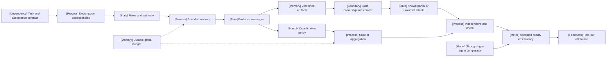

VOLUME III / PART IX — RETRIEVAL, CONTEXT, AND AGENT SYSTEMS / CHAPTER 54

# 54 — Multi-agent coordination and system-level evaluation

[DERIVED] Multi-agent benefit is a workload-specific hypothesis about decomposition, evidence, dependence and resource control that must survive a strong budget-matched single-agent comparison.

6 sections · 2 spine papers · 0 numbered-stack implementations · prerequisites: 06, 38, 48, 51–53 · artifact: a coordination experiment with a budget-matched single-agent baseline (planned) · updated 2026-10-14

## Why this chapter exists

[DERIVED] Multiple agents introduce parallel reasoning and separate contexts, but also more ways to lose task constraints, duplicate work and propagate error. An informal role assignment can split a sequential state-dependent task into unnecessary conversations. A successful team can receive more tools, tokens or evaluator assistance than its comparator, making the apparent gain scientifically ambiguous.

[DERIVED] The dominant constraint is therefore the relationship between useful independent work and total coordination cost. Communication carries claims and evidence while consuming context. Shared state creates ownership and commit obligations. Critics can correct or subvert answers; agreement can reflect shared false premises. Concurrency can shorten one dependency chain while increasing memory pressure, straggler delay and remote work that remains active after timeout.

[DERIVED] A defensible system makes these mechanisms explicit. It uses bounded task/artifact interfaces, independent authority and state checks, durable resource reservations, verified outcomes and complete failure accounting. Its experiment includes a single controller with more allowed computation, independent aggregation and frozen mechanism ablations. Current 2026 research adds diversity and scaling hypotheses, but proxy geometry, pairwise correlation and outcome-containing regressions require independent scrutiny. The chapter develops the mathematics needed to distinguish conditional mechanisms from universal claims and to identify what evidence would settle the remaining questions.

## Concept map



[DERIVED] Text equivalent:

- Task and acceptance contract
  - Decompose dependencies
  - Roles and authority
  - Bounded workers
- Evidence and state
  - Evidence messages
  - Versioned artifacts
  - State ownership and commit
  - Known partial or unknown effects
- Coordination and verification
  - Coordination policy
  - Critic or aggregation
  - Independent task check
- Resources and comparison
  - Durable global budget constrains workers and aggregation
  - Strong single-agent comparator
  - Accepted quality, cost and latency
  - Held-out attribution feeds subsequent design

## Position in the book

| Relation | Chapters |
|---|---|
| Prerequisites | [6: Experimental design and evaluation before optimization](../../../vol-01-learning-and-representation/part-01-scientific-foundations/ch06-experimental-design-and-evaluation-before-optimization/README.md) · [38: Inference-time reasoning, search, and adaptive compute](../../../vol-02-execution-and-optimization/part-07-inference-algorithms-distillation-and-compression/ch38-inference-time-reasoning-search-and-adaptive-compute/README.md) · [48: Capacity planning, benchmarking, and lifecycle economics](../../../vol-02-execution-and-optimization/part-08-inference-engines-and-production-serving/ch48-capacity-planning-benchmarking-and-lifecycle-economics/README.md) · [51: Tool use, protocol interfaces, and reliable execution](../ch51-tool-use-protocol-interfaces-and-reliable-execution/README.md) · [52: Planning, control flow, verification, and recovery](../ch52-planning-control-flow-verification-and-recovery/README.md) · [53: Agent memory, persistent state, and long-horizon consistency](../ch53-agent-memory-persistent-state-and-long-horizon-consistency/README.md) |
| Siblings (same part) | [49: Retrieval models, indexing, and evidence access](../ch49-retrieval-models-indexing-and-evidence-access/README.md) · [50: Context construction and retrieval-augmented generation](../ch50-context-construction-and-retrieval-augmented-generation/README.md) · [51: Tool use, protocol interfaces, and reliable execution](../ch51-tool-use-protocol-interfaces-and-reliable-execution/README.md) · [52: Planning, control flow, verification, and recovery](../ch52-planning-control-flow-verification-and-recovery/README.md) · [53: Agent memory, persistent state, and long-horizon consistency](../ch53-agent-memory-persistent-state-and-long-horizon-consistency/README.md) |
| Downstream | [61: Capability portfolios and benchmark validity](../../part-11-evaluation-interpretability-and-deployment-assurance/ch61-capability-portfolios-and-benchmark-validity/README.md) · [62: Human preference, model judges, and uncertainty](../../part-11-evaluation-interpretability-and-deployment-assurance/ch62-human-preference-model-judges-and-uncertainty/README.md) · [63: Agent, retrieval, multimodal, and system reliability evaluation](../../part-11-evaluation-interpretability-and-deployment-assurance/ch63-agent-retrieval-multimodal-and-system-reliability-evaluation/README.md) · [64: Mechanistic interpretability and causal model analysis](../../part-11-evaluation-interpretability-and-deployment-assurance/ch64-mechanistic-interpretability-and-causal-model-analysis/README.md) · [65: Security, privacy, safety, and adversarial robustness](../../part-11-evaluation-interpretability-and-deployment-assurance/ch65-security-privacy-safety-and-adversarial-robustness/README.md) |
| Trades off with | [38: Inference-time reasoning, search, and adaptive compute](../../../vol-02-execution-and-optimization/part-07-inference-algorithms-distillation-and-compression/ch38-inference-time-reasoning-search-and-adaptive-compute/README.md) · [48: Capacity planning, benchmarking, and lifecycle economics](../../../vol-02-execution-and-optimization/part-08-inference-engines-and-production-serving/ch48-capacity-planning-benchmarking-and-lifecycle-economics/README.md) |


## Sections

| Section | Title | What changes here | Evidence |
|---|---|---|---|
| [54.1](54-1-decomposition.md) | Decomposition | Task dependencies and interfaces determine useful parallelism | MATHEMATICALLY-DERIVED; PAPER-REPORTED |
| [54.2](54-2-communication.md) | Communication | Evidence/version transfer replaces unbounded prose exchange | MATHEMATICALLY-DERIVED; PAPER-REPORTED |
| [54.3](54-3-shared-state.md) | Shared state | Enforced ownership and merge invariants constrain concurrent work | DERIVED; OFFICIAL-DOCUMENTATION |
| [54.4](54-4-coordination-policies.md) | Coordination policies | Correction, voting and higher-order error dependence are separated | MATHEMATICALLY-DERIVED; PAPER-REPORTED |
| [54.5](54-5-resource-control.md) | Resource control | Durable global reservations govern descendants and stragglers | MATHEMATICALLY-DERIVED; OFFICIAL-DOCUMENTATION |
| [54.6](54-6-evaluation.md) | Evaluation | Strong baselines and available-before-outcome features govern attribution | MATHEMATICALLY-DERIVED; PAPER-REPORTED |

## Artifact

[DERIVED] The artifact is a coordination experiment specification with: frozen task/evaluator and accepted-effect contract; task graph and role interfaces; model/context/tool differences; communication/version/provenance policy; shared-state ownership and journals; topology/aggregation/tie rules; global budget/reservation/deadline policy; strong single-agent and independent-ensemble baselines; complete outcomes/resource events; paired analysis and uncertainty; held-out transfer and failure audit.

[DERIVED] Its control cycle reserves, delegates, communicates, validates and reconciles before accepting a task. Invalid or incomplete evidence returns as a bounded failure/replanning signal. The cycle does not replenish budgets or convert consensus into success.


```figure
{
  "id": "fig-54.1",
  "kind": "cycle",
  "title": "Bounded coordination cycle",
  "caption": "Reserve resources, delegate admissible work, preserve evidence, verify the task and reconcile uncertain work before another bounded iteration.",
  "placement": "inline",
  "evidence": "DERIVED",
  "source": "DERIVED:eq-54.17",
  "alt": "Reserve resources, delegate admissible work, preserve evidence, verify the task and reconcile uncertain work before another bounded iteration.",
  "spec": {
    "stages": [
      {
        "id": "r",
        "label": "Reserve task resources",
        "kind": "memory"
      },
      {
        "id": "d",
        "label": "Delegate admissible work",
        "kind": "process"
      },
      {
        "id": "e",
        "label": "Preserve evidence",
        "kind": "state"
      },
      {
        "id": "v",
        "label": "Verify accepted outcome",
        "kind": "branch"
      },
      {
        "id": "u",
        "label": "Reconcile or stop",
        "kind": "feedback"
      }
    ],
    "edges": [
      {
        "from": "r",
        "to": "d"
      },
      {
        "from": "d",
        "to": "e"
      },
      {
        "from": "e",
        "to": "v"
      },
      {
        "from": "v",
        "to": "u"
      },
      {
        "from": "u",
        "to": "r",
        "kind": "feedback"
      }
    ]
  }
}
```

## Verification

[DERIVED] The proposed study compares multiple agents with a single agent given the same declared total resource cap and reports actual consumption/frontiers. Independent candidates, serial specialists, communication and critic ablations distinguish mechanisms. Fault/duplicate/stale-state cases test ownership and durable budgets. All attempted tasks, failures, unknown effects and coordination overhead remain in the denominator. See [verification](verification.md).

## Lineage

- 2022 · ReAct · **conceptual ancestor**: [PAPER-REPORTED] one controller interleaves reasoning and environment actions [P41].
- 2023 · AutoGen · **engineering optimization**: [PAPER-REPORTED] programmable conversation flow [R54.3].
- 2023 · MetaGPT · **alternative branch**: [PAPER-REPORTED] SOP roles and structured artifacts; inspected v6 is 2024 [R54.2].
- 2024 · τ-bench · **conceptual ancestor**: [PAPER-REPORTED] repeated state-grounded task evaluation [P43].
- 2025 · Voting/consensus and Debate-or-Vote · **alternative branch**: [PAPER-REPORTED] decision and communication ablations [R54.6–R54.7].
- 2025 · Failure taxonomy · **engineering optimization**: [PAPER-REPORTED] trace-grounded diagnosis [R54.12].
- 2025 · Controlled architecture study · **current frontier**: [PAPER-REPORTED] domain-dependent outcomes and disputed predictive interpretation [R54.4].
- 2026 · Diversity scaling · **current frontier**: [PAPER-REPORTED] output-geometry proxy with explicit information/correctness limits [R54.5].

- 2026 · Proposal supply and verification-aware readout · **current frontier**: [PAPER-REPORTED] headroom/recovery/damage accounting and fixed-proposal/identical-finalizer controls, with construction and decoding limits [R54.17].


```figure
{
  "id": "fig-54.2",
  "kind": "lineage",
  "title": "Coordination mechanism and evidence lineage",
  "caption": "Structured interaction, state-grounded evaluation and current policy controls address different obligations; no lineage arrow establishes universal superiority.",
  "placement": "inline",
  "evidence": "DERIVED",
  "source": [
    "P41",
    "R54.3",
    "R54.2",
    "P43",
    "R54.6",
    "R54.12",
    "R54.4",
    "R54.5",
    "R54.17"
  ],
  "alt": "Structured interaction, state-grounded evaluation and current policy controls address different obligations; no lineage arrow establishes universal superiority.",
  "spec": {
    "entries": [
      {
        "year": 2022,
        "work": "ReAct",
        "cite": "P41",
        "relation": "conceptual ancestor"
      },
      {
        "year": 2023,
        "work": "AutoGen",
        "cite": "R54.3",
        "relation": "engineering optimization"
      },
      {
        "year": 2023,
        "work": "MetaGPT",
        "cite": "R54.2",
        "relation": "alternative branch"
      },
      {
        "year": 2024,
        "work": "τ-bench",
        "cite": "P43",
        "relation": "conceptual ancestor"
      },
      {
        "year": 2025,
        "work": "Debate or Vote",
        "cite": "R54.6",
        "relation": "alternative branch"
      },
      {
        "year": 2025,
        "work": "Failure taxonomy",
        "cite": "R54.12",
        "relation": "engineering optimization"
      },
      {
        "year": 2025,
        "work": "Architecture controls",
        "cite": "R54.4",
        "relation": "current frontier"
      },
      {
        "year": 2026,
        "work": "Diversity proxy analysis",
        "cite": "R54.5",
        "relation": "current frontier"
      },
      {
        "year": 2026,
        "work": "Proposal supply and readout",
        "cite": "R54.17",
        "relation": "current frontier"
      }
    ]
  }
}
```

## Terms owned here

[DERIVED] General controller planning, persistent memory, tool-effect contracts and service economics remain in Chapters 52, 53, 51 and 48 respectively. This chapter owns:

| Term | Definition | Owning section |
|---|---|---|
| Coordination task graph | The declared dependency graph separating total work, critical path and join obligations | [54.1](54-1-decomposition.md#formulation) |
| Evidence-preserving inter-agent message | A bounded typed message carrying identity, version and provenance without granting new authority | [54.2](54-2-communication.md#formulation) |
| Agent ownership epoch | A versioned ownership context used to reject stale messages or publication attempts | [54.3](54-3-shared-state.md#formulation) |
| Coordination correction/subversion | Conditional correction of an initially wrong answer versus corruption of an initially correct one | [54.4](54-4-coordination-policies.md#formulation) |
| Correlated-vote validity boundary | Marginal accuracy and pairwise correlation alone do not determine majority success; the declared joint-error assumptions matter | [54.4](54-4-coordination-policies.md#mechanism) |
| Global coordination resource reservation | Atomic admission of shared call, cost and concurrency capacity with a protected finalization allowance | [54.5](54-5-resource-control.md#formulation) |
| Budget-matched coordination attribution | Comparison over all offered attempts under declared matched resources, paired workloads and outcome criteria | [54.6](54-6-evaluation.md#formulation) |

## Reference-stack coverage

| Stack section | Entry | Stack layer | What this chapter takes from it | Surface used | Sections | Evidence label |
|---|---|---|---|---|---|---|
| §1 lab | #1 Anthropic | Not applicable | First-party research-system decomposition, overhead and reliability disclosure [R54.13], with its unmatched internal comparison boundary | [Blog](https://www.anthropic.com/engineering); exact report in [references](references.md) | 54.1, 54.6 | OFFICIAL-DOCUMENTATION |
| §1 lab | #3 Google DeepMind | Not applicable | Controlled architecture/domain study [R54.4]; evaluate its resource controls and predictor leakage separately | [Papers](https://deepmind.google/research/publications/); exact primary revision in [references](references.md) | 54.1, 54.5–54.6 | PAPER-REPORTED |
| §1 lab | #13 Microsoft Research / Microsoft AI | Not applicable | AutoGen conversation programming and application-specific protocols [R54.3] | [Papers](https://www.microsoft.com/research/publications/); exact primary revision in [references](references.md) | 54.1–54.4 | PAPER-REPORTED |
| §3 discovery source | #1 arXiv | Not applicable | Locate originating, revision-specific papers; retrieval metadata establishes no mechanism/result claim | [Home](https://arxiv.org/); [search/API](https://arxiv.org/search/advanced) | 54.1–54.6 | UNVERIFIED for discovery-only snippets; primary texts separately PAPER-REPORTED |

**Outside the reference stack (routed via book_plan.md anchors).**

| Plan source anchor | Sources and mechanism | Primary surface | Sections | Evidence label |
|---|---|---|---|---|
| Multi-agent coordination and framework studies | ReAct [P41], MetaGPT [R54.2], diversity/debate/voting [R54.5–R54.7, R54.17], failure taxonomy [R54.12] | Originating full texts and exact locators in [references](references.md) | 54.1–54.6 | PAPER-REPORTED |
| Orchestration, persistence and recovery | LangGraph persistence/checkpointers/source/license [R54.8, R54.14–R54.16]; SQLite transaction semantics [R54.9] | Official documentation and immutable LangGraph source pin in [references](references.md) | 54.2–54.3, 54.5 | OFFICIAL-DOCUMENTATION |
| Agent-system evaluation | Environment-outcome protocols in τ-bench and τ²-bench [P43, R54.11] | Originating benchmark papers in [references](references.md) | 54.5–54.6 | PAPER-REPORTED |

[DERIVED] MetaGPT, LangGraph, SQLite, Sierra benchmarks, Wisconsin/Göttingen debate studies, Berkeley's failure taxonomy and the 2026 diversity study are relevant primary sources outside the numbered system list. Their inclusion follows the chapter matrix and Appendix H's tool/agent connections. Generic frameworks are implementation surfaces, not evidence of multi-agent superiority.

[DERIVED] **Inspection dimensions applied.** Parallelism and Communication cover dependency DAGs, messages, barriers and coordination (§§54.1–54.4); Memory and Checkpointing cover versioned internal state, receipts and framework recovery (§§54.2–54.3, 54.5), with no claim about training checkpoints; Inference and Metrics cover model/tool calls, evaluator populations and budget-matched comparisons (§§54.1, 54.4–54.6); Reliability and Reproducibility cover authority, atomic publication, failure attribution, immutable source pins and declared experimental controls (§§54.2–54.6). Precision, Kernels and Post-training are not inferred from conversation topology. Coordination frameworks sit outside the numbered §4 system list; no implementation ID or runtime verification is invented.

## Source route

[DERIVED] Use the stack's lab search (§1.1), proceedings check (§2.1) and originating-paper cascade (§3.1), then inspect the declared full-text revision and controls. Concrete routes include:

- `site:anthropic.com/research "multi-agent" OR site:arxiv.org/abs "Anthropic" "multi-agent"`
- `site:deepmind.google/research/publications "agent systems" OR site:arxiv.org/abs "Google DeepMind" "agent systems"`
- `site:microsoft.com/research/publication "AutoGen" OR site:arxiv.org/abs "Microsoft Research" "AutoGen"`
- `site:openreview.net "Why Do Multi-Agent LLM Systems Fail?"`
- `site:arxiv.org/abs "When Debate Helps"`
- `site:github.com/langchain-ai/langgraph "checkpoint" "thread_id"`

[DERIVED] Follow an originating disclosure to its archival paper/code rather than inferring evidence from a lab name. The first-party Anthropic engineering report and plan-anchored LangGraph/SQLite surfaces are listed separately in the ledger. Apply the §4.3 documentation→repository→pinned-source inspection pattern to those unlisted frameworks; the recorded source checks establish disclosed semantics only, not an executed deployment.

## Status

[OFFICIAL-DOCUMENTATION] All source access occurred on 2026-10-14. LangGraph state.py is pinned to ccb851effb7b4c6255add86dbeed577061475aff; documentation remains mutable. ReAct and τ-bench retain canonical spine identities P41/P43 with revision-specific local records.

[UNVERIFIED] All nine files remain manuscript_draft. No agents, models, framework, database, simulator or benchmark was executed. Exact mathematical counterexamples establish logical limitations, while source-reported experiments remain bounded by their protocols. Document validation does not establish scientific replication or production capability.
