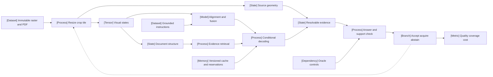

VOLUME III / PART X - MULTIMODAL, WORLD, AND EMBODIED MODELS / CHAPTER 55

# 55 - Vision-language models and document intelligence

[DERIVED] A defensible visual answer requires an unbroken chain from source pixels through representation, structure and computation to independently checked evidence, under an explicit resource budget.

6 sections | 12 current primary reports and one pinned originating implementation | prerequisites: 18,31,49-50 | artifact: vision/document evaluation with component ablations (proposed) | research window 2026-03-01 through 2026-10-24 | inspected 2026-10-25 | manuscript draft

## Why this chapter exists

[DERIVED] Visual fluency can conceal failures at distinct boundaries. A glyph can disappear during resizing, an encoder can retain it but expose it poorly, a parser can bind it to the wrong header, retrieval can omit a qualifier, or a decoder can ignore correct evidence. A correct answer can also arise without reading the image. Improving one aggregate benchmark score does not identify which boundary changed or whether the added computation is justified.

[DERIVED] This chapter connects those boundaries through explicit mathematical and engineering contracts. It distinguishes pooled image-text alignment from dense visual features, source geometry from sequence position, table structure from OCR strings, gold-page coverage from evidence use, and exact cache equivalence from approximate reuse. Each distinction changes what must be measured and which corrective action is admissible. The current evidence includes negative results, changing evaluation cohorts, source/table inconsistencies and static implementation details that a paper equation leaves unspecified.

[DERIVED] The acceptance rule is task-specific: answer correctness, required evidence support and selective coverage must meet the declared threshold within the complete latency/memory/cost boundary. No inspected source establishes a universally best objective, processor, parser or cache policy. The planned artifact tests the relevant interfaces and records which outcome would reverse a design choice.

## Concept map



[DERIVED] Text equivalent:

- Immutable evidence
  - Source raster and PDF identity
  - Processed views and source geometry
  - Visual states and alignment/fusion
- Reading and evidence
  - Grounded supervision and conditional decoding
  - Typed document structure and retrieval
  - Source-resolvable output evidence
- Acceptance and resources
  - Oracle controls test answer and support
  - Bounded accept, acquire or abstain decision
  - Versioned cache and reservations
  - Quality, coverage and complete cost

## Position in the book

| Relation | Canonical connections |
|---|---|
| Prerequisites | [18: Multimodal architectural primitives](../../../vol-01-learning-and-representation/part-03-model-architectures-and-state/ch18-multimodal-architectural-primitives/README.md); [31: Supervised fine-tuning and behavior acquisition](../../../vol-02-execution-and-optimization/part-06-post-training-and-reinforcement-learning/ch31-supervised-fine-tuning-and-behavior-acquisition/README.md); [49: Retrieval models, indexing, and evidence access](../../part-09-retrieval-context-and-agent-systems/ch49-retrieval-models-indexing-and-evidence-access/README.md); [50: Context construction and retrieval-augmented generation](../../part-09-retrieval-context-and-agent-systems/ch50-context-construction-and-retrieval-augmented-generation/README.md) |
| State and service accounting | [42: Prefill, decode, KV state, and inference resource models](../../../vol-02-execution-and-optimization/part-07-inference-algorithms-distillation-and-compression/ch42-prefill-decode-kv-state-and-inference-resource-models/README.md); [44: Scheduling, distributed serving, and disaggregation](../../../vol-02-execution-and-optimization/part-08-inference-engines-and-production-serving/ch44-scheduling-distributed-serving-and-disaggregation/README.md); [48: Capacity planning, benchmarking, and lifecycle economics](../../../vol-02-execution-and-optimization/part-08-inference-engines-and-production-serving/ch48-capacity-planning-benchmarking-and-lifecycle-economics/README.md) |
| Downstream | [57: Video, temporal reasoning, and streaming multimodality](../ch57-video-temporal-reasoning-and-streaming-multimodality/README.md); 58: Generative multimodal models and alternative generation paths (planned); 59: Predictive representations, JEPA, and world models (planned); 63: Agent, retrieval, multimodal, and system reliability evaluation (planned) |

## Sections

| Section | Controlling question | Changed property and acceptance evidence |
|---|---|---|
| [55.1](55-1-visual-representations.md) Visual representations | Which answer-relevant distinctions survive sampling? | Coordinate-preserving views and retained-feature access; controlled resolution/geometry tests |
| [55.2](55-2-alignment-and-fusion.md) Alignment and fusion | Can the downstream reader use the retained states? | Objective/readout and gradient-path controls; task-specific dense/global comparisons |
| [55.3](55-3-instruction-and-reasoning-data.md) Instruction and reasoning data | Does supervision distinguish the desired visual operation from shortcuts? | Executable targets, grounded records and paired content/style interventions |
| [55.4](55-4-document-structure.md) Document structure | Are content bindings and evidence paths preserved? | Typed structure, page identities, retrieval versus oracle structure/evidence |
| [55.5](55-5-reliability.md) Reliability | What changed on the same items and evidence regime? | Fixed-cohort transitions, selective risk and component oracle controls |
| [55.6](55-6-deployment.md) Deployment | Does accepted quality survive the actual resource policy? | Processor reconciliation, valid cache state and complete lifecycle accounting |

## Artifact

[DERIVED] The proposed artifact is a joined per-item ledger of immutable inputs, processed views, source transforms, realized visual tokens, model/fusion state, parsed structure, selected evidence, answers, acceptance and resource events. Component ablations compare raster-only, oracle OCR, oracle structure, oracle pages and fresh computation under explicitly different information regimes. A fixed base workload and evaluation denominator support paired conclusions; every timeout, invalid output and abstention remains visible. No artifact model run is claimed.

```figure
{
  "id": "fig-55.1",
  "kind": "diagram",
  "title": "Where a visual answer can fail",
  "caption": "The same wrong answer can arise before encoding, at fusion, during structural binding, at retrieval or during computation. Oracle interventions change one boundary at a time; their gains are diagnostic under the declared information regime.",
  "placement": "inline",
  "anchor": "artifact",
  "evidence": "DERIVED",
  "source": "DERIVED:eq-55.14",
  "alt": "The same wrong answer can arise before encoding, at fusion, during structural binding, at retrieval or during computation. Oracle interventions change one boundary at a time; their gains are diagnostic under the declared information regime.",
  "spec": {
    "direction": "LR",
    "nodes": [
      {
        "id": "pixels",
        "kind": "dataset",
        "label": "Source pixels"
      },
      {
        "id": "sample",
        "kind": "process",
        "label": "Processed views"
      },
      {
        "id": "states",
        "kind": "tensor",
        "label": "Visual states"
      },
      {
        "id": "fusion",
        "kind": "model",
        "label": "Fusion and reader"
      },
      {
        "id": "struct",
        "kind": "state",
        "label": "Structure and evidence"
      },
      {
        "id": "answer",
        "kind": "metric",
        "label": "Answer plus support"
      },
      {
        "id": "oracle",
        "kind": "dependency",
        "label": "Oracle text / structure / pages"
      }
    ],
    "edges": [
      {
        "from": "pixels",
        "to": "sample",
        "label": "sampling"
      },
      {
        "from": "sample",
        "to": "states",
        "label": "encoding"
      },
      {
        "from": "states",
        "to": "fusion",
        "label": "interface"
      },
      {
        "from": "fusion",
        "to": "struct",
        "label": "bindings"
      },
      {
        "from": "struct",
        "to": "answer",
        "label": "computation"
      },
      {
        "from": "oracle",
        "to": "answer",
        "label": "controlled probes"
      }
    ]
  }
}
```


## Verification

[DERIVED] The verification design separates observation loss, structure/evidence access and downstream computation before selecting a repair. A crop convention counterexample diagnoses implementation; a wrong oracle answer redirects investigation to computation/evaluation; a changed filtered cohort requires reanalysis; a stronger matched-cost comparator reverses preference. The finite study can end inconclusively. See [verification](verification.md) for complete proposed experiment fields and the topic matrix.

## Lineage

[DERIVED] Earlier architectural foundations remain at their canonical Chapter 18 location; this ledger introduces current-window contributions only. The relations below identify changed mechanisms rather than a ranking or causal ancestry claim where none was established.

- 2026 · Qianfan-OCR [R55.1] · **engineering optimization** — March: dynamic visual interface and document-centered supervision.
- 2026 · Counterfactual Phrase Intervention [R55.4] · **alternative branch** — May: offline phrase-sensitive selection without changing the training loss.
- 2026 · PaddleOCR-VL-1.6 [R55.8] · **engineering optimization** — June: data refinement and staged optimization with the prior architecture retained.
- 2026 · LeVLJEPA [R55.2] · **alternative branch** — July: negative-free cross-modal prediction evaluated under dense and global readouts.
- 2026 · SCVER [R55.3] [R55.13] · **current frontier** — August: decoder-state access to retained current-image features.
- 2026 · VELD-QA [R55.10] and ViSiP-Bench [R55.11] · **current frontier** — October: evidence-access and model-specific-prior diagnostics.
- 2026 · VisMemo [R55.12] · **engineering optimization** — October: approximate historical visual-KV reuse with a separate quality obligation.

```figure
{
  "id": "fig-55.2",
  "kind": "lineage",
  "title": "Current evidence changes different boundaries",
  "caption": "All entries first appeared inside the 2026 research window. Relations describe the changed mechanism, not a universal ranking. Earlier fusion/contrastive foundations remain in Chapter 18.",
  "placement": "inline",
  "anchor": "lineage",
  "evidence": "DERIVED",
  "source": [
    "R55.1",
    "R55.4",
    "R55.8",
    "R55.2",
    "R55.3",
    "R55.10",
    "R55.11",
    "R55.12"
  ],
  "alt": "All entries first appeared inside the 2026 research window. Relations describe the changed mechanism, not a universal ranking. Earlier fusion/contrastive foundations remain in Chapter 18.",
  "spec": {
    "entries": [
      {
        "year": 2026,
        "work": "Qianfan-OCR",
        "cite": "R55.1",
        "relation": "engineering optimization"
      },
      {
        "year": 2026,
        "work": "Phrase-sensitive selection",
        "cite": "R55.4",
        "relation": "alternative branch"
      },
      {
        "year": 2026,
        "work": "PaddleOCR-VL-1.6",
        "cite": "R55.8",
        "relation": "engineering optimization"
      },
      {
        "year": 2026,
        "work": "LeVLJEPA",
        "cite": "R55.2",
        "relation": "alternative branch"
      },
      {
        "year": 2026,
        "work": "SCVER",
        "cite": "R55.3",
        "relation": "current frontier"
      },
      {
        "year": 2026,
        "work": "VELD-QA",
        "cite": "R55.10",
        "relation": "current frontier"
      },
      {
        "year": 2026,
        "work": "ViSiP-Bench",
        "cite": "R55.11",
        "relation": "current frontier"
      },
      {
        "year": 2026,
        "work": "VisMemo",
        "cite": "R55.12",
        "relation": "engineering optimization"
      }
    ]
  }
}
```


## Terms owned here

[DERIVED] This chapter owns the task-conditioned visual representation contract, source/crop coordinate transfer, visual instruction evidence record, document structural binding, visual conflict cohort and visual-cache evidence boundary. Generic contrastive learning, cross-attention, KV state, ANN retrieval and evaluation uncertainty are linked to earlier canonical treatments rather than redefined as separate methods.

## Reference-stack coverage

| Stack section | Entry | Stack layer / use | What this chapter takes from it | Surface used | Sections | Evidence label / boundary |
|---|---|---|---|---|---|---|
| §1 lab | #5 Alibaba Qwen | — | Plan's multimodal release route; backbones named in the inspected reports | https://qwenlm.github.io/ ; https://github.com/QwenLM | 55.1–55.6 | PAPER-REPORTED cases; no newly verified architecture from an older model name |
| §1 lab | #16 Baidu Research / ERNIE / Paddle | — | Qianfan/Paddle originating reports and document data pipelines | https://research.baidu.com/Publications ; https://github.com/PaddlePaddle | 55.1, 55.3, 55.4 | PAPER-REPORTED; published report versions pinned |
| §2 conference | #5 CVPR; #8 ECCV | — | Vision/multimodality discovery routes | https://openaccess.thecvf.com/CVPR2026 ; https://eccv.ecva.net/Conferences/2026/AcceptedPapers | 55.1–55.6 | Discovery only; venue acceptance not inferred from an arXiv record |
| §3 discovery source | #1 arXiv | — | Primary full texts and revision histories for current topical methods | https://arxiv.org/ | 55.1–55.6 | PAPER-REPORTED; all twelve introduced reports first released inside the window |
| §4 system | #17 PyTorch | MODEL / AUTOGRAD FRAMEWORK | reported training/inference and inspected adapter | https://pytorch.org/docs/stable/ | 55.1, 55.2, 55.6 | PAPER-REPORTED / OFFICIAL-DOCUMENTATION; runtime compatibility unexecuted |
| §4 system | #26 Hugging Face Transformers | MODEL DEFINITION / ADAPTATION | originating SCVER adapter delegates sampling and pins 4.57.6 | https://huggingface.co/docs/transformers/ | 55.1 | OFFICIAL-DOCUMENTATION static repository inspection; delegated kernel not executed |
| §4 system | #42 SGLang | INFERENCE ENGINE | VisMemo's reported integration | https://docs.sglang.ai/ | 55.6 | PAPER-REPORTED only; engine commit NOT-DISCLOSED |

[DERIVED] The arXiv topical route supplies studies from additional originating university/industry groups; their names remain source authorship, not invented reference-stack lab entries. Plan anchors CLIP/BLIP-2 are historical context and are not newly introduced sources under the current window. The Qwen release repository is a route, not evidence that all named backbones share current internals. Exact source inspection is in [references](references.md).

[DERIVED] Sec.4.2 dimensions applied: parallelism, precision, memory, communication, kernels, checkpointing, post-training, inference, metrics, reliability and reproducibility. The manuscript accounts for bridge gradients, distributional gathers, visual/decoder state, source normalization and cache lifetimes. Uninspected kernels, package commits, recovery behavior, energy and money remain explicitly unresolved; successful manuscript compilation cannot settle them.

## Source queries and inspection

[DERIVED] Current-run queries covered visual document representation, negative-free visual alignment, phrase-sensitive data, ordinal/count/chart diagnostics, long-document evidence and approximate visual cache reuse, through arXiv full texts and originating repositories. Examples: `2026 vision language document visual evidence retrieval`; `2026 vision language pretraining negatives dense features`; `2026 visual perception language priors`; `2026 visual cache reuse multimodal`. Metadata was followed to methods, equations, benchmark tables and appendices. Exact current v1/v2 texts and the static SCVER commit were accessed 2026-10-25; dated details are in the source ledger. An old paper with a March revision was excluded because first public release preceded the window.

## Status and evidence gaps

[UNVERIFIED] This is a substantive manuscript draft with unexecuted validation protocols. All six planned sections and20 authored figures are present; source-specific negative results and unresolved details remain visible. Missing work includes model execution, complete package/kernel pins for paper systems, independent dataset/contamination audit, fixed-cohort item-level reproduction, multilingual/diagram transfer and load-sensitive deployment measurement. The proposed protocols make those obligations reviewable without manufacturing their outcomes.
