VOLUME III / PART X — MULTIMODAL, WORLD, AND EMBODIED MODELS / CHAPTER 56

# 56 — Audio, speech, and real-time interaction

[DERIVED] An audio-language system is acceptable only when its representation preserves required evidence and its response, control, and physical playback meet a common task-quality and timing contract.

6 sections · 10 retained research papers + 1 excluded candidate · 0 book-executed model implementations · prerequisites: 18, 31, 42, 46–47 · artifact: an audio-language latency and task-quality profile · updated 2026-10-25

## Why this chapter exists

[DERIVED] Clip-level recognition and synthesis scores leave a central interaction question unresolved: can a system use the right acoustic evidence and respond at the right time while it is already speaking? A transcript can discard speaker and prosodic distinctions. A compact codec can reduce model positions yet accumulate a long block before emission. An integrated model can accept an input stream without using interruption-onset evidence promptly. The controlling constraint is therefore the conjunction of information preservation, causal availability, task correctness, and physical delivery.

[DERIVED] Streaming introduces commitments whose costs differ. A tentative transcript may be revised; an exposed committed transcript may already have triggered downstream work; generated audio may be canceled before playback; heard speech cannot be retracted. Reliable interaction requires explicit state transitions across these boundaries and a playback acknowledgment. A model-only latency figure cannot establish that path. A controller must also distinguish response intent from completeness, target speech from background speech, and a backchannel from an interruption.

[DERIVED] The chapter develops those constraints through representation arithmetic, probabilistic and execution graphs, causal control, an offered-event evaluation ledger, and queue/deadline accounting. Current source studies supply bounded examples and negative results. The book's contribution is the connected analysis and falsifiable artifact specification, not an asserted benchmark win. Every selected design remains conditional on acceptance, missing disclosures, and stated reversal conditions.

```figure
{
  "id": "fig-56.1",
  "kind": "systems-trace",
  "title": "Evidence to audible acceptance",
  "caption": "The artifact follows one offered event across representation, decision, and physical delivery; no boundary silently substitutes for another.",
  "placement": "inline",
  "evidence": "DERIVED",
  "source": "DERIVED:eq-56.14",
  "alt": "Capture/admission determines evidence support. Model and control stages decide content and timing. Packet/playback stages determine what is heard. The artifact retains failures and every named clock.",
  "spec": {
    "columns": [
      "latency",
      "memory",
      "compute",
      "communication",
      "failure"
    ],
    "stages": [
      {
        "name": "Captured evidence",
        "values": {
          "latency": "Sample support and admission",
          "memory": "Waveform/feature buffers",
          "failure": "Missing or aliased evidence"
        }
      },
      {
        "name": "Model/control",
        "values": {
          "latency": "Commit and response decisions",
          "compute": "Encoder, decoder, renderer",
          "failure": "Wrong meaning or turn"
        }
      },
      {
        "name": "Physical delivery",
        "values": {
          "latency": "Last/first played samples",
          "communication": "Packets, epochs, acknowledgments",
          "failure": "Stale playback or missed deadline"
        }
      },
      {
        "name": "Accepted artifact",
        "values": {
          "memory": "Offered-event ledger",
          "failure": "Missing outcomes stay visible"
        }
      }
    ]
  }
}
```

## Concept map

```mermaid
flowchart LR
  A["[Tensor] Waveform and sample clock"] --> B["[Process] Feature and codec mapping"]
  B --> C["[Tensor] Temporal support and indices"]
  C --> D["[Node] Task contract"]
  D --> E["[Model] Mediation architecture"]
  E --> F["[State] Partial and committed output"]
  F --> G["[Process] Turn and interruption policy"]
  G --> H["[State] Response epoch"]
  H --> I["[Memory] Network and playback queues"]
  I --> J["[Hardware] Audible output"]
  J --> K["[Metric] Quality and clock ledger"]
  K --> L["[Objective] Joint task acceptance"]
```



[DERIVED] The same dependency path in text:

- Waveform/sample clock → feature/codec mapping → temporal support and indices.
- Task contract → mediation architecture → partial and committed output.
- Turn/interrupt policy → response epoch → network/playback queues → audible output.
- Quality/clock ledger → joint task acceptance, retaining failures and subgroup membership.

## Position in the book

| Relation | Connection |
|---|---|
| Prerequisites | [18: multimodal primitives](../../../vol-01-learning-and-representation/part-03-model-architectures-and-state/ch18-multimodal-architectural-primitives/README.md), [31: supervised behavior](../../../vol-02-execution-and-optimization/part-06-post-training-and-reinforcement-learning/ch31-supervised-fine-tuning-and-behavior-acquisition/README.md), [42: inference state](../../../vol-02-execution-and-optimization/part-07-inference-algorithms-distillation-and-compression/ch42-prefill-decode-kv-state-and-inference-resource-models/README.md), [46: admission and contracts](../../../vol-02-execution-and-optimization/part-08-inference-engines-and-production-serving/ch46-admission-control-routing-autoscaling-and-service-contracts/README.md), [47: observability/recovery](../../../vol-02-execution-and-optimization/part-08-inference-engines-and-production-serving/ch47-observability-deployment-changes-and-incident-recovery/README.md) |
| Siblings (same part) | [55: vision/document evidence](../ch55-vision-language-models-and-document-intelligence/README.md), [57: video/streaming](../ch57-video-temporal-reasoning-and-streaming-multimodality/README.md) |
| Downstream | [57](../ch57-video-temporal-reasoning-and-streaming-multimodality/README.md) extends synchronization across modalities; planned Chapters 60, 61, 63, and 66 use the artifact's evidence and runtime contracts |
| Trades off with | [46.2 admission/backpressure](../../../vol-02-execution-and-optimization/part-08-inference-engines-and-production-serving/ch46-admission-control-routing-autoscaling-and-service-contracts/46-2-admission-and-backpressure.md), [56.4 commitment](56-4-streaming-interaction.md), and [56.6 buffering](56-6-systems-constraints.md) |

```figure
{
  "id": "fig-56.2",
  "kind": "diagram",
  "title": "Scientific decision and reversal",
  "caption": "A design must survive information, causal, and resource constraints before comparative cost is meaningful. Failed mandatory requirements reopen the choice.",
  "placement": "inline",
  "evidence": "DERIVED",
  "source": "DERIVED:eq-56.14",
  "alt": "Task requirements lead to evidence preservation, causal feasibility, a joint measured profile, and admissibility. A counterexample returns the investigation to the violated constraint.",
  "spec": {
    "direction": "LR",
    "nodes": [
      {
        "id": "t",
        "kind": "objective",
        "label": "Task quality and deadline bounds"
      },
      {
        "id": "i",
        "kind": "branch",
        "label": "Required evidence preserved"
      },
      {
        "id": "c",
        "kind": "branch",
        "label": "Causal and feasible execution"
      },
      {
        "id": "e",
        "kind": "metric",
        "label": "Joint profile with uncertainty"
      },
      {
        "id": "a",
        "kind": "state",
        "label": "Admissible configuration"
      },
      {
        "id": "r",
        "kind": "feedback",
        "label": "Counterexample reverses choice"
      }
    ],
    "edges": [
      {
        "from": "t",
        "to": "i"
      },
      {
        "from": "i",
        "to": "c"
      },
      {
        "from": "c",
        "to": "e"
      },
      {
        "from": "e",
        "to": "a"
      },
      {
        "from": "e",
        "to": "r"
      },
      {
        "from": "r",
        "to": "i"
      }
    ]
  }
}
```

## Sections

| Section | Title | What changes here | Primary evidence labels |
|---|---|---|---|
| [56.1](56-1-audio-representation.md) | Audio representation | Sample, frame, codebook, and byte clocks become distinct | MATHEMATICALLY-DERIVED; PAPER-REPORTED |
| [56.2](56-2-task-families.md) | Task families | Input/output boundaries acquire explicit acceptance events | DERIVED; PAPER-REPORTED |
| [56.3](56-3-architecture.md) | Architecture | Mediation, alignment, and execution dependencies become inspectable | MATHEMATICALLY-DERIVED; PAPER-REPORTED |
| [56.4](56-4-streaming-interaction.md) | Streaming interaction | Partial evidence must license irreversible commitments | MATHEMATICALLY-DERIVED; PAPER-REPORTED |
| [56.5](56-5-evaluation.md) | Evaluation | Separate quality/timing axes meet on one offered-event denominator | MATHEMATICALLY-DERIVED; PAPER-REPORTED |
| [56.6](56-6-systems-constraints.md) | Systems constraints | Continuous arrivals face physical deadlines and bounded resources | MATHEMATICALLY-DERIVED; PAPER-REPORTED |

## Artifact

[DERIVED] **An audio-language latency and task-quality profile** consists of `manifest.json` (task, language, speaker/session grouping, acoustic conditions, model/evaluator revisions), `representation.csv` (rates, support, quantization, packing, buffer layout), `events.jsonl` (offered IDs, chunks, revisions, epochs, failures, clock mappings, played offsets), `quality.csv` (transcription, semantics, speaker/acoustic, control outcomes), `latency.csv` (each named boundary and missingness), and `resources.csv` (compute/state/traffic/energy/money with measurement boundary or explicit unknown). These are specified deliverables, not files claimed to have been generated by a model run.

[DERIVED] The profile supports a concrete design decision: keep only configurations that meet mandatory quality and deadline bounds, then compare remaining resource costs. If a counterexample shows evidence loss, invalid timing, or a failed mandatory subgroup, reverse the corresponding choice. No aggregate can override that failure. The full field and acceptance contracts are in [verification](verification.md).

## Verification

[ASSUMED] The unexecuted verification protocol times microphone admission through physical response playback while varying interruption onset, background noise, accent/speaker conditions, and packet delay. It retains every offered event, including timeouts, and tests causal support and cancellation fences. A faster configuration is rejected if required meaning, speaker attribution, interruption handling, or the declared quality floor fails. Proposed workload values are analytical choices, not source findings.

## Lineage

- 2026 · Voxtral TTS [R56.2] · **engineering optimization** — [PAPER-REPORTED] hybrid rendering and staged/graph serving comparisons, bounded to its workload.
- 2026 · Qwen3.5-Omni [R56.10] · **current frontier** — [PAPER-REPORTED] speech mediation and prefix alignment, with implementation disclosure limits.
- 2026 · CASU [R56.11] · **alternative branch** — [PAPER-REPORTED] scene-understanding and controlled layer-ablation tasks.
- 2026 · HumDial [R56.5] · **alternative branch** — [PAPER-REPORTED] acted scenario evaluation with distinct behavior and delay scores.
- 2026 · State-inertia study [R56.6] · **current frontier** — [PAPER-REPORTED] interruption-onset diagnosis and a tested steering intervention.
- 2026 · Streaming codec/Dual-TIRE [R56.7] · **engineering optimization** — [PAPER-REPORTED] global/temporal factorization with metric trade-offs.
- 2026 · Qwen-Audio-3.0-TTS [R56.1] · **current frontier** — [PAPER-REPORTED] low-frame-rate tokenizer capacity comparisons.
- 2026 · X2Streaming-ASR [R56.3] and HiThink Turn [R56.4] · **alternative branch** — [PAPER-REPORTED] learned commitment and intent-conditioned control.
- 2026 · WaxalNet v2 [R56.8] · **alternative branch** — [PAPER-REPORTED] language/domain evaluation with transfer limitations.

[DERIVED] These relation labels describe changed mechanisms or evaluation scope, not a ranking. Generic likelihood, attention, post-training, and multimodal fusion retain their earlier canonical chapters rather than being reintroduced as recent research.

## Terms owned here

| Term | Definition and canonical section |
|---|---|
| Audio sample clock | Capture coordinate of samples, including origin/rate/channel contract; [56.1](56-1-audio-representation.md#formulation) |
| Speech task contract | Input, target, support, permitted conditioning, and acceptance; [56.2](56-2-task-families.md#formulation) |
| Speech mediation boundary | Intermediate variable with support, uncertainty, and commitment policy; [56.3](56-3-architecture.md#formulation) |
| Causal speech commitment | Irreversible interface event using only admitted evidence; [56.4](56-4-streaming-interaction.md#formulation) |
| Audio acceptance profile | Jointly indexed quality/timing outcomes with instruments and denominators; [56.5](56-5-evaluation.md#formulation) |
| Audio playout slack | Scheduled playback minus ready time on a common clock; [56.6](56-6-systems-constraints.md#formulation) |


## Reference-stack coverage

| Stack section | Entry | Stack layer | What this chapter takes from it | Surface used | Sections | Evidence label |
|---|---|---|---|---|---|---|
| §1 lab | #5 Alibaba Qwen | — | Current tokenizer R56.1 and Thinker/Talker alignment R56.10, reached through the plan's Qwen audio/omni anchor | Papers: https://qwenlm.github.io/ | 56.1, 56.3 | PAPER-REPORTED |
| §1 lab | #11 Mistral AI | — | Voxtral TTS report R56.2 and source-described serving | Papers: https://mistral.ai/news/ | 56.2, 56.6 | PAPER-REPORTED |
| §3 discovery source | #1 arXiv | — | Exact first-release/revision metadata and originating full texts | https://arxiv.org/ ; https://arxiv.org/search/advanced | All | DERIVED (retrieval route) |
| §4 system | #41 vLLM | LLM inference engine | Report-described vLLM-Omni generation/codec scheduling; no API/commit execution | https://docs.vllm.ai/ | 56.2, 56.6 | PAPER-REPORTED |
| §4 system | #1 NVIDIA CUDA | Accelerator runtime / programming model | Report-described graph capture/buckets; no executable compatibility claim | https://docs.nvidia.com/cuda/ | 56.6 | PAPER-REPORTED |
| Outside the reference stack (routed via book_plan.md anchors) | R56.3–R56.9 and R56.11: XSquare Robot, HiThink Research, HumDial authors, state-inertia authors, codec authors, WaxalNet and CASU authors; ELARSpeech withdrawal metadata | — | Current primary audio/streaming alternatives and experiments, plus the excluded R56.9 provenance record, reached from Chapter 56's audio/omni task and verification anchors; not new reference-stack lab entries | Exact full-text URLs and locators in [references](references.md) | 56.1–56.6 | PAPER-REPORTED |
| Outside the reference stack (reported implementation only) | ms-swift | — | HiThink's stated training toolkit; not inspected as code | R56.4 §3.1 | 56.4 | PAPER-REPORTED |

[DERIVED] **Inspection dimensions applied:** Parallelism (stage/codebook scheduling, 56.3/56.6); Precision (sample packing and disclosed model gaps, 56.1/56.6); Memory (encoder/KV/codec/queue state, 56.3/56.6); Communication (chunks, epochs, packet clocks, 56.4/56.6); Kernels (reported graph capture, 56.6); Checkpointing (mediator revision compatibility, 56.3); Post-training (conditional synthesis/commit findings, 56.2/56.4); Inference (all stages); Metrics (separate clocks and denominators, 56.5); Reliability (gaps/cancellation/fallback, 56.4/56.6); Reproducibility (all six ledgers). No executable runtime or measured local performance is inferred from this inspection.

## Source route

[DERIVED] Follow the reference stack's lab protocol to the originating report, its paper cascade to full methods/results, and its stack protocol only for actually claimed implementation surfaces. Conference labels in a title do not establish peer review. Concrete retrieval queries are:

- `site:qwenlm.github.io "audio tokenizer" OR site:arxiv.org/abs "Qwen" "audio tokenizer"`
- `site:mistral.ai/news "Voxtral TTS" OR site:arxiv.org/abs "Mistral AI" "Voxtral TTS"`
- `site:arxiv.org "X2Streaming-ASR" "2026"`
- `site:arxiv.org "HiThink Turn" "2026"`
- `site:arxiv.org "full-duplex" "state inertia"`
- `site:arxiv.org "ELARSpeech" OR "WAXAL-NET"`

## Status

[DERIVED] **Independent manuscript draft.** Ten retained research reports and their relevant methods/tables were inspected on 2026-10-25; first public release dates fall within 2026-03-01–2026-10-24. Twenty chapter-local figures expose mechanisms, comparisons, and conditional calculations. Successful structural/figure compilation does not certify scientific completeness or a numerical quality rating.

[NOT-DISCLOSED] Complete serving precision/runtime pinning, client/device delay, energy/money, and several raw judge/alignment/calibration artifacts remain unavailable. [UNVERIFIED] No model, codec, microphone, network emulator, serving runtime, or proposed experiment was executed by the book. [References](references.md) and [verification](verification.md) retain source conflicts, protocol limits, and the topic audit.
