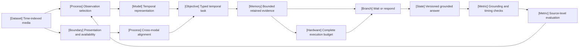

VOLUME III / PART X — MULTIMODAL, WORLD, AND EMBODIED MODELS / CHAPTER 57

# 57 — Video, temporal reasoning, and streaming multimodality

[DERIVED] A video system can justify a temporal answer only when its observation, timing, retained-state and execution contracts preserve the evidence that the answer requires.

6 sections ·0 newly cited spine papers ·3 reference-stack implementation roles · prerequisites:15,18,55–56 · artifact: a temporally grounded multimodal evaluation · updated 2026-10-25

## Why this exists

[DERIVED] Static recognition and temporal inference fail at different boundaries. A sparse observation grid can omit an event before inference starts. An order-insensitive representation can collapse distinct histories after the relevant frames have been selected. An incorrectly aligned transcript can supply evidence that was not available at the claimed decision time. A fluent final answer can conceal all three failures.

[DERIVED] Streaming adds finite resources and an unknown future. Retention decisions occur before later questions are known, and a response policy must choose when to wait, speak or return an incomplete result. A small final context does not account for the work used to build it. Moving perception before the query can shorten response latency while leaving media-hour cost unchanged or higher.

[DERIVED] The dominant design question is therefore which distinctions must survive, under which admissible information and operational conditions. This chapter connects representation and sampling choices to clock/availability constraints, typed temporal tasks, bounded state, full-sequence evaluation and complete deployment cost. Its current primary evidence first appeared within the declared March–October 2026 window. Older architecture and statistical foundations remain linked to their canonical chapters.

[DERIVED] The conclusion is deliberately conditional: choose a mechanism only when it meets the same grounding, timing and resource acceptance rule as its comparator. A counterexample, source discrepancy, invalid evaluator or incompatible implementation reopens that preference. No new book-authored model experiment is reported.

## Concept map



[DERIVED] Text equivalent:

- Time-indexed media supplies observation selection and separate presentation/availability metadata.
- Observation selection feeds temporal representation; time metadata feeds cross-modal alignment.
- Both support a typed temporal task whose retained evidence is bounded.
- The response policy waits or emits a versioned answer under the execution budget.
- Grounding/timing checks feed source-level evaluation, which can reopen observation and retention choices.

```figure
id: fig-57.1
kind: diagram
title: The temporal evidence and execution contract
caption: A valid answer needs both admissible evidence and a feasible execution path. Missing evidence, unresolved timing and exhausted budgets have explicit incomplete outcomes.
evidence: DERIVED
source: [DERIVED:eq-57.6, DERIVED:eq-57.15, DERIVED:eq-57.26]
alt: Source media passes observation and timing gates, then bounded state and a task checker. A complete resource ledger constrains execution. Failed gates lead to incomplete status.
spec:
  direction: LR
  nodes:
    - {id: source, kind: dataset, label: Source media and identities}
    - {id: gate, kind: branch, label: "Observed, aligned and available"}
    - {id: memory, kind: memory, label: Retained task distinctions}
    - {id: answer, kind: process, label: Bounded answer and check}
    - {id: cost, kind: hardware, label: Complete resource ledger}
    - {id: unknown, kind: state, label: Incomplete or unresolved}
  edges:
    - {from: source, to: gate}
    - {from: gate, to: memory, label: admissible}
    - {from: gate, to: unknown, label: failed evidence condition}
    - {from: memory, to: answer}
    - {from: cost, to: answer, kind: dependency, label: feasible deadline and capacity}
    - {from: answer, to: unknown, label: failed check or budget}
```

## Position in the book

| Relation | Canonical location and boundary |
|---|---|
| Prerequisites | [Chapter 15](../../../vol-01-learning-and-representation/part-03-model-architectures-and-state/ch15-position-long-context-and-effective-information-access/README.md), [Chapter 18](../../../vol-01-learning-and-representation/part-03-model-architectures-and-state/ch18-multimodal-architectural-primitives/README.md), [Chapter 55](../ch55-vision-language-models-and-document-intelligence/README.md), [Chapter 56](../ch56-audio-speech-and-real-time-interaction/README.md) |
| Siblings | [Chapter 58](../ch58-generative-multimodal-models-and-alternative-generation-paths/README.md): generation objectives; [Chapter 59](../ch59-predictive-representations-jepa-and-world-models/README.md): learned dynamics; [Chapter 60](../ch60-vision-language-action-policies-and-embodied-learning/README.md): action and embodiment |
| Downstream | [Chapter 61](../../part-11-evaluation-interpretability-and-deployment-assurance/ch61-capability-portfolios-and-benchmark-validity/README.md), [Chapter 63](../../part-11-evaluation-interpretability-and-deployment-assurance/ch63-agent-retrieval-multimodal-and-system-reliability-evaluation/README.md) |
| Trades off with | [Chapter 42](../../../vol-02-execution-and-optimization/part-07-inference-algorithms-distillation-and-compression/ch42-prefill-decode-kv-state-and-inference-resource-models/README.md): context resources; [Chapter 48](../../../vol-02-execution-and-optimization/part-08-inference-engines-and-production-serving/ch48-capacity-planning-benchmarking-and-lifecycle-economics/README.md): service capacity; [Chapter 53](../../part-09-retrieval-context-and-agent-systems/ch53-agent-memory-persistent-state-and-long-horizon-consistency/README.md): persistent state |

## Sections

| Section | What changes here | Evidence |
|---|---|---|
| [57.1 Temporal representations](57-1-temporal-representations.md) | Sampling and compression determine which temporal distinctions remain identifiable | MATHEMATICALLY-DERIVED; PAPER-REPORTED |
| [57.2 Cross-modal alignment](57-2-cross-modal-alignment.md) | Clock uncertainty and evidence availability become separate gates | MATHEMATICALLY-DERIVED; PAPER-REPORTED |
| [57.3 Task structure](57-3-task-structure.md) | Localization, order, state and causal claims receive distinct acceptance rules | DERIVED; PAPER-REPORTED |
| [57.4 Streaming inference](57-4-streaming-inference.md) | Finite retention and response decisions require explicit gaps and revisions | MATHEMATICALLY-DERIVED; PAPER-REPORTED |
| [57.5 Evaluation](57-5-evaluation.md) | Controlled access, temporal interventions and source-level uncertainty test the actual claim | MATHEMATICALLY-DERIVED; PAPER-REPORTED |
| [57.6 Compute and deployment](57-6-compute-and-deployment.md) | Pre-query work, cache dependencies and media deadlines constrain deployment | MATHEMATICALLY-DERIVED; PAPER-REPORTED; OFFICIAL-DOCUMENTATION |

## Artifact

[DERIVED] The planned artifact is a temporally grounded multimodal evaluation containing source/checksum and split manifests, sampling/edit records, clock/availability traces, processed model inputs, entity/evidence ledgers, versioned responses, evaluator configurations and complete offered-work/resource results. Each response must resolve its supporting intervals inside its decision cutoff. The [verification protocol](verification.md) specifies candidate acceptance rules and falsifying outcomes.

## Verification

[DERIVED] Hold the source frame multiset fixed while changing a curated order-dependent task, check both corresponding labels, and compare with order-invariant controls. Independently vary sample phase/rate, modality access and evidence-to-query gap. For streaming, score preceding silence, first responses, later revisions and full continuous cost. A failed evidence gate or unmatched comparator makes a capability claim inconclusive rather than successful.

```figure
id: fig-57.2
kind: compare
title: Mechanism choice follows the controlling obstruction
caption: The next investigation should resolve a decision-relevant gap. No row claims that newer or more complex mechanisms dominate under every task.
evidence: DERIVED
source: [DERIVED:eq-57.1, DERIVED:eq-57.15, DERIVED:eq-57.19]
alt: The comparison maps missing observations, lost historical distinctions and late responses to different investigations and reversal conditions.
spec:
  axis: failure location under the same target task and resource boundary
  columns:
    - {id: observation, label: Missing observation}
    - {id: retention, label: Lost historical evidence}
    - {id: timing, label: Late or premature response}
  rows:
    - {dimension: Inspect first, values: {observation: sampling phase and visibility, retention: source retrieval and retained state, timing: availability and trigger policy}}
    - {dimension: Candidate intervention, values: {observation: coverage or clip change, retention: matched memory alternative, timing: calibrated bounded response policy}}
    - {dimension: Reopen preference if, values: {observation: cheaper coverage meets task, retention: simple recent baseline suffices, timing: complete deadline or silence rule fails}}
```

## Lineage

[PAPER-REPORTED] The dated lineage below records eligible contributions, not a model ranking. Older foundations are canonical links in the section text.

| First public evidence | Work | Relation | Changed question |
|---|---|---|---|
| 2026-04-02 | SimpleStream [R57.11] | alternative branch | A recent-frame comparator tests the value attributed to memory |
| 2026-04-27 | Nemotron3 Nano Omni [R57.9] | engineering optimization | A dated tubelet/pruning integration separates encoder and decoder cost boundaries |
| 2026-05-03 | DSCache [R57.10] | alternative branch | Cache construction changes recent versus cumulative context |
| 2026-05-11 | StreamPro [R57.8] | current frontier | Proactive training includes timing and trajectory rewards |
| 2026-05-22 | CaST-Bench [R57.3] | current frontier | Answer correctness is checked with grounded evidence chains |
| 2026-05-25 | StreamOV [R57.4] | current frontier | Multimodal retention and a prefill-state trigger are evaluated together |
| 2026-07-01 | AV-SyncBench [R57.2] | current frontier | Temporal and semantic alignment perturbations are separated |
| 2026-08-06 | StreamArena/StreamMind [R57.5] | current frontier | Long-horizon interaction exposes a response-latency/complete-cost boundary |
| 2026-09-03 | VT-Contrast [R57.1]; LatentStream [R57.7] | alternative branch | Representation supervision and query-conditioned latent search intervene at different levels |
| 2026-09-11 | LiveProBench [R57.6] | current frontier | Full-sequence silence and response behavior is evaluated on paired recordings |

## Terms owned here

| Term | Local meaning and owner |
|---|---|
| Task-conditional temporal retention | Preserving the distinctions required by a declared video-query family;57.1 |
| Evidence availability time | Earliest recorded time a derived media observation is usable by the system, distinct from its presentation time;57.2 |
| Temporal evidence contract | The task, interval/entity semantics, admissible prefix and checker required for a grounded video answer;57.3 |
| Streaming decision cutoff | Immutable presentation and availability boundary attached to one response/wait decision;57.4 |
| Temporal pair correctness | Correctness on both members of an independently verified task-distinct temporal pair;57.5 |
| Media-token rate | Actual or explicitly approximated multimodal tokens admitted per second of source media;57.6 |

## Reference-stack coverage

| Stack section | Entry | Stack layer | What this chapter takes from it | Surface used | Sections | Evidence |
|---|---|---|---|---|---|---|
| §1 lab | #5 Alibaba Qwen | — | Named backbones in current source experiments, including StreamOV/LatentStream | https://qwenlm.github.io/ |57.1,57.4–57.6 | PAPER-REPORTED through the inspected originating studies |
| §1 lab | #14 NVIDIA Research | — | April 2026 report and pinned model-card release constraints | https://research.nvidia.com/publications ; https://huggingface.co/nvidia |57.1,57.6 | PAPER-REPORTED; OFFICIAL-DOCUMENTATION |
| §3 discovery source | #1 arXiv | — | Full primary texts and revision histories; dates and locators in the ledger | https://arxiv.org/ |all | Retrieval route, not a separate method claim |
| §3 discovery source | #10 Hugging Face Papers | — | Discovery-to-primary/model-card route | https://huggingface.co/papers |57.6 | Retrieval route |
| §4 system | #17 PyTorch | Core training framework | Tensor/mask and frozen-backbone roles; no code execution claim | https://pytorch.org/docs/stable/ |all | DERIVED role boundary; source-reported implementations |
| §4 system | #26 Hugging Face Transformers | Model-definition layer | Processor/model input and hidden-state boundary | https://huggingface.co/docs/transformers/ |all | OFFICIAL-DOCUMENTATION via dated card; compatibility UNVERIFIED |
| §4 system | #41 vLLM | LLM inference engine | Dated report/card serving context, distinct from the research controller | https://docs.vllm.ai/ |57.6 | PAPER-REPORTED; OFFICIAL-DOCUMENTATION |
| Outside the reference stack, routed via book_plan.md's Chapter 57 temporal-video verification | Academic originating studies R57.1–R57.8,R57.10–R57.11 | — | Temporal representations, alignment, causal grounding, streaming and evaluation; older Gemini2.5/V-JEPA2 anchors remain retrieval context rather than new eligible evidence | Versioned arXiv URLs in references.md |all | PAPER-REPORTED |

[DERIVED] **Inspection dimensions applied.** Precision, Memory, Inference and Metrics are explicit in all sections; Parallelism, Communication and Kernels are bounded in57.6; Checkpointing and Reliability follow decision epochs, revisions and state dependencies in57.4/57.6; Reproducibility is recorded throughout. Post-training is treated only for the source-reported contrastive/control-token objectives, with its canonical machinery linked elsewhere.

## Source route

[DERIVED] Apply lab search protocol§1.1, conference workflow§2.1, paper cascade§3.1 and training-stack search§4.3 from the reference stack. Resolve the full primary revision before attributing a method. Filled-in searches used or suitable for reopening the evidence are:

- site:research.nvidia.com/publications "Nemotron" "video"2026
- site:arxiv.org/abs "Qwen" "streaming video"2026
- site:arxiv.org/abs "temporal" "video-token contrast"2026
- site:arxiv.org/abs "audio-visual" "synchronization"2026
- site:arxiv.org/abs "streaming" "silence" "benchmark"2026
- site:github.com "DSCache" "position" ; verify the originating paper before claiming code behavior.

## Status

[DERIVED] All nine files are manuscript drafts. New research evidence is restricted to first public releases within 2026-03-01–2026-10-24, inspected on 2026-10-25. Exact versions, disclosure gaps and source discrepancies are in [references](references.md). No model, media pipeline, serving or benchmark experiment was executed. Source-backed methodology and conditional mathematical derivations do not establish independent empirical replication or an independent 10/10 review.
