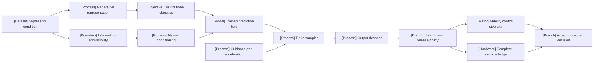

VOLUME III / PART X — MULTIMODAL, WORLD, AND EMBODIED MODELS / CHAPTER 58

# 58 — Generative multimodal models and alternative generation paths

[DERIVED] A generative multimodal system is defensible only when its representation, objective, condition, finite sampler and release policy meet the same task and resource acceptance rule.

6 sections | 0 newly cited spine papers | 11 current research reports and 2 pinned originating implementations | prerequisites:04,18,25-28,37-41,55-57 | artifact: an objective/sampler/runtime comparison | updated2026-10-25

## Why this chapter exists

[DERIVED] A plausible image or waveform is not sufficient evidence that a generator satisfied its condition. Compression can erase a required distinction before generation begins. A learned conditional field can be accurate on training corruptions yet inaccurate on guided or cache-perturbed trajectories. A numerical solver can reach its final coordinate while violating an instruction. A search policy can improve its selector score while reducing diversity, hiding prompt groups or increasing total cost.

[DERIVED] The controlling constraint changes with the interface. Raw or lightly compressed representations preserve detail but increase repeated target-state work. Compact representations reduce positions while introducing codec error and inherited teacher/decoder cost. Autoregressive, continuous flow and discrete masked objectives support different assembly algorithms; a common transformer does not make their loss values or inference costs comparable. Native unified models further mix shared representations, task-specific parameters, frozen codecs and distinct output routes.

[DERIVED] Current evidence makes these boundaries inspectable, while also revealing limits. Matched trainable-parameter budgets can exclude frozen codecs. Parameter compression can retain repeated internal computation. A cache can better resemble a base sampler while losing a separate quality metric. A policy's lower released loss can require more abstention and compute. The chapter therefore connects source methods to conditional mathematics, exact implementation surfaces, reported protocol and reversal conditions. It does not use recency, a scalar score or successful compilation as proof of scientific superiority.

## Concept map



[DERIVED] Text equivalent:

- Signals pass through a generative representation into a declared objective.
- Conditions pass an admissibility boundary and spatial/temporal alignment before influencing the trained field.
- A finite sampler combines that field with guidance/acceleration, then decodes outputs.
- Search and release determine which outputs receive fidelity, control and diversity evaluation.
- Complete resource accounting and quality constraints jointly determine acceptance or renewed investigation.

## Position in the book

| Relation             | Canonical connections                                                                                                                                                                                                                                                                                                                                                                                                                                                                                                                                                                                                                                                                                                                                                                                                                                                                                                                                                                                                                                                                                                                                                                                                                                                                                                                                                                                                                                                                                                                                                                                                                                                                                                                                                                                                                                                                                                                                                                                                                                                                                                                                                           |
| -------------------- | ------------------------------------------------------------------------------------------------------------------------------------------------------------------------------------------------------------------------------------------------------------------------------------------------------------------------------------------------------------------------------------------------------------------------------------------------------------------------------------------------------------------------------------------------------------------------------------------------------------------------------------------------------------------------------------------------------------------------------------------------------------------------------------------------------------------------------------------------------------------------------------------------------------------------------------------------------------------------------------------------------------------------------------------------------------------------------------------------------------------------------------------------------------------------------------------------------------------------------------------------------------------------------------------------------------------------------------------------------------------------------------------------------------------------------------------------------------------------------------------------------------------------------------------------------------------------------------------------------------------------------------------------------------------------------------------------------------------------------------------------------------------------------------------------------------------------------------------------------------------------------------------------------------------------------------------------------------------------------------------------------------------------------------------------------------------------------------------------------------------------------------------------------------------------------- |
| Prerequisites        | [4: Language modeling and learning objectives](../../../vol-01-learning-and-representation/part-01-scientific-foundations/ch04-language-modeling-and-learning-objectives/README.md); [18: Multimodal architectural primitives](../../../vol-01-learning-and-representation/part-03-model-architectures-and-state/ch18-multimodal-architectural-primitives/README.md); [25: Accelerators, memory hierarchy, and performance models](../../../vol-02-execution-and-optimization/part-05-hardware-kernels-and-distributed-execution/ch25-accelerators-memory-hierarchy-and-performance-models/README.md); [28: Frameworks, graph compilers, and runtime integration](../../../vol-02-execution-and-optimization/part-05-hardware-kernels-and-distributed-execution/ch28-frameworks-graph-compilers-and-runtime-integration/README.md); [37: Decoding, constrained generation, and speculative execution](../../../vol-02-execution-and-optimization/part-07-inference-algorithms-distillation-and-compression/ch37-decoding-constrained-generation-and-speculative-execution/README.md); [39: Knowledge, response, and policy distillation](../../../vol-02-execution-and-optimization/part-07-inference-algorithms-distillation-and-compression/ch39-knowledge-response-and-policy-distillation/README.md); [40: Quantization from numerical model to deployable artifact](../../../vol-02-execution-and-optimization/part-07-inference-algorithms-distillation-and-compression/ch40-quantization-from-numerical-model-to-deployable-artifact/README.md); [41: Pruning, sparsity, rank reduction, and adaptive execution](../../../vol-02-execution-and-optimization/part-07-inference-algorithms-distillation-and-compression/ch41-pruning-sparsity-rank-reduction-and-adaptive-execution/README.md); [55: Vision-language models and document intelligence](../ch55-vision-language-models-and-document-intelligence/README.md); [56: Audio, speech, and real-time interaction](../ch56-audio-speech-and-real-time-interaction/README.md); [57: Video, temporal reasoning, and streaming multimodality](../ch57-video-temporal-reasoning-and-streaming-multimodality/README.md) |
| Siblings (same part) | [55: Vision-language models and document intelligence](../ch55-vision-language-models-and-document-intelligence/README.md); [56: Audio, speech, and real-time interaction](../ch56-audio-speech-and-real-time-interaction/README.md); [57: Video, temporal reasoning, and streaming multimodality](../ch57-video-temporal-reasoning-and-streaming-multimodality/README.md)                                                                                                                                                                                                                                                                                                                                                                                                                                                                                                                                                                                                                                                                                                                                                                                                                                                                                                                                                                                                                                                                                                                                                                                                                                                                                                                                                                                                                                                                                                                                                                                                                                                                                                                                                                                                      |
| Downstream           | [59: Predictive representations, JEPA, and world models](../ch59-predictive-representations-jepa-and-world-models/README.md); [60: Vision-language-action policies and embodied learning](../ch60-vision-language-action-policies-and-embodied-learning/README.md); [63: Agent, retrieval, multimodal, and system reliability evaluation](../../part-11-evaluation-interpretability-and-deployment-assurance/ch63-agent-retrieval-multimodal-and-system-reliability-evaluation/README.md)                                                                                                                                                                                                                                                                                                                                                                                                                                                                                                                                                                                                                                                                                                                                                                                                                                                                                                                                                                                                                                                                                                                                                                                                                                                                                                                                                                                                                                                                                                                                                                                                                                                                                       |
| Trades off with      | [38: Inference-time reasoning, search, and adaptive compute](../../../vol-02-execution-and-optimization/part-07-inference-algorithms-distillation-and-compression/ch38-inference-time-reasoning-search-and-adaptive-compute/README.md); [42: Prefill, decode, KV state, and inference resource models](../../../vol-02-execution-and-optimization/part-07-inference-algorithms-distillation-and-compression/ch42-prefill-decode-kv-state-and-inference-resource-models/README.md); [46: Admission control, routing, autoscaling, and service contracts](../../../vol-02-execution-and-optimization/part-08-inference-engines-and-production-serving/ch46-admission-control-routing-autoscaling-and-service-contracts/README.md); [48: Capacity planning, benchmarking, and lifecycle economics](../../../vol-02-execution-and-optimization/part-08-inference-engines-and-production-serving/ch48-capacity-planning-benchmarking-and-lifecycle-economics/README.md)                                                                                                                                                                                                                                                                                                                                                                                                                                                                                                                                                                                                                                                                                                                                                                                                                                                                                                                                                                                                                                                                                                                                                                                                              |

[DERIVED] Chapter 18 owns multimodal fusion, Chapter 04 categorical likelihood, Chapters37-41 inference/compression and Chapters55-57 perception/audio/video. This chapter owns their generative interface and finite assembly, then passes predictive/control questions to59-60. Evaluation architecture in61/63 remains a separate canonical subject.

## Sections

| Section                                            | Title                              | What changes here                                               | Primary evidence                                               |
| -------------------------------------------------- | ---------------------------------- | --------------------------------------------------------------- | -------------------------------------------------------------- |
| [58.1](58-1-generative-representations.md)         | Generative representations         | Codec information and complete-cost boundary                    | PAPER-REPORTED; MATHEMATICALLY-DERIVED                         |
| [58.2](58-2-objectives.md)                         | Objectives                         | Factorization, noisy targets, transport and discrete corruption | PAPER-REPORTED; OFFICIAL-DOCUMENTATION; MATHEMATICALLY-DERIVED |
| [58.3](58-3-conditioning.md)                       | Conditioning                       | Required information, aligned coordinates and admissible timing | PAPER-REPORTED; MATHEMATICALLY-DERIVED                         |
| [58.4](58-4-sampling-and-acceleration.md)          | Sampling and acceleration          | Numerical, guidance, cache and distillation approximations      | PAPER-REPORTED; MATHEMATICALLY-DERIVED                         |
| [58.5](58-5-joint-understanding-and-generation.md) | Joint understanding and generation | Selective sharing, interference and retained capabilities       | PAPER-REPORTED; OFFICIAL-DOCUMENTATION; MATHEMATICALLY-DERIVED |
| [58.6](58-6-evaluation-and-systems.md)             | Evaluation and systems             | Complete-policy risk/coverage and accepted-output cost          | PAPER-REPORTED; MATHEMATICALLY-DERIVED                         |

## Artifact

[DERIVED] The deliverable is **an objective/sampler/runtime comparison**, with joined immutable records rather than only a benchmark summary.

| Record                     | Required fields                                                                                                    |
| -------------------------- | ------------------------------------------------------------------------------------------------------------------ |
| source-and-condition.jsonl | Group/split, source hashes, prompt, authorized condition, coordinates and physical-time availability               |
| representation.jsonl       | Codec/decoder revisions, latent shape, normalization, codebook/posterior policy, inherited components              |
| objective.jsonl            | Target variable, corruption/path, time sampling, active masks, channel/token/sample/rank reductions                |
| sampler.jsonl              | Grid/solver, endpoint rule, guidance convention, all evaluations, internal applications, cache policy/identity     |
| policy.jsonl               | Candidate stream, search transitions, verifier/judge revisions, stopping, release/abstention, threshold provenance |
| outputs.jsonl              | Raw output hash, per-constraint outcomes, feature metrics, diversity and temporal checks, evaluator failures       |
| resources.jsonl            | Queue/condition/denoise/decode/verify times, peak memory/lifetimes, transfer, calibration and all-attempt work     |
| decision.md                | Acceptance/coverage/resource rule, admissible comparators, controlling uncertainty, reversal and stopping          |

[DERIVED] A result row must identify the benchmark distribution, input/output dimensions, duration/frame rate where applicable, hardware, precision, concurrency, model/processor/runtime versions and timing boundary. Missing values remain NOT-DISCLOSED or UNVERIFIED. The artifact proposal has not been executed.

```figure
{
  "id": "fig-58.1",
  "kind": "compare",
  "title": "Compare the same claimed property",
  "caption": "A valid comparison fixes the target, information regime and acceptance rule. Exposure, parameter count, field evaluations and time each control a different quantity.",
  "placement": "inline",
  "anchor": "artifact",
  "evidence": "DERIVED",
  "source": "DERIVED:eq-58.21",
  "alt": "A valid comparison fixes the target, information regime and acceptance rule. Exposure, parameter count, field evaluations and time each control a different quantity.",
  "spec": {
    "axis": "Decision-relevant difference",
    "columns": [
      {
        "id": "axis",
        "label": "Matched quantity"
      },
      {
        "id": "limit",
        "label": "What remains to check"
      }
    ],
    "rows": [
      {
        "dimension": "Data exposure",
        "values": {
          "axis": "Same training examples/tokens",
          "limit": "Total compute and inherited codecs"
        }
      },
      {
        "dimension": "Capacity",
        "values": {
          "axis": "Same trainable parameters",
          "limit": "Frozen and loaded modules"
        }
      },
      {
        "dimension": "Sampler",
        "values": {
          "axis": "Same nominal step budget",
          "limit": "All field calls and guidance semantics"
        }
      },
      {
        "dimension": "Release",
        "values": {
          "axis": "Same loss threshold",
          "limit": "Coverage, diversity and all-attempt cost"
        }
      }
    ]
  }
}
```

## Verification

[DERIVED] The [verification protocol](verification.md) proposes four falsifiable studies: codec/objective attribution, condition admissibility, sampler/cache/distillation accounting and policy-level release calibration. Fixed-quality and fixed-compute comparisons are separate. Metrics must be challenged with semantic/control counterexamples, and all proposals retain independent group splits, meaningful baselines, ablations and reversal conditions. No expected numerical outcome is substituted for evidence.

```figure
{
  "id": "fig-58.2",
  "kind": "diagram",
  "title": "A failed result has different possible causes",
  "caption": "A failed acceptance gate should identify whether information, mathematics, implementation, evaluator or resource assumptions failed. Budget exhaustion returns unresolved status.",
  "placement": "inline",
  "anchor": "verification",
  "evidence": "DERIVED",
  "source": "DERIVED:eq-58.21",
  "alt": "A failed acceptance gate should identify whether information, mathematics, implementation, evaluator or resource assumptions failed. Budget exhaustion returns unresolved status.",
  "spec": {
    "direction": "LR",
    "nodes": [
      {
        "id": "gate",
        "kind": "branch",
        "label": "Acceptance gate fails"
      },
      {
        "id": "info",
        "kind": "dependency",
        "label": "Missing required information"
      },
      {
        "id": "math",
        "kind": "objective",
        "label": "Invalid approximation premise"
      },
      {
        "id": "impl",
        "kind": "process",
        "label": "Implementation mismatch"
      },
      {
        "id": "judge",
        "kind": "metric",
        "label": "Evaluator defect"
      },
      {
        "id": "cost",
        "kind": "hardware",
        "label": "Resource infeasibility"
      },
      {
        "id": "next",
        "kind": "state",
        "label": "Targeted next evidence"
      }
    ],
    "edges": [
      {
        "from": "gate",
        "to": "info",
        "kind": "flow"
      },
      {
        "from": "gate",
        "to": "math",
        "kind": "flow"
      },
      {
        "from": "gate",
        "to": "impl",
        "kind": "flow"
      },
      {
        "from": "gate",
        "to": "judge",
        "kind": "flow"
      },
      {
        "from": "gate",
        "to": "cost",
        "kind": "flow"
      },
      {
        "from": "info",
        "to": "next",
        "kind": "flow"
      },
      {
        "from": "math",
        "to": "next",
        "kind": "flow"
      },
      {
        "from": "impl",
        "to": "next",
        "kind": "flow"
      },
      {
        "from": "judge",
        "to": "next",
        "kind": "flow"
      },
      {
        "from": "cost",
        "to": "next",
        "kind": "flow"
      }
    ]
  }
}
```

## Lineage

- 2026 · MacTok [R58.1] · **current frontier** — [PAPER-REPORTED] March 31: compressed continuous image states with masked reconstruction/alignment.
- 2026 · IOMM [R58.4] · **alternative branch** — [PAPER-REPORTED] March 17: image-only generative pretraining followed by mixed alignment.
- 2026 · Foley-Flow [R58.5] · **alternative branch** — [PAPER-REPORTED] March 9: temporally varying video conditions for audio; incomplete preprocessing reconstruction remains explicit.
- 2026 · Guidance support [R58.8] · **current frontier** — [PAPER-REPORTED] May 22 inspected revision: exact-score support result under restrictive geometry/fine-step conditions.
- 2026 · GCache [R58.7] · **engineering optimization** — [PAPER-REPORTED] August 13: globally weighted fixed-budget cache-policy search.
- 2026 · DDB [R58.3] · **alternative branch** — [PAPER-REPORTED] August 30: source/mask hybrid discrete generation.
- 2026 · SHIP [R58.10] · **engineering optimization** — [PAPER-REPORTED] August 22: calibrate actual releases of complete inference policies.
- 2026 · SenseNova-U1.5 [R58.6] · **current frontier** — [PAPER-REPORTED] September 10 report: native pixel interface and specialist consolidation.
- 2026 · Multimodal Flow [R58.2] · **alternative branch** — [PAPER-REPORTED] September 30: chunk-causal continuous language/vision modeling.
- 2026 · Depth as Time [R58.9] · **engineering optimization** — [PAPER-REPORTED] October 2: shared internal blocks and parameter/compute distinction.
- 2026 · Setting-Matched Benchmark v4 [R58.13] · **current frontier** — [PAPER-REPORTED] May 7 inspected revision: component/scaled metrics and disclosed comparison limits.

## Terms owned here

- **Generative codec boundary** (58.1): the encoder-state-decoder contract, including its information loss and total resource cost.
- **Endpoint-to-velocity conversion** (58.2): the path-dependent transformation from predicted clean state to transport field, including singular/clipped endpoint behavior.
- **Hybrid absorbing state** (58.2): a categorical corruption endpoint mixing source-code anchors with mask states, separately tracking unresolved positions.
- **Denoising refresh budget** (58.4): the allowed number of full target-feature evaluations inside an otherwise reuse-enabled finite sampler.
- **Objective/sampler/runtime comparison** (58.6): an evaluation record that holds task acceptance and information access explicit while accounting for complete generation/release work.

## Reference-stack coverage

| Stack section                                                 | Entry                           | Stack layer                | What this chapter takes from it                                                                                                                                                                                                 | Surface used                                      | Sections       | Evidence label                                                |
| ------------------------------------------------------------- | ------------------------------- | -------------------------- | ------------------------------------------------------------------------------------------------------------------------------------------------------------------------------------------------------------------------------- | ------------------------------------------------- | -------------- | ------------------------------------------------------------- |
| §3 discovery source                                           | #1 arXiv                        | —                          | Eleven primary full texts, first-release histories and current revisions; originating project links                                                                                                                             | https://arxiv.org/                                | 58.1-58.6      | PAPER-REPORTED; discovery index is not method evidence        |
| §3 discovery source                                           | #10 Hugging Face Papers         | —                          | Topic/title discovery followed back to originating reports                                                                                                                                                                      | https://huggingface.co/papers                     | 58.1,58.4-58.6 | UNVERIFIED discovery-only surface                             |
| §4 system                                                     | #17 PyTorch                     | MODEL / AUTOGRAD FRAMEWORK | Reported implementations and two pinned originating tensor/loss paths                                                                                                                                                           | https://pytorch.org/docs/stable/                  | 58.1-58.6      | PAPER-REPORTED / OFFICIAL-DOCUMENTATION; execution unverified |
| Outside the reference stack (routed via book_plan.md anchors) | Originating generative projects | —                          | The plan explicitly requires newer primary diffusion/flow and generative sources; arXiv topical cascade resolves MacTok, MF, DDB, IOMM, Foley, SenseNova, GCache, guidance theory, Depth as Time, SHIP and matched benchmarking | Exact originating text/code URLs in references.md | 58.1-58.6      | PAPER-REPORTED / OFFICIAL-DOCUMENTATION; no lab-rank claim    |

**Inspection dimensions applied.** [DERIVED] Precision: endpoint conversion, covariance numerics and dtype restrictions(58.2/58.4/58.6). Memory/communication/kernels: codec states, repeated attention, cache identity and complete pipeline boundary(58.1/58.3/58.4/58.6). Post-training: specialist consolidation and depth distillation(58.4-58.5). Inference/metrics/reliability/reproducibility: all sections and verification. Parallelism/checkpointing: source-specific resource provenance is recorded; no undisclosed distributed recipe or checkpoint compatibility is inferred.

## Source route

[DERIVED] Retrieval followed the reference stack's primary-paper cascade, then full method/table/appendix and pinned source inspection. Concrete queries included:

- arXiv topical search: continuous image tokenizer posterior collapse2026; follow MacTok to Sec.3 and Appendix A.
- arXiv exact title: Multimodal Flow Unified Flow Modeling Language Vision; check history, Appendix B/C and originating code.
- arXiv topical search: discrete diffusion image generation2026; follow DDB to hybrid-state equations and supplementary settings.
- arXiv exact title: Depth as Time in One-Step Generative Models; inspect readout controls and internal compute accounting.
- arXiv exact title: Setting-Matched and Semantics-Scaled Benchmarking; inspect v4 rather than reusing v1's earlier composite.
- arXiv exact title: Calibrate What You SHIP; inspect the formal certificate separately from descriptive operating-point tables.

[DERIVED] Lab and conference routes are discovery alternatives; no uninspected proceedings page is promoted to primary evidence. Originating repository files were fetched read-only at exact commits through GitHub. Search snippets and model reputations do not support detailed mechanisms.

## Status and evidence gaps

[DERIVED] **Editorial status: manuscript_draft.** Six substantive sections, an unexecuted verification artifact, twenty authored figures plus a concept map and an exact-revision ledger are present. Structural presence and source inspection do not certify scientific completeness or a numerical quality rating.

[NOT-DISCLOSED] Material limits include Foley's temporal preprocessing/sampler details; complete source-model runtime/precision and energy disclosure; baseline inheritance and total training-compute comparability; active checkpoint-to-config identity; DDB zero-information handling; and independent replications. The MF paper/source reduction difference remains a replication question. MacTok's appendix is not used as a universal anti-collapse proof. Guidance theory keeps its exact-score/support assumptions.

[UNVERIFIED] The book executed no model training, generation, calibration or benchmark. Static source inspection and analytical checks have narrower scopes. Each preference states what evidence would reverse it; absent required evidence, the outcome remains unresolved rather than "best."
