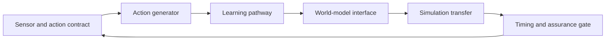

# Chapter 60 - Vision-language-action policies and embodied learning

[DERIVED] An embodied policy is a timed contract between sensor history, task specification, generated commands and a physical controller. Semantic understanding and plausible action generation do not establish executable, timely or safe behavior. This chapter follows that contract through representation, learning, world-model use, simulation transfer and assurance.

[PAPER-REPORTED] Seven retained2026 research reports and three originating implementation/release artifacts ground the current cases. First release is checked against2026-03-01 through 2026-10-24; actual access is2026-10-25. Historical OpenVLA, original diffusion policy, FAST and earlier pi models remain foundations/comparators rather than newly dated evidence. No robot, simulator, source policy or training run was executed by the book.

## Scope

[DERIVED] The artifact is a simulation-first evaluation with action schemas, timed execution, controlled perturbations, failure severity and explicit authorization gates. Research recipes that update a policy on hardware are described as source methods; they are not instructions to run them on a connected robot. The chapter supplies no hardware deployment authorization.

## Prerequisites

[DERIVED] @ms.chapter.18 supplies architecture/optimization interfaces; @ms.chapter.24 feedback and reinforcement learning; @ms.chapter.34, @ms.chapter.35 and @ms.chapter.36 adaptation/post-training; @ms.chapter.52 agents; @ms.chapter.55 perception; @ms.chapter.56 timing and state publication; @ms.chapter.57 temporal modeling; @ms.chapter.58 generation; @ms.chapter.59 predictive-state and candidate-ranking reasoning.

## Learning outcomes

- [DERIVED] Declare coordinate frames, units, normalization, action mode and timestamps before evaluating a policy.
- [DERIVED] Reconstruct token, chunk, flow and hierarchical action generation with their resource boundaries.
- [DERIVED] Distinguish imitation, offline/online RL, residual learning and self-supervised execution compensation.
- [DERIVED] Bound model-based bias under explicit assumptions and separate subgoal conditioning from counterfactual planning.
- [DERIVED] Design simulation transfer tests with reset and parameter-identification controls.
- [DERIVED] Report success, severity, all-attempt cost, calibration and intervention behavior as separate quantities.

## Notation and terms

[DERIVED] h_t is available sensor/action history; ell a task instruction; q joint configuration; a a normalized model command; u its physical command. H is generated action count, K the executed count before replanning, Delta the actuator command period. tau measures wall-clock age, distinct from a flow-time coordinate s. Masks distinguish real action dimensions/time positions from padding. Superscript B on a transform denotes a base-frame coordinate system.

> **Definition — Action contract.** [DERIVED] A versioned mapping from model outputs to physical commands, including embodiment, frames, units, normalization, rate, limits and reset semantics.

> **Definition — Observation age.** [DERIVED] The time between acquisition of the sensor data conditioning a command and its effective actuation, measured in a declared clock domain.

> **Definition — Execution mismatch.** [DERIVED] A discrepancy between commanded and measured motion after aligning time, units and coordinate frames; it need not be caused by actuator error alone.

> **Definition — Grounded continuation.** [DERIVED] An observed trajectory produced by recorded actions in the environment, distinguished from a model-imagined trajectory.

> **Definition — Selected violation risk.** [DERIVED] Violation probability conditional on executing a decision under the complete frozen selection/abstention pipeline, provided execution probability is positive.

## Chapter map



- Sensor and action contracts define what action generation means.
  - Learning changes the policy and its data distribution.
  - World models can supply subgoals, predicted costs or imagined training data.
    - Simulation transfer tests sensing, dynamics and resets.
    - Timing/assurance gates determine which outputs can enter an authorized controller.
      - New observations and failures revise the contract.

```figure
{
  "id": "fig-60.1",
  "kind": "diagram",
  "title": "A policy is one component in the control loop",
  "caption": "Task reasoning, generated actions and the actual controller remain distinct. The gate consumes timestamps and limits as well as model output.",
  "placement": "inline",
  "anchor": "scope",
  "evidence": "DERIVED",
  "source": "DERIVED:fig-60.1",
  "alt": "Task reasoning, generated actions and the actual controller remain distinct. The gate consumes timestamps and limits as well as model output.",
  "spec": {
    "direction": "LR",
    "nodes": [
      {
        "id": "s",
        "kind": "node",
        "label": "Sensors/history"
      },
      {
        "id": "p",
        "kind": "model",
        "label": "Policy"
      },
      {
        "id": "g",
        "kind": "boundary",
        "label": "Contract and timing gate"
      },
      {
        "id": "c",
        "kind": "process",
        "label": "Low-level controller"
      },
      {
        "id": "e",
        "kind": "state",
        "label": "Environment"
      }
    ],
    "edges": [
      {
        "from": "s",
        "to": "p",
        "kind": "flow",
        "label": "condition"
      },
      {
        "from": "p",
        "to": "g",
        "kind": "flow",
        "label": "propose"
      },
      {
        "from": "g",
        "to": "c",
        "kind": "flow",
        "label": "authorized feasible command"
      },
      {
        "from": "c",
        "to": "e",
        "kind": "flow",
        "label": "actuate"
      },
      {
        "from": "e",
        "to": "s",
        "kind": "feedback",
        "label": "measure"
      }
    ]
  }
}
```

```figure
{
  "id": "fig-60.2",
  "kind": "compare",
  "title": "Three different meanings of zero-shot",
  "caption": "A transfer claim must name the component and the information already supplied.",
  "placement": "inline",
  "anchor": "scope",
  "evidence": "DERIVED",
  "source": "DERIVED:fig-60.2",
  "alt": "A transfer claim must name the component and the information already supplied.",
  "spec": {
    "axis": "Decision-relevant difference",
    "columns": [
      {
        "id": "claim",
        "label": "Claim"
      },
      {
        "id": "held",
        "label": "What is held out"
      },
      {
        "id": "cost",
        "label": "What may remain"
      }
    ],
    "rows": [
      {
        "dimension": "Task transfer",
        "values": {
          "claim": "No target-task policy finetuning",
          "held": "Target task examples",
          "cost": "Pretrained semantics and coaching context"
        }
      },
      {
        "dimension": "Residual transfer",
        "values": {
          "claim": "No real residual RL",
          "held": "Physical residual updates",
          "cost": "Task teleoperation, simulator and object tracker"
        }
      },
      {
        "dimension": "Embodiment transfer",
        "values": {
          "claim": "No target skill demonstrations",
          "held": "Skill on target robot",
          "cost": "Target controller/schema and other target tasks"
        }
      }
    ]
  }
}
```

## Sections

| Section          | Mechanism                                  | Acceptance question                                          |
| ---------------- | ------------------------------------------ | ------------------------------------------------------------ |
| @ms.section.60.1 | Sensor/action schemas and geometry         | Are outputs physically interpretable?                        |
| @ms.section.60.2 | Tokens, chunks, flows and hierarchy        | What does one prediction cost and commit?                    |
| @ms.section.60.3 | Imitation, RL, mixtures and adaptation     | Which data/support and optimization claims hold?             |
| @ms.section.60.4 | Predictive state, planning and imagination | Which errors influence decisions?                            |
| @ms.section.60.5 | Randomization, identification and transfer | Which simulator assumptions survive reality?                 |
| @ms.section.60.6 | Delay, limits, intervention and recovery   | What can be executed within the authorized operating region? |

## Lineage

- 2026 · pi0.7 [R60.1] · **current frontier** — [PAPER-REPORTED] Context-rich mixed-data policy training and hierarchical visual subgoals.
- 2026 · MolmoAct2 [R60.2] · **current frontier** — [PAPER-REPORTED] Discrete pretraining plus detached per-layer KV conditioning for continuous actions.
- 2026 · piR2 [R60.3] · **engineering optimization** — [PAPER-REPORTED] Fast proprioception, asynchronous semantic context and latency-adaptive streaming flow.
- 2026 · MeRL [R60.4] · **alternative branch** — [PAPER-REPORTED] Reliability-conditioned imagined-data scheduling and replay.
- 2026 · Object-centric residual RL [R60.5] · **alternative branch** — [PAPER-REPORTED] Simulation-trained corrective policy with a deployable pose interface.
- 2026 · Self-compensating VLA [R60.6] · **engineering optimization** — [PAPER-REPORTED] Execution residuals train bounded adapters during deployment.
- 2026 · BOKBO [R60.7] · **current frontier** — [PAPER-REPORTED] Sampling/abstention diagnostics, with a conditional-risk proof gap retained.

## Reference-stack coverage

| Stack section                                                 | Entry                                | Stack layer                | What this chapter takes from it                                                       | Surface used                     | Sections  | Evidence label                                |
| ------------------------------------------------------------- | ------------------------------------ | -------------------------- | ------------------------------------------------------------------------------------- | -------------------------------- | --------- | --------------------------------------------- |
| §3 discovery source                                           | #1 arXiv                             | —                          | Eligible full methods/tables/appendices and histories                                 | https://arxiv.org/               | 60.1-60.6 | PAPER-REPORTED; discovery is not verification |
| §4 system                                                     | #17 PyTorch                          | MODEL / AUTOGRAD FRAMEWORK | Originating action-expert masks and tensor interfaces                                 | https://pytorch.org/docs/stable/ | 60.1-60.3 | OFFICIAL-DOCUMENTATION; static only           |
| Outside the reference stack (routed via book_plan.md anchors) | Originating embodied-policy projects | —                          | Newer primary VLA reports, official release and pinned code reached from plan anchors | references.md                    | 60.1-60.6 | PAPER-REPORTED / OFFICIAL-DOCUMENTATION       |

[DERIVED] The research route followed current generalist VLA, flow-control latency, residual sim-to-real, world-model post-training and selective-risk queries to originating texts. Inspection covers coordinate precision, masks/gradient paths, memory/compute, training versus evaluation seeds, calibration and complete execution boundaries. Mutable release marketing is not substituted for a method/table or physical safety evidence.

## Status and evidence gaps

[DERIVED] **Editorial status: manuscript_draft.** Six sections, twenty authored figures plus a map, mathematical procedures and proposed typed experiments are present. No numerical quality rating, physical safety certificate or execution result is asserted. Active checkpoint/config identity, hardware compatibility, force-proxy validity, rare-failure rates and general transfer remain unresolved. Read @ms.references.60 and @ms.verification.60.
