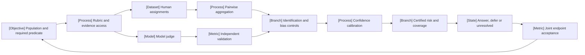

VOLUME III / PART XI — EVALUATION, INTERPRETABILITY, AND DEPLOYMENT ASSURANCE / CHAPTER 62

# 62 — Human preference, model judges, and uncertainty

[DERIVED] A judgment becomes decision evidence only when its population, predicate, evaluator errors and uncertainty support the action being considered.

6 sections · 7 current primary papers · 1 pinned implementation family, static inspection only · prerequisites: 02, 06, 32–33, 61 · artifact: a human/judge evaluation with calibration and disagreement analysis · updated 2026-10-25

## Why this chapter exists

[DERIVED] Open-ended generation creates an evaluation bottleneck: exact checks are often incomplete, human judgments differ, and model judges can produce a confident, repeatable verdict without satisfying the intended criterion. Scaling the number of judgments can make a biased or invalid instrument look more precise. The problem is therefore not resolved by selecting a larger judge or an agreeable panel.

[DERIVED] The controlling constraint is identifying what a score means and when it can justify action. Preference depends on whose tasks and values are sampled; a truth judgment needs independent evidence; a latent paired score depends on model and comparison assumptions; an abstention guarantee depends on sampling and threshold selection. These objects can support one another without becoming interchangeable.

[DERIVED] This chapter makes those interfaces explicit. It follows human collection through aggregation and judge validation, treats presentation/adversarial failures as matched interventions, derives risk-control conditions and connects the resulting evidence to a declared action rule. Primary-source review includes substantive qualifications: performance-filtered human cohorts, nonidentified nuisance terms, conditional adversarial denominators, an i.i.d. proof presented under an exchangeability label, and differences between raw and chance-corrected agreement. The aim is an inspectable measurement argument whose uncertainty remains visible when an endpoint is selected.

## Concept map



- Population and required predicate
  - Rubric and evidence access
  - Human assignments and pairwise aggregation
  - Model judge and independent validation
  - Identification and bias controls
  - Confidence calibration and certified risk/coverage
  - Answer, defer or unresolved action
  - Joint endpoint acceptance and reopening conditions

[DERIVED] Text equivalent: the required population/predicate governs both human and model evaluation. Independent validation and aggregation diagnostics constrain calibration. A certified action rule and joint endpoint acceptance close the decision; changed requirements or drift reopen it. The graph does not claim that every workflow needs a model judge or a scalar ranking.

## Position in the book

| Relation | Canonical connections |
|---|---|
| Prerequisites | [Mathematical/statistical foundations](../../../vol-01-learning-and-representation/part-01-scientific-foundations/ch02-mathematical-and-statistical-foundations/README.md), [experimental design](../../../vol-01-learning-and-representation/part-01-scientific-foundations/ch06-experimental-design-and-evaluation-before-optimization/README.md), [reward/preference training](../../../vol-02-execution-and-optimization/part-06-post-training-and-reinforcement-learning/ch32-preferences-reward-models-verifiers-and-oversight/README.md), [alignment objectives](../../../vol-02-execution-and-optimization/part-06-post-training-and-reinforcement-learning/ch33-direct-preference-optimization-and-related-objectives/README.md), [capability portfolios](../ch61-capability-portfolios-and-benchmark-validity/README.md) |
| Siblings (same part) | [System reliability evaluation](../ch63-agent-retrieval-multimodal-and-system-reliability-evaluation/README.md), [causal interpretability](../ch64-mechanistic-interpretability-and-causal-model-analysis/README.md), [security/safety](../ch65-security-privacy-safety-and-adversarial-robustness/README.md) |
| Downstream | [Release evidence and authorization](../ch66-release-decisions-reproducibility-and-research-to-production-closure/README.md) |
| Trades off with | [Lifecycle economics](../../../vol-02-execution-and-optimization/part-08-inference-engines-and-production-serving/ch48-capacity-planning-benchmarking-and-lifecycle-economics/README.md): evaluator/review expense versus independently supported decision precision |

## Sections

| Section | What changes here | Primary evidence labels |
|---|---|---|
| [62.1](62-1-human-evaluation-design.md) Human evaluation design | The rater population, rubric and assignment define the judgment | DERIVED · MATHEMATICALLY-DERIVED · PAPER-REPORTED |
| [62.2](62-2-pairwise-aggregation.md) Pairwise aggregation | Pairwise projection needs tie and identification assumptions | DERIVED · MATHEMATICALLY-DERIVED · PAPER-REPORTED |
| [62.3](62-3-model-as-judge.md) Model-as-judge | A model grade needs independent predicate/parser validation | DERIVED · MATHEMATICALLY-DERIVED · OFFICIAL-DOCUMENTATION · PAPER-REPORTED |
| [62.4](62-4-judge-failure-modes.md) Judge failure modes | Matched interventions separate nuisance from changed quality | DERIVED · MATHEMATICALLY-DERIVED · PAPER-REPORTED |
| [62.5](62-5-confidence-and-abstention.md) Confidence and abstention | A score becomes a risk rule only under valid sampling and selection | DERIVED · MATHEMATICALLY-DERIVED · PAPER-REPORTED |
| [62.6](62-6-interpreting-scores.md) Interpreting scores | Population, truth and endpoint identity delimit action | DERIVED · MATHEMATICALLY-DERIVED · PAPER-REPORTED |

## Artifact

[DERIVED] The evaluation artifact contains the required predicate and target population; rubric/anchors and rater recruitment/assignment; randomized display slots; raw criterion judgments, ties and abstentions; independent adjudication; judge/model/parser versions; development/calibration/confirmation splits; bias and adversarial controls; comparison-model identification/convergence records; fixed-grid risk certificates; resource joins; and a bounded decision note. Every summary must reconnect to its offered IDs and measurement operator.

[DERIVED] Acceptance requires an independent reviewer to reconstruct the score's reference, opportunity denominator, dependence, failures and decision rule. A human consensus, a model ensemble or a narrow interval discharges only its own tested obligation. The final report preserves both criterion-level outcomes and any optional utility aggregate; unresolved requirements remain explicit.

```figure
{
  "id": "fig-62.1",
  "kind": "cycle",
  "title": "Validate the evaluator before acting on its grade",
  "caption": "A frozen rubric is checked against independent evidence, then used with a selection-aware decision rule. Bias, drift or label failure returns to the corresponding instrument; a numerical score alone does not close the loop.",
  "placement": "inline",
  "anchor": "artifact",
  "evidence": "MATHEMATICALLY-DERIVED",
  "source": "DERIVED:eq-62.16",
  "alt": "A frozen rubric is checked against independent evidence, then used with a selection-aware decision rule. Bias, drift or label failure returns to the corresponding instrument; a numerical score alone does not close the loop.",
  "spec": {
    "stages": [
      {
        "id": "target",
        "label": "Population, predicate and action",
        "kind": "objective"
      },
      {
        "id": "design",
        "label": "Rubric and evaluator design",
        "kind": "process"
      },
      {
        "id": "validate",
        "label": "Independent validation",
        "kind": "metric"
      },
      {
        "id": "calibrate",
        "label": "Calibration and uncertainty",
        "kind": "process"
      },
      {
        "id": "decide",
        "label": "Bounded decision or review",
        "kind": "state"
      }
    ],
    "edges": [
      {
        "from": "target",
        "to": "design"
      },
      {
        "from": "design",
        "to": "validate"
      },
      {
        "from": "validate",
        "to": "calibrate"
      },
      {
        "from": "calibrate",
        "to": "decide"
      },
      {
        "from": "validate",
        "to": "design",
        "kind": "feedback",
        "label": "failed control"
      },
      {
        "from": "decide",
        "to": "target",
        "kind": "feedback",
        "label": "new population or drift"
      }
    ]
  }
}
```

## Verification

[ASSUMED] [Verification](verification.md) proposes three unexecuted protocols: human/order auditing; independent judge, nuisance and adversarial controls; and calibration/decision reconstruction under independent, dependent and shifted data. All twelve canonical fields specify finite caps, controls, denominators and interpretations. None was executed; mathematical counterexamples establish conditional limits rather than new model or human performance.

## Lineage

[PAPER-REPORTED] 2026 · domain-informed human reference construction · alternative branch [R62.1]. 2026 · OSCAR paired aggregation · alternative branch [R62.2]. 2026 · RankJudge localization · alternative branch [R62.3]. 2026 · agreement/repeatability audit · alternative branch [R62.4]. 2026 · authorship-label intervention · alternative branch [R62.5]. 2026 · CIC selective certification · alternative branch [R62.6]. 2026 · adversarial judge audit · alternative branch [R62.7]. Their different targets prevent interpreting this list as an overall ranking.

```figure
{
  "id": "fig-62.2",
  "kind": "lineage",
  "title": "Current judge research changes different assumptions",
  "caption": "The retained 2026 studies address population/label construction, order-aware aggregation, structured localization, agreement interpretation, authorship, selective certification and adversarial validity. They supply complementary bounded evidence rather than a universal judge ranking.",
  "placement": "wide",
  "anchor": "lineage",
  "evidence": "PAPER-REPORTED",
  "source": [
    "R62.1",
    "R62.2",
    "R62.3",
    "R62.4",
    "R62.5",
    "R62.6",
    "R62.7"
  ],
  "alt": "Seven 2026 branches investigate different evaluator assumptions: human reference construction, paired aggregation, structured judging, repeatability, attribution labels, selective risk and adversarial grading.",
  "spec": {
    "entries": [
      {
        "year": 2026,
        "work": "Domain-informed human reference design",
        "cite": "R62.1",
        "relation": "alternative branch"
      },
      {
        "year": 2026,
        "work": "OSCAR order-aware aggregation",
        "cite": "R62.2",
        "relation": "alternative branch"
      },
      {
        "year": 2026,
        "work": "RankJudge structured localization",
        "cite": "R62.3",
        "relation": "alternative branch"
      },
      {
        "year": 2026,
        "work": "Agreement and repeatability audit",
        "cite": "R62.4",
        "relation": "alternative branch"
      },
      {
        "year": 2026,
        "work": "Authorship-label intervention",
        "cite": "R62.5",
        "relation": "alternative branch"
      },
      {
        "year": 2026,
        "work": "CIC selective-risk construction",
        "cite": "R62.6",
        "relation": "alternative branch"
      },
      {
        "year": 2026,
        "work": "Adversarial judge audit",
        "cite": "R62.7",
        "relation": "alternative branch"
      }
    ]
  }
}
```

## Terms owned here

- **Population-conditioned preference (62.1):** expected tie-adjusted judgment under a specified task/rater population and rubric.
- **Paired-comparison projection (62.2):** a declared statistical model mapping pairwise outcomes to conditional scores/probabilities, with residual and identification limits.
- **Validated model-judge role (62.3):** the grade/predicate domain independently supported for a particular evaluator and parser.
- **Authorship-attribution effect (62.4):** a score change induced by displayed source labels on fixed evaluation content under a matched intervention.
- **Selective risk (62.5):** the error probability conditional on a fixed policy accepting a response, defined only at positive coverage.
- **Evaluation-to-action rule (62.6):** a decision construction connecting a validated predicate, admitted information and explicit costs/constraints.

[DERIVED] General train/test separation, target masks, tool correctness, evidence support and deployment authorization remain at their canonical chapters. The chapter applies those mechanisms to evaluation and does not make human or model judgment a universal oracle.

## Reference-stack coverage

| Stack section | Entry | Stack layer | What this chapter takes from it | Surface used | Sections | Evidence label |
|---|---|---|---|---|---|---|
| §3 discovery source | #1 arXiv | — | Exact metadata, current full-text methods, proofs, tables and revision histories for retained studies; retrieval itself is not method evidence | https://arxiv.org/ ; https://arxiv.org/search/advanced | 62.1–62.6 | PAPER-REPORTED |
| §2 conference | #6 EMNLP | — | Source-reported Findings context for the authorship paper; independent proceedings acceptance audit not claimed | https://aclanthology.org/venues/emnlp/ | 62.4 | NOT-DISCLOSED |
| Outside the reference stack (routed via book_plan.md anchors) | RankJudge / Layer 6 AI | Evaluation orchestration, outside §4 taxonomy | Current implementation for the plan's model-judge/pairwise evaluation topic; originating paper retrieved through arXiv, exact dated commit pinned | https://github.com/layer6ai-labs/RankJudge | 62.3 | OFFICIAL-DOCUMENTATION |

[DERIVED] **Inspection dimensions applied:** Reproducibility includes first-release/revision/access separation and exact static function locators; Metrics includes confusion, preference, uncertainty and risk/coverage; Reliability includes invalid calls and fixed-roster completeness; Inference includes judge/reference access and additional sampling; Memory includes raw judgments/traces; Precision and hardware are retained where the adversarial study discloses its T4/4-bit boundary. No source inspection certifies a local runtime, kernel, parallel configuration or current provider price.

## Source route

[DERIVED] Use the reference stack's paper cascade and inspect actual methods/results, not secondary summaries. Concrete queries: site:arxiv.org/abs "pairwise" "judge" "2026"; site:arxiv.org/abs "OSCAR" "order"; site:arxiv.org/abs "abstention" "confidence interval"; site:arxiv.org/abs "Self- and Other-Labels"; site:aclanthology.org "EMNLP" "judge"; site:github.com/layer6ai-labs/RankJudge "run_match". Follow repository claims to the exact commit, inspect the relevant function, and distinguish static inspection from execution. Review metadata before assuming eligibility from an identifier.

## Status

[DERIVED] Manuscript draft with seven current primary studies and one pinned static implementation family. Every section includes the mechanism, mathematical domains and counterexamples, finite procedure, implementation/resource implications, reported protocol and limits, and decision/reversal conditions. Verification remains unexecuted and no candidate ranking or numerical quality rating is asserted.

[NOT-DISCLOSED] The target user/task population, private provider execution, exact local compatibility, real deployment calibration, complete artifact costs and untested domain/attack rates remain unestablished. The [source ledger](references.md) records inspected scope and unresolved guarantee boundaries; no broader source re-verification or empirical replication is implied.
