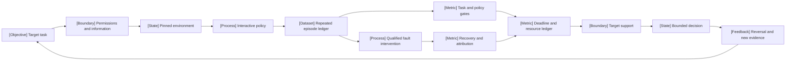

VOLUME III / PART XI — EVALUATION, INTERPRETABILITY, AND DEPLOYMENT ASSURANCE / CHAPTER 63

# 63 — Agent, retrieval, multimodal, and system reliability evaluation

[DERIVED] Reliable task completion is a joint event over outcome, policy, durable state and deadline, measured on every offered episode with complete resource and uncertainty accounting.

6 sections · 7 spine papers · 2 statically inspected implementation surfaces · prerequisites: 48–62 · artifact: an end-to-end reliability report with stage-level attribution · updated 2026-10-25

## Why this exists

[DERIVED] Final-answer scoring fails when the system changes the world while it reasons. A repository patch can pass an incomplete test, a support response can accompany an unauthorized account update, and a desktop dialog can claim success before a write is durable. Treating these as one text-output event loses the difference between completing the request, obeying its policy and preserving unrelated state.

[DERIVED] Repeated execution introduces another bottleneck. A policy may find one valid attempt after many retries while rarely succeeding consistently. Tool failures, hidden server state, stale data and asynchronous completion can propagate through several stages; the last visible error need not locate the cause. Additional search or judging can improve an answer while making it late, expensive or unsafe to repeat. The dominant constraint becomes preserving the episode and its dependencies across outcome, timing and cost evidence.

[DERIVED] The evaluation therefore changes from ranking isolated answers to qualifying a whole closed loop. Freeze the environment and information boundary, observe repeated outcomes, use controlled interventions for causal questions and retain all offered-task costs. A scoped report then says what transfers to the target workflow, what remains unresolved and which operational condition would reverse the decision.

## Concept map



- Target task
  - Permissions and information
  - Pinned environment
    - Interactive policy
    - Repeated episode ledger
  - Task and policy gates
  - Qualified fault intervention
    - Recovery and attribution
  - Deadline and resource ledger
  - Target support
    - Bounded decision
    - Reversal and new evidence

[DERIVED] Text equivalent: target and permitted information define the interactive environment; repeated episodes support outcome gates, while qualified interventions support recovery/attribution. Their complete timing/resource ledger and target support constrain the decision and its reversal.

```figure
{
  "id": "fig-63.1",
  "kind": "diagram",
  "title": "From offered task to scoped evidence",
  "caption": "The complete task loop produces independent gate outcomes, stage evidence and resource measurements before any reliability decision.",
  "placement": "inline",
  "anchor": "concept-map",
  "evidence": "DERIVED",
  "source": "DERIVED:eq-63.2",
  "alt": "The complete task loop produces independent gate outcomes, stage evidence and resource measurements before any reliability decision.",
  "spec": {
    "direction": "LR",
    "nodes": [
      {
        "id": "n0",
        "kind": "dataset",
        "label": "Target tasks + permissions"
      },
      {
        "id": "n1",
        "kind": "process",
        "label": "Frozen interactive protocol"
      },
      {
        "id": "n2",
        "kind": "state",
        "label": "Repeated execution + fault controls"
      },
      {
        "id": "n3",
        "kind": "process",
        "label": "Independent gates + attribution"
      },
      {
        "id": "n4",
        "kind": "metric",
        "label": "Quality / deadline / resource report"
      },
      {
        "id": "n5",
        "kind": "process",
        "label": "Scoped decision + reversal"
      }
    ],
    "edges": [
      {
        "from": "n0",
        "to": "n1"
      },
      {
        "from": "n1",
        "to": "n2"
      },
      {
        "from": "n2",
        "to": "n3"
      },
      {
        "from": "n3",
        "to": "n4"
      },
      {
        "from": "n4",
        "to": "n5"
      }
    ]
  }
}
```

## Position in the book

| Relation | Canonical connections |
|---|---|
| Prerequisites | [48 economics](../../../vol-02-execution-and-optimization/part-08-inference-engines-and-production-serving/ch48-capacity-planning-benchmarking-and-lifecycle-economics/README.md), [49–53 retrieval/context/state](../../part-09-retrieval-context-and-agent-systems/ch49-retrieval-models-indexing-and-evidence-access/README.md), [54 agents/tools](../../part-09-retrieval-context-and-agent-systems/ch54-multi-agent-coordination-and-system-level-evaluation/README.md), [55–57 modalities/streams](../../part-10-multimodal-world-and-embodied-models/ch55-vision-language-models-and-document-intelligence/README.md), [61 validity](../ch61-capability-portfolios-and-benchmark-validity/README.md), [62 judgments](../ch62-human-preference-model-judges-and-uncertainty/README.md) |
| Siblings (same part) | [64 causal model analysis](../ch64-mechanistic-interpretability-and-causal-model-analysis/README.md), [65 security](../ch65-security-privacy-safety-and-adversarial-robustness/README.md), [66 release closure](../ch66-release-decisions-reproducibility-and-research-to-production-closure/README.md) |
| Downstream | [65 adversarial requirements](../ch65-security-privacy-safety-and-adversarial-robustness/README.md), [66 release dossier](../ch66-release-decisions-reproducibility-and-research-to-production-closure/README.md) |
| Trades off with | [42 state/resource lifetime](../../../vol-02-execution-and-optimization/part-07-inference-algorithms-distillation-and-compression/ch42-prefill-decode-kv-state-and-inference-resource-models/README.md), [47 recovery](../../../vol-02-execution-and-optimization/part-08-inference-engines-and-production-serving/ch47-observability-deployment-changes-and-incident-recovery/README.md), [48 economics](../../../vol-02-execution-and-optimization/part-08-inference-engines-and-production-serving/ch48-capacity-planning-benchmarking-and-lifecycle-economics/README.md), [62 risk/coverage](../ch62-human-preference-model-judges-and-uncertainty/README.md) |

## Sections

| Section | Title | What changes here | Evidence |
|---|---|---|---|
| [63.1](63-1-interactive-benchmarks.md) | Interactive benchmarks | Freezes policy/environment/verifier contract | DERIVED; PAPER-REPORTED |
| [63.2](63-2-repeated-run-reliability.md) | Repeated-run reliability | Separates search, consistency and adaptive policies | MATHEMATICALLY-DERIVED; PAPER-REPORTED |
| [63.3](63-3-stage-attribution.md) | Stage attribution | Distinguishes symptom, intervention and selected diagnosis | DERIVED; OFFICIAL-DOCUMENTATION |
| [63.4](63-4-stress-and-fault-testing.md) | Stress/fault testing | Qualifies mutation relations and recovery invariants | DERIVED; PAPER-REPORTED |
| [63.5](63-5-performance-quality-coupling.md) | Performance/quality | Joins all offered-task quality/cost/deadline outcomes | MATHEMATICALLY-DERIVED; PAPER-REPORTED |
| [63.6](63-6-realistic-evaluation.md) | Realistic evaluation | Bounds target transfer and operational evidence | DERIVED; MATHEMATICALLY-DERIVED |

## Artifact

[DERIVED] The reliability report comprises episode-contract.json (task/version/information/permissions/predicates), roster.jsonl (all offered IDs and clusters), traces.jsonl (stages, actions, arrivals and durable effects), outcomes.jsonl (all gates and unresolved states), interventions.jsonl (applicability, changed bytes and hidden labels), diagnoses.jsonl (visible information, predictions and probes), resources.jsonl (all retries/branches/cost and timing), and report.json (joint metrics, uncertainty, support limits and reversal conditions). These are proposed artifact roles, not an executed benchmark package.

```figure
{
  "id": "fig-63.2",
  "kind": "compare",
  "title": "A reliability report has several irreducible events",
  "caption": "Capability, policy, diagnosis and resource outcomes answer different questions. No aggregate score removes a failed required gate.",
  "placement": "rail",
  "anchor": "artifact",
  "evidence": "DERIVED",
  "source": "DERIVED:eq-63.17",
  "alt": "Capability, policy, diagnosis and resource outcomes answer different questions. No aggregate score removes a failed required gate.",
  "spec": {
    "axis": "Keep the event and denominator visible",
    "columns": [
      {
        "id": "a",
        "label": "Reported event"
      },
      {
        "id": "b",
        "label": "Required context"
      }
    ],
    "rows": [
      {
        "dimension": "Task completion",
        "values": {
          "a": "Requested outcome achieved",
          "b": "All offered tasks; qualified predicate"
        }
      },
      {
        "dimension": "Policy and integrity",
        "values": {
          "a": "Allowed durable effect",
          "b": "Permissions, side effects, epoch"
        }
      },
      {
        "dimension": "Diagnosis",
        "values": {
          "a": "Known fault/type localized",
          "b": "Eligible remaining failures and visibility"
        }
      },
      {
        "dimension": "Deadline/resource",
        "values": {
          "a": "Valid completion in budget",
          "b": "All attempts and campaign boundary"
        }
      }
    ]
  }
}
```

## Verification

[ASSUMED] Evaluate repeated matched tasks, qualified fault propagation and a joint resource/target confirmation with independent predicates and complete denominators. Distinguish localization among remaining failures from resilience, and compare policies on every offered task. [Verification](verification.md) provides three 12-field unexecuted studies and exact calculator component/unit/domain bindings.

## Lineage

- 2026 · Computer Use Agent Reliability [R63.2] · current frontier: task-paired repeated outcomes.
- 2026 · AgenticRAG-FP [R63.3] · alternative branch: certified hop intervention and suffix response.
- 2026 · RAG Metamorphic Testing [R63.4] · engineering optimization: transformation-specific corpus testing.
- 2026 · Incident-Arena [R63.9] · current frontier: bounded operational outcome/safety verification.

## Terms owned here

- **Offered-episode contract** (63.1): frozen task/environment/information/effect/predicate agreement defining a registered interactive evaluation unit.
- **Remaining-failure localization** (63.3): diagnosis accuracy conditional on eligible injected trajectories that still fail after execution.
- **Qualified mutation relation** (63.4): an expected output relation whose evidence-preservation/update premise was independently checked.

## Reference-stack coverage

| Stack section | Entry | Stack layer | What this chapter takes | Surface used | Sections | Evidence |
|---|---|---|---|---|---|---|
| §3 discovery | 1. arXiv | Not a runtime layer | Exact R63.1–R63.6/R63.9 histories and full-text methods/tables | https://arxiv.org/ | 63.1–63.6 | PAPER-REPORTED |
| Outside the reference stack (routed via book_plan.md anchors) | AgentChaosBench R63.7–R63.8 | Telemetry evaluation | Two pinned official source files, justified by plan stage-attribution/fault-testing obligations and benchmark code routes | https://github.com/kevinzck8k/agentic-fault-diagnosis | 63.3 | OFFICIAL-DOCUMENTATION |

**Inspection dimensions applied.** [DERIVED] Metrics and Reliability span 63.1–63.6; Inference/resource boundaries are 63.2/63.5; Memory/state lifetime and Communication/event timing are 63.3–63.5; Reproducibility is explicit throughout. No inference server was executed or certified.

## Source route

[DERIVED] Use §3.1 exact-title/newest-revision → archival venue → bibliographic graph → official code/configuration → source-local report. Concrete queries: `cat:cs.AI AND ti:"reliability" AND abs:"computer use"`; `site:arxiv.org "When Failures Propagate"`; `site:arxiv.org "SWE-Bench Pro Verified"`; `site:github.com/kevinzck8k/agentic-fault-diagnosis "structured_view"`. The §2.1 proceedings workflow is a separate check when available; lab or runtime routes (§1.1/§4.3) must be applied before attributing uninspected implementation claims, not counted as completed here.

## Status

[DERIVED] Manuscript draft; seven eligible new papers and two pinned static sources inspected, accessed 2026-10-25. No model, service, computer-use environment or proposed study executed. Source-local limits include selected failed/baseline-correct cohorts, hidden hosted hardware/precision/concurrency, incomplete target support and the unresolved Incident-Arena abstract/full-text effort discrepancy. [References](references.md) records exact versions/locators. Independent scientific and integration review remain required.
