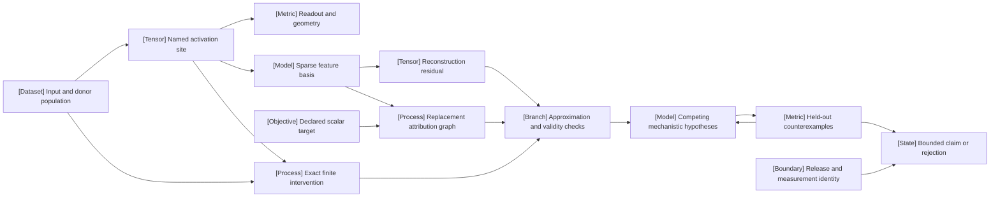

VOLUME III / PART XI - EVALUATION, INTERPRETABILITY, AND DEPLOYMENT ASSURANCE / CHAPTER 64

# 64 - Mechanistic interpretability and causal model analysis

[DERIVED] A mechanistic claim is defensible only when its variables, replacement assumptions and intervention predictions survive controls that distinguish it from competing explanations.

6 sections - 0 newly cited spine papers - 5 reference-stack implementation roles - prerequisites: 2, 5, 13-18, 32, 61-62 - artifact: a mechanistic hypothesis with intervention controls - updated 2026-10-25

## Why this exists

[DERIVED] Output accuracy leaves many internal computations observationally indistinguishable. Activation access makes new measurements possible, but a predictive probe can read information that generation does not use. A sparse basis can reconstruct a signal while splitting its variables differently. A graph can retain most edge weight while losing the small uncancelled contribution that determines its answer. These are distinct identification failures, requiring different controls.

[DERIVED] The bottleneck is the validity of the mapping from a measurement to the claim made from it. An exact patch establishes an effect under a particular donor and execution policy. A gradient approximates that effect only under a suitable finite-step regime. A learned replacement adds reconstruction, joint-execution and basis assumptions. A natural-language activation explanation adds a second model that can convey useful information without making every sentence true. Combining these instruments does not erase their individual error boundaries.

[DERIVED] The chapter therefore organizes interpretation around an inspectable contract: model/site/population identities, target, intervention family, competing hypotheses, resource budget and rejection rule. Current sources first released within 1 March-24 October 2026 supply concrete methods and reported tests. Conditional derivations expose what follows from their assumptions and where counterexamples stop a stronger inference. The artifact remains a draft scientific hypothesis with an evidence ledger; no model training, GPU intervention study or replication is reported by this edition.

## Concept map



[DERIVED] Text equivalent:

- The input/donor population supplies named activation sites and exact finite interventions.
  - Activations support readout/geometry measurements and a sparse feature basis.
  - The basis produces a replacement graph and an explicit reconstruction residual.
- A declared scalar target determines the graph being explained.
- Exact interventions, graph predictions and residuals enter approximation/validity checks.
  - Competing mechanistic hypotheses face held-out counterexamples.
  - The outcome is a bounded claim or rejection, attached to a release/measurement identity.

```figure
{
  "id": "fig-64.1",
  "kind": "diagram",
  "title": "Interpretation is a contract between hypothesis and intervention",
  "caption": "The graph is an analysis instrument, while the hypothesis is accepted or rejected by declared held-out intervention predictions and controls.",
  "alt": "Text equivalent: Source and donor population. Versioned activation measurement. Competing mechanistic hypotheses. Exact intervention and controls. Residual and approximation ledger. Bounded claim or counterexample. Arrows encode the stated dependencies, not measured causal strengths.",
  "evidence": "DERIVED",
  "source": [
    "DERIVED:eq-64.1",
    "DERIVED:eq-64.2",
    "DERIVED:eq-64.18"
  ],
  "spec": {
    "direction": "LR",
    "nodes": [
      {
        "id": "input",
        "kind": "dataset",
        "label": "Source and donor population"
      },
      {
        "id": "measure",
        "kind": "tensor",
        "label": "Versioned activation measurement"
      },
      {
        "id": "hyp",
        "kind": "model",
        "label": "Competing mechanistic hypotheses"
      },
      {
        "id": "control",
        "kind": "branch",
        "label": "Exact intervention and controls"
      },
      {
        "id": "residual",
        "kind": "memory",
        "label": "Residual and approximation ledger"
      },
      {
        "id": "claim",
        "kind": "state",
        "label": "Bounded claim or counterexample"
      }
    ],
    "edges": [
      {
        "from": "input",
        "to": "measure",
        "label": "extract"
      },
      {
        "from": "measure",
        "to": "hyp",
        "label": "construct"
      },
      {
        "from": "hyp",
        "to": "control",
        "label": "predict"
      },
      {
        "from": "input",
        "to": "control",
        "label": "align donor"
      },
      {
        "from": "residual",
        "to": "control",
        "label": "test error boundary"
      },
      {
        "from": "control",
        "to": "claim",
        "label": "held-out decision"
      }
    ]
  }
}
```

## Position in the book

| Relation             | Canonical location and ownership boundary                                                                                                                                                                                                                                                                                                                                                                                                                                                                                                                                                                                                                                                                                                                                                                                                                                                                                                                                                                                                                                                                                                                                                                                                                                                                                                                                                                                                                                                                                                                                                 |
| -------------------- | ----------------------------------------------------------------------------------------------------------------------------------------------------------------------------------------------------------------------------------------------------------------------------------------------------------------------------------------------------------------------------------------------------------------------------------------------------------------------------------------------------------------------------------------------------------------------------------------------------------------------------------------------------------------------------------------------------------------------------------------------------------------------------------------------------------------------------------------------------------------------------------------------------------------------------------------------------------------------------------------------------------------------------------------------------------------------------------------------------------------------------------------------------------------------------------------------------------------------------------------------------------------------------------------------------------------------------------------------------------------------------------------------------------------------------------------------------------------------------------------------------------------------------------------------------------------------------------------- |
| Prerequisites        | [Chapter 2](../../../vol-01-learning-and-representation/part-01-scientific-foundations/ch02-mathematical-and-statistical-foundations/README.md); [Chapter 5](../../../vol-01-learning-and-representation/part-01-scientific-foundations/ch05-minimal-transformer-and-execution-trace/README.md); [Chapter 13](../../../vol-01-learning-and-representation/part-03-model-architectures-and-state/ch13-dense-transformer-design-and-parameter-allocation/README.md); [Chapter 14](../../../vol-01-learning-and-representation/part-03-model-architectures-and-state/ch14-attention-architectures-and-cache-representations/README.md); [Chapter 15](../../../vol-01-learning-and-representation/part-03-model-architectures-and-state/ch15-position-long-context-and-effective-information-access/README.md); [Chapter 16](../../../vol-01-learning-and-representation/part-03-model-architectures-and-state/ch16-mixture-of-experts-architectures/README.md); [Chapter 17](../../../vol-01-learning-and-representation/part-03-model-architectures-and-state/ch17-state-space-recurrent-linear-attention-and-hybrid-models/README.md); [Chapter 18](../../../vol-01-learning-and-representation/part-03-model-architectures-and-state/ch18-multimodal-architectural-primitives/README.md); [Chapter 32](../../../vol-02-execution-and-optimization/part-06-post-training-and-reinforcement-learning/ch32-preferences-reward-models-verifiers-and-oversight/README.md) own the statistical, execution, architectural and reward prerequisites; Chapters 61-62 own benchmark/judge validity. |
| Siblings (same part) | [Chapter 61](../ch61-capability-portfolios-and-benchmark-validity/README.md), [Chapter 62](../ch62-human-preference-model-judges-and-uncertainty/README.md), [Chapter 63](../ch63-agent-retrieval-multimodal-and-system-reliability-evaluation/README.md): external task and system evaluation                                                                                                                                                                                                                                                                                                                                                                                                                                                                                                                                                                                                                                                                                                                                                                                                                                                                                                                                                                                                                                                                                                                                                                                                                                                                                            |
| Downstream           | [Chapter 65](../ch65-security-privacy-safety-and-adversarial-robustness/README.md): threat-model controls; [Chapter 66](../ch66-release-decisions-reproducibility-and-research-to-production-closure/README.md): release evidence and authorization                                                                                                                                                                                                                                                                                                                                                                                                                                                                                                                                                                                                                                                                                                                                                                                                                                                                                                                                                                                                                                                                                                                                                                                                                                                                                                                                       |
| Trades off with      | [Chapter 40](../../../vol-02-execution-and-optimization/part-07-inference-algorithms-distillation-and-compression/ch40-quantization-from-numerical-model-to-deployable-artifact/README.md): numerical changes can alter the instrument; [Chapter 63](../ch63-agent-retrieval-multimodal-and-system-reliability-evaluation/README.md): cheap external tests versus expensive internal analysis                                                                                                                                                                                                                                                                                                                                                                                                                                                                                                                                                                                                                                                                                                                                                                                                                                                                                                                                                                                                                                                                                                                                                                                             |

## Sections

| Section                                                                                       | What changes here                                                             | Primary evidence              |
| --------------------------------------------------------------------------------------------- | ----------------------------------------------------------------------------- | ----------------------------- |
| [64.1 Behavioral versus mechanistic evidence](64-1-behavioral-versus-mechanistic-evidence.md) | Predictive association becomes a finite interventional claim with controls    | R64.1, R64.10; DERIVED        |
| [64.2 Representation analysis](64-2-representation-analysis.md)                               | Coordinate, readout and intervention invariances are separated                | R64.1; MATHEMATICALLY-DERIVED |
| [64.3 Feature decomposition](64-3-feature-decomposition.md)                                   | Sparse reconstruction introduces basis, omission and allocation obligations   | R64.2-R64.3, R64.5            |
| [64.4 Causal tracing](64-4-causal-tracing.md)                                                 | Finite effects replace an unqualified gradient interpretation                 | R64.4                         |
| [64.5 Attribution graphs](64-5-attribution-graphs.md)                                         | Reconstruction, joint replacement and causal fidelity are separate boundaries | R64.1-R64.3                   |
| [64.6 Applications and limits](64-6-applications-and-limits.md)                               | Readout utility and model modification face drift and support tests           | R64.6-R64.9                   |

## Artifact

[DERIVED] The artifact is a mechanistic hypothesis with intervention controls: model/tokenizer/dictionary manifest; activation-site and donor-alignment schema; source-grouped split; candidate abstract variables and competing mechanisms; unpruned graph with residuals; exact and approximate effect ledger; null/identity/random controls; predeclared acceptance/rejection rules; counterexample set; resource trace; and release/measurement fingerprint. Every score carries its normalization and failed/undefined denominator. [Verification](verification.md) specifies the unexecuted protocol and pure mathematical fixtures.

## Verification

[DERIVED] Validate the proposed circuit on held-out exact interventions and counterexamples that distinguish it from the nearest competing explanation. Keep discovery separate from evaluation; compare against norm/size-matched nulls and a cheaper component-level baseline. Report site reconstruction, joint replacement and original-model intervention agreement separately. Repeat the instrument after a declared checkpoint/dtype change, counting unmatched and undefined features. A failed control invalidates the experiment, an OOD counterexample limits the mechanism, and exhausted precision or compute returns inconclusive.

```figure
{
  "id": "fig-64.2",
  "kind": "compare",
  "title": "Resolve the controlling uncertainty before choosing a method",
  "caption": "Newer or more detailed instruments do not dominate by default. The next test must distinguish a failed assumption from an acceptable bounded claim.",
  "alt": "Text equivalent: Newer or more detailed instruments do not dominate by default. The next test must distinguish a failed assumption from an acceptable bounded claim.",
  "evidence": "DERIVED",
  "source": [
    "DERIVED:eq-64.1",
    "DERIVED:eq-64.16",
    "DERIVED:eq-64.18"
  ],
  "spec": {
    "axis": "Resolve the controlling uncertainty before choosing a method",
    "columns": [
      {
        "id": "readout",
        "label": "Readout validity"
      },
      {
        "id": "patch",
        "label": "Finite effect validity"
      },
      {
        "id": "graph",
        "label": "Replacement validity"
      }
    ],
    "rows": [
      {
        "dimension": "Uncertainty",
        "values": {
          "readout": "Does the label identify the intended distinction?",
          "patch": "Does the approximation predict this donor effect?",
          "graph": "Does the analysis model preserve this behavior?"
        }
      },
      {
        "dimension": "Consequential test",
        "values": {
          "readout": "Held-out source and nuisance controls",
          "patch": "Exact patch and smoothness counterexample",
          "graph": "Joint replacement and causal transfer"
        }
      },
      {
        "dimension": "Stop or reopen",
        "values": {
          "readout": "Unidentified label means descriptive claim only",
          "patch": "Unresolved path error means inconclusive",
          "graph": "Residual dominance rejects completeness"
        }
      }
    ]
  },
  "placement": "rail",
  "anchor": "verification"
}
```

## Lineage

| First public release | Work                                  | Relation                 | Changed boundary                                                           |
| -------------------- | ------------------------------------- | ------------------------ | -------------------------------------------------------------------------- |
| 2026-03-22           | CLT-Forge [R64.2]                     | engineering optimization | Cached, sparse and distributed cross-layer replacement analysis            |
| 2026-05-07           | Natural Language Autoencoders [R64.6] | alternative branch       | Text becomes a reconstruction-trained activation readout                   |
| 2026-05-13           | Descriptive Collision [R64.5]         | alternative branch       | Label distinctiveness is separated from activation detection               |
| 2026-06-02           | Quantization/SAE study [R64.9]        | alternative branch       | Behavioral parity is separated from frozen-feature measurement transfer    |
| 2026-06-05           | HVP attribution correction [R64.4]    | engineering optimization | Downstream curvature corrects finite-effect approximation under smoothness |
| 2026-08-27           | CTA [R64.1]                           | current frontier         | Attribution targets an internal probe instead of a next-token logit        |
| 2026-09-27           | Flow-NLA [R64.8]                      | alternative branch       | Conditional denoising addresses point reconstruction's mean-only optimum   |

[DERIVED] This lineage records documented changes, not a ranking or exhaustive literature census. The plan's P52 Circuit Tracing anchor is older than the current evidence window and is a retrieval lead, not a newly introduced current citation. Earlier transformer/statistical foundations remain canonical book links.

## Terms owned here

| Term                       | Local definition and canonical owner                                                                     |
| -------------------------- | -------------------------------------------------------------------------------------------------------- |
| Mechanistic hypothesis     | Variables and transformations that predict a declared family of internal interventions; 64.1             |
| Intervention contract      | Site, donor, alignment, background recomputation and score defining a finite model-internal effect; 64.1 |
| Representation similarity  | Statistic with specified coordinate invariances and paired population; 64.2                              |
| Superposition              | Conditional representation of multiple signals in overlapping directions; 64.2                           |
| Sparse analysis feature    | Learned dictionary coordinate whose selectivity and causal use require separate validation; 64.3         |
| Cross-layer transcoder     | Sparse feature model decoding current/earlier layer codes into MLP outputs; 64.3                         |
| Attribution patching       | First-order directional estimate of a finite patch effect; 64.4                                          |
| Attribution graph          | Target-local graph of replacement-model dependencies with frozen-path and pruning assumptions; 64.5      |
| Mechanistic generalization | Validity of a proposed mechanism across explicitly tested intervention/population regimes; 64.6          |

## Reference-stack coverage

| Stack section                                                 | Entry                                                                                                              | Stack layer                                  | What this chapter takes                                                                                                                                                    | Surface used                                                                                                                        | Sections        | Evidence label                                            |
| ------------------------------------------------------------- | ------------------------------------------------------------------------------------------------------------------ | -------------------------------------------- | -------------------------------------------------------------------------------------------------------------------------------------------------------------------------- | ----------------------------------------------------------------------------------------------------------------------------------- | --------------- | --------------------------------------------------------- |
| §1 lab                                                        | #1 Anthropic                                                                                                       | n/a                                          | NLA originating report and code route                                                                                                                                      | Research https://www.anthropic.com/research                                                                                         | 64.6            | PAPER-REPORTED                                            |
| §1 lab                                                        | #46 Vector Institute                                                                                               | n/a                                          | CTA affiliation and originating-paper search route                                                                                                                         | Research https://vectorinstitute.ai/research/                                                                                       | 64.1-64.2, 64.5 | DERIVED                                                   |
| §1 lab                                                        | #50 Max Planck Institute for Intelligent Systems (MPI-IS)                                                          | n/a                                          | CLT-Forge/CTA originating-paper route                                                                                                                                      | Papers https://is.mpg.de/publications                                                                                               | 64.1-64.5       | DERIVED                                                   |
| §2 conference                                                 | 1 NeurIPS; 2 ICML; 3 ICLR                                                                                          | n/a                                          | Core-method discovery and early-release screening, not proof of a result                                                                                                   | Papers https://proceedings.neurips.cc/ ; https://proceedings.mlr.press/ ; https://openreview.net/group?id=ICLR.cc/2026/Conference   | all             | DERIVED                                                   |
| §2 conference                                                 | 6 EMNLP                                                                                                            | n/a                                          | CTA archival-identity discovery; arXiv records accepted status, not an inspected final proceedings version                                                                 | Papers https://aclanthology.org/venues/emnlp/                                                                                       | 64.1-64.2       | DERIVED                                                   |
| §3 discovery                                                  | 1 arXiv; 2 OpenReview; 5 ACL Anthology                                                                             | n/a                                          | Title/history/full-method resolution and eligibility checks                                                                                                                | https://arxiv.org/search/advanced ; https://openreview.net/ ; https://aclanthology.org/                                             | all             | DERIVED                                                   |
| §4 system                                                     | #17 PyTorch                                                                                                        | Model/autograd framework                     | Activation tensors, differentiation, CLT loss reductions                                                                                                                   | docs-code https://pytorch.org/docs/stable/                                                                                          | all             | DERIVED role; static findings in sections                 |
| §4 system                                                     | #26 Hugging Face Transformers                                                                                      | Model-definition layer                       | Architecture/site and model-loading contract in inspected source                                                                                                           | docs-code https://huggingface.co/docs/transformers/                                                                                 | all             | DERIVED role; static findings in sections                 |
| §4 system                                                     | #19 PyTorch FSDP2; #23 NVIDIA Megatron-Core                                                                        | Distributed execution                        | NLA backend/layout and collective participation                                                                                                                            | docs-code https://docs.pytorch.org/docs/stable/distributed.fsdp.fully_shard.html ; https://docs.nvidia.com/megatron-core/index.html | 64.6            | DERIVED role; static findings in sections                 |
| §4 system                                                     | #42 SGLang                                                                                                         | Inference engine                             | NLA rollout/reward interface and synchronization boundary                                                                                                                  | docs-code https://docs.sglang.ai/                                                                                                   | 64.6            | DERIVED role; static findings in sections                 |
| Outside the reference stack (routed via book_plan.md anchors) | CLT-Forge; CTA; TransformerLens; NNsight; SAE labels; NLA repository; HVP and Flow-NLA reports; quantization study | Source-specific analysis tooling and reports | P52 circuit-tracing anchor routes feature/graph and intervention successors; 64.6's stated applications/drift scope routes activation-text and numerical-transfer evidence | Pinned official repositories and primary full texts in references.md                                                                | all             | PAPER-REPORTED; source-specific code findings in sections |

**Inspection dimensions applied.** [DERIVED] Parallelism and Communication: feature-shard reductions and critic collective participation (64.3, 64.6). Precision, Memory and Kernels: float32 loss reductions, BF16 allocations, sparse gather temporaries, differentiation support and quantization measurement (64.3-64.6). Checkpointing and Reproducibility: complete model/site/dictionary identities throughout. Post-training: explainer objective/update boundary (64.6). Inference: graph extraction, text rollout and reward cost boundaries (64.5-64.6). Metrics and Reliability: undefined denominators, controls, source-level uncertainty, failure and drift records throughout. Stack URLs identify the permitted routing surfaces; current runtime compatibility comes from neither their names nor unpinned documentation.

## Source route

[DERIVED] The lab protocol starts at the official research/publications index, follows a relevant release to its primary paper/history, then official code/model artifacts, and only then any disclosed operational measurements. The conference workflow checks recent NeurIPS/ICML/ICLR core methods and ACL/EMNLP language work, resolves newest revisions and archival identity, and inspects experiments/appendices rather than relying on acceptance labels. The paper cascade is arXiv/OpenReview, proceedings, bibliographic identity checks (Semantic Scholar/OpenAlex/DBLP when needed), official GitHub/Hugging Face, and the originating lab. The training-stack protocol is docs to code/RFC, performance context, compatibility, then failure/reproducibility. An unsuccessful route is recorded as a gap rather than filled with a secondary summary.

1. `site:anthropic.com/research "natural language autoencoders"` -> originating May report -> method/limitations -> official code.
2. `site:is.mpg.de/publications "CLT-Forge"` -> arXiv exact title/history -> v2 Appendix B/C -> pinned CLT allocations.
3. `site:arxiv.org/abs "When Attribution Patching Lies"` -> v1 smoothness theorem -> matched protocol -> negative Appendix E.8.
4. `site:aclanthology.org "EMNLP" "Concept-Targeted Attribution"` -> accepted-status check -> arXiv full Appendix A and official repository.
5. `site:arxiv.org/abs "Understanding Confabulation"` -> conditional denoising and evaluator information access -> code-availability gap.
6. `site:github.com/kitft/natural_language_autoencoders "NLA_LOG_MSE_REWARD"` -> pinned reward, normalization and collective/failure paths.

## Status

[DERIVED] Manuscript draft. The source window is inclusive 2026-03-01 through 2026-10-24; actual access is 2026-10-25. New references have date/revision and exact-locator records. Static source inspection and pure arithmetic checks are distinguished from model execution. Unresolved items include CLT paper/code parameter and batch conventions, CTA direction descriptions and exact environment, HVP runnable implementation identity, NLA report/default-code reward differences, Flow-NLA unreleased artifacts and frozen-feature-to-causal-mechanism transfer. These gaps prevent a reviewed or safety-certified status, not the bounded mathematical treatment.
