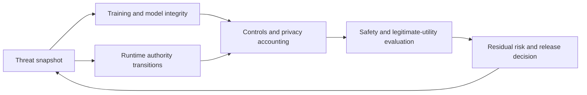

# Chapter 65 - Security, privacy, safety, and adversarial robustness

[DERIVED] An AI system is defensible only relative to a specified adversary, protected asset, authorization boundary and evaluation budget. A model's refusal rate does not establish that credentials remain inaccessible; a clean benchmark does not exclude a training backdoor; and a failed extraction attempt does not prove that information is absent from weights. This chapter connects those distinctions to mechanisms, formal premises and engineering controls.

[PAPER-REPORTED] Nine current research disclosures, July 2026 protocol guidance and one pinned originating implementation support the cases. Their first release falls within 2026-03-01 through 2026-10-24, with actual inspection on2026-10-25. Seven arXiv reports and two dated first-party technical disclosures have separate first-release/revision/access records. No source training, live attack, private-data extraction or deployed mitigation test was executed by the book.

## Scope

[DERIVED] Six sections cover lifecycle threat surfaces, training/model attacks, runtime manipulation, controls, safety evaluation and residual risk. The artifact is a threat model plus an unexecuted mitigation evaluation on synthetic secrets and authorized local fixtures. Mechanisms are analyzed without supplying deployable payloads, collecting real credentials or claiming a universal defense.

## Prerequisites

[DERIVED] @ms.chapter.7 and @ms.chapter.8 own data provenance/quality foundations; @ms.chapter.24 feedback; @ms.chapter.32 through @ms.chapter.36 post-training; @ms.chapter.46 and @ms.chapter.47 model/runtime transformations. @ms.chapter.51 owns tool protocol/execution semantics; @ms.chapter.52 through @ms.chapter.60 agent, memory and multimodal interfaces; @ms.chapter.61, @ms.chapter.62 and @ms.chapter.63 own benchmark, judge and system-reliability methodology; @ms.chapter.64 owns interpretability. Security-specific consequences are developed here rather than duplicating those foundations.

## Learning outcomes

- [DERIVED] Write a threat model whose claims cannot silently acquire stronger attacker access or weaker success criteria.
- [DERIVED] Distinguish poisoning, malicious weights/code, membership evidence, extraction and memorization.
- [DERIVED] Reconstruct the trust-boundary failure behind injection and unauthorized tool actions.
- [DERIVED] Audit privacy adjacency, composition, selection costs and post-processing assumptions.
- [DERIVED] Evaluate safety and legitimate utility together under adaptive, held-out attacks.
- [DERIVED] State the residual risk and the evidence that would reverse a deployment decision.

## Notation and terms

[DERIVED] D is training data; theta model parameters; x a request; a an action; h a trajectory history; A an adversary; B a query/interaction budget; V a violation event. C denotes an effective capability set, not a model-generated assertion of permission. Epsilon/delta are formal privacy parameters only when a mechanism and adjacency relation are declared. ASR is attack success under an explicit denominator and budget, not an intrinsic model constant.

> **Definition — Threat snapshot.** [DERIVED] A versioned tuple of assets, invariants, adversary access/knowledge, attack surfaces, budget, deployment state and executable success criteria.

> **Definition — Authority transition.** [DERIVED] A point where untrusted data influences an operation with greater privileges, such as a retrieved string determining a tool argument.

> **Definition — Empirical attack frontier.** [DERIVED] The observed violation/utility/resource outcomes attainable by the tested attacks under their declared access and budget; a lower bound on discovered vulnerability, not the worst possible attacker.

> **Definition — Privacy unit.** [DERIVED] The record, user, conversation or group whose addition/removal/replacement defines neighboring datasets for a privacy claim.

> **Definition — Residual-risk record.** [DERIVED] A statement of remaining failure modes, untested conditions, control dependencies, operational owner and evidence that triggers reopening or rollback.

## Chapter map



- A threat snapshot defines protected assets, attacker access and success criteria.
  - Training/model integrity and runtime authority transitions expose different failure mechanisms.
  - Controls include access boundaries and formal privacy accounting.
    - Safety and legitimate utility are evaluated on held-out, adaptive conditions.
    - Residual risk and release decisions update the threat snapshot.

```figure
{
  "id": "fig-65.1",
  "kind": "diagram",
  "title": "Security claims follow the authority graph",
  "caption": "Data paths and permission paths are different. A trusted retriever or signed artifact can still carry harmful instructions or behavior.",
  "placement": "inline",
  "anchor": "scope",
  "evidence": "DERIVED",
  "source": "DERIVED:fig-65.1",
  "alt": "Data paths and permission paths are different. A trusted retriever or signed artifact can still carry harmful instructions or behavior.",
  "spec": {
    "direction": "LR",
    "nodes": [
      {
        "id": "d",
        "kind": "dataset",
        "label": "Data/weights/dependencies"
      },
      {
        "id": "m",
        "kind": "model",
        "label": "Model and context"
      },
      {
        "id": "p",
        "kind": "boundary",
        "label": "Permission broker"
      },
      {
        "id": "t",
        "kind": "process",
        "label": "Tools and memory"
      },
      {
        "id": "a",
        "kind": "node",
        "label": "Protected assets"
      }
    ],
    "edges": [
      {
        "from": "d",
        "to": "m",
        "kind": "flow",
        "label": "consume"
      },
      {
        "from": "m",
        "to": "p",
        "kind": "flow",
        "label": "propose"
      },
      {
        "from": "p",
        "to": "t",
        "kind": "flow",
        "label": "validate authority"
      },
      {
        "from": "t",
        "to": "a",
        "kind": "dependency",
        "label": "bounded access"
      },
      {
        "from": "a",
        "to": "m",
        "kind": "feedback",
        "label": "returned data"
      }
    ]
  }
}
```

```figure
{
  "id": "fig-65.2",
  "kind": "compare",
  "title": "Different claims need different evidence",
  "caption": "No single refusal or attack score establishes all four properties.",
  "placement": "inline",
  "anchor": "scope",
  "evidence": "DERIVED",
  "source": "DERIVED:fig-65.2",
  "alt": "No single refusal or attack score establishes all four properties.",
  "spec": {
    "axis": "Decision-relevant difference",
    "columns": [
      {
        "id": "claim",
        "label": "Claim"
      },
      {
        "id": "test",
        "label": "Necessary evidence"
      },
      {
        "id": "gap",
        "label": "Remaining gap"
      }
    ],
    "rows": [
      {
        "dimension": "Privacy",
        "values": {
          "claim": "Limited individual influence",
          "test": "Declared unit/mechanism/accountant",
          "gap": "Public facts, logs and access still matter"
        }
      },
      {
        "dimension": "Security",
        "values": {
          "claim": "Protected invariant survives attacker",
          "test": "Access/budget and actual state checks",
          "gap": "Untested adversary remains"
        }
      },
      {
        "dimension": "Safety",
        "values": {
          "claim": "Behavior meets deployment policy",
          "test": "Harm/benign boundary and severity",
          "gap": "Policy/evaluator can be wrong"
        }
      },
      {
        "dimension": "Integrity",
        "values": {
          "claim": "Artifact is expected one",
          "test": "Provenance/hash/dependency verification",
          "gap": "Authentic artifact may be malicious"
        }
      }
    ]
  }
}
```

## Sections

| Section | Mechanism | Decision |
|---|---|---|
| @ms.section.65.1 | Lifecycle surfaces and authority graph | Which invariants and attacker access matter? |
| @ms.section.65.2 | Poisoning, backdoors, extraction and membership | What is compromised or inferable? |
| @ms.section.65.3 | Jailbreaks, injection, tool outputs and memory | Where does data cross into authority? |
| @ms.section.65.4 | Isolation, provenance, capabilities and privacy | Which controls enforce a boundary? |
| @ms.section.65.5 | Harmful/benign testing and oversight | Which measured tradeoff is acceptable? |
| @ms.section.65.6 | Adaptive budgets, shift and residual risk | What has not been established? |

## Lineage

- 2026 · Classifier fine-tuning poisoning [R65.1] · **current frontier** — [PAPER-REPORTED] Safeguard training integrity differs from ordinary robustness.
- 2026 · Back-Reveal [R65.2] · **alternative branch** — [PAPER-REPORTED] Malicious weights, memory access and outbound retrieval compose.
- 2026 · AutoMIA [R65.3] · **engineering optimization** — [PAPER-REPORTED] Budgeted search for target-specific membership signals.
- 2026 · Alignment Whack-a-Mole [R65.4] · **current frontier** — [PAPER-REPORTED] Finetuning changes extractability without demonstrating erasure.
- 2026 · Adaptive Adversaries [R65.5] · **current frontier** — [PAPER-REPORTED] Protocol and attacker budget change discovered failures.
- 2026 · DP-SelFT [R65.6] · **alternative branch** — [PAPER-REPORTED] Private synthetic selection and constrained noisy updates.
- 2026 · WIFA [R65.7] · **alternative branch** — [PAPER-REPORTED] Shared harmful/benign wrappers and anchored group consistency.
- 2026 · Safety for Whom [R65.8] · **alternative branch** — [PAPER-REPORTED] Local refusal boundaries and severe over-refusal negatives.
- 2026 · Self-Assessment [R65.9] · **engineering optimization** — [PAPER-REPORTED] Cached conversation monitoring with teacher/adaptation limits.

## Reference-stack coverage

| Stack section | Entry | Stack layer | What this chapter takes from it | Surface used | Sections | Evidence label |
|---|---|---|---|---|---|---|
| §3 discovery source | #1 arXiv | — | Latest eligible full methods/tables/appendices and histories | https://arxiv.org/ |65.1-65.6 | PAPER-REPORTED; index is not evidence |
| §4 system | #17 PyTorch | MODEL / AUTOGRAD FRAMEWORK | Reported adaptation/privacy tensor mechanisms | https://pytorch.org/docs/stable/ |65.2,65.4-65.5 | PAPER-REPORTED; execution unverified |
| Outside the reference stack (routed via book_plan.md anchors) | Anthropic originating research and MCP protocol | — | Dated classifier/monitor disclosures and July 28 security guidance; exact code pin | references.md |65.1-65.6 | PAPER-REPORTED / OFFICIAL-DOCUMENTATION |

[DERIVED] Retrieval followed current poisoning, privacy, injection, safety-boundary and adaptive-evaluation queries to originating texts. Inspection covers adversary access, objective/gradient paths, evaluator leakage, privacy units/composition, computation/query budgets, negative controls and implementation identity. Blogs support only their first-party technical disclosures; reputation does not verify a general claim.

## Status and evidence gaps

[DERIVED] **Editorial status: manuscript_draft.** Source inspection and structural checks do not establish a numerical quality rating or a deployed mitigation result. No live exploitation, private-data processing, red-team campaign or source replication was performed. Read @ms.references.65 for specific source contradictions and @ms.verification.65 for proposed tests and mathematical bindings.
